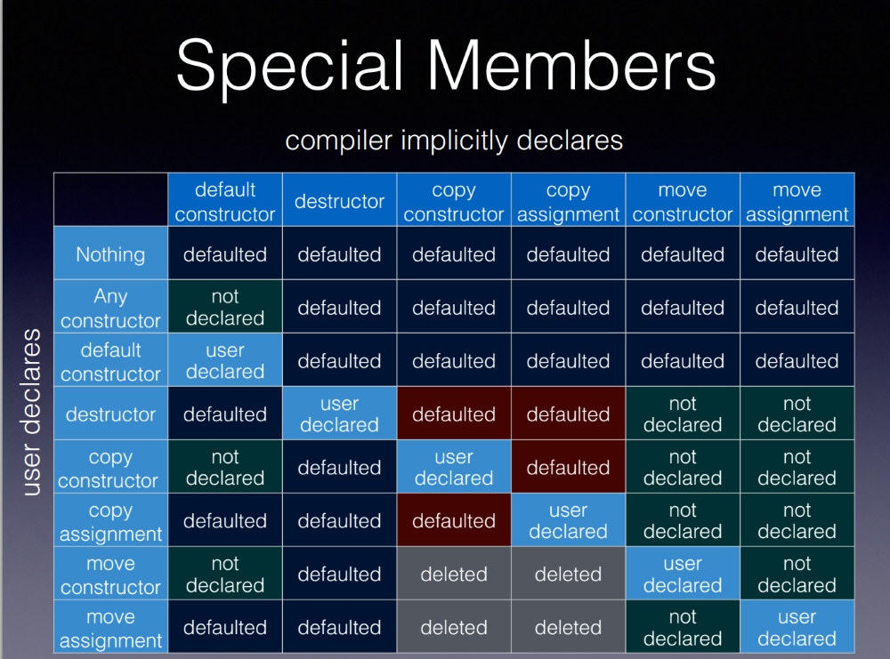

<!--
title: Lecture 03
paginate: true

_class: titlepage
-->

# Lecture 03
<br>

## Object-oriented programming. Classes and access control in C++. Operators.
<br>

#### Advanced Programming for Computational Science<br>SISSA, UniTS, 2026-2027

###### Pasquale Claudio Africa

###### 13 Oct 2026

---

# Outline

1. Introduction to Object-Oriented Programming (OOP)
2. Classes and objects in C++
3. Notes on code organization
4. Encapsulation and access control
5. Operator overloading

---

<!--
_class: titlepage
-->

# Introduction to<br>Object-Oriented Programming (OOP)

---

# What is OOP?

- OOP is a programming paradigm that revolves around objects.
- Objects represent instances of classes, encapsulating data **and behavior**.
- Key principles include encapsulation, inheritance, and polymorphism.

## OOP in C++

- C++ is not (only) an OOP language.
- C++ is a multi-paradigm programming language that supports procedural, object-oriented, and generic programming.
- C++ allows developers to combine these paradigms effectively for various programming tasks.

---

# Key principles of OOP

Object-Oriented Programming (OOP) is a programming paradigm that emphasizes the use of objects to represent real-world entities and concepts. It is based on several key principles:

- **Encapsulation**: Encapsulation bundles data (attributes) and the functions (methods) that operate on the data into a single unit called an *object*. This promotes data hiding and reduces the complexity of the code.
- **Inheritance**: Inheritance allows you to create new classes (derived or child classes) based on existing classes (base or parent classes). It enables code reuse and the creation of class hierarchies.
- **Polymorphism**: Polymorphism allows objects of different classes to be treated as objects of a common base class. It promotes code flexibility and the ability to work with objects at a higher level of abstraction.

---

# Advantages of OOP

OOP offers numerous advantages, including:

- **Modularity**: OOP encourages the division of a complex system into smaller, manageable objects, promoting code modularity and reusability.
- **Maintenance**: Objects are self-contained, making it easier to maintain and update specific parts of the code without affecting other parts.
- **Flexibility**: Inheritance and polymorphism provide flexibility, allowing you to extend and modify the behavior of classes without altering their existing code.
- **Readability**: OOP promotes code readability by organizing data and functions related to a specific object within a class.

---

<!--
_class: titlepage
-->

# Classes and objects in C++

---

# Creating objects (1/2)

In C++, objects are instances of classes. Here's an example of creating and using a `Car` object:

```cpp
class Car {
public:
    std::string manufacturer;
    std::string model;
    unsigned int year;

    void start_engine() {
        std::cout << "Engine started!" << std::endl;
    }
};
```

---

# Creating objects (2/2)

```cpp
// Access by direct instance.
Car my_car; // Creating an object of class Car.

my_car.manufacturer = "Volkswagen";
my_car.model = "Tiguan";
my_car.year = 2024;

my_car.start_engine(); // Invoking a method.

// Access by pointer.
// This works also for dynamically allocated objects.
Car* my_car_ptr = new Car{};

my_car_ptr->manufacturer = "Alfa Romeo";
my_car_ptr->model = "Giulietta";
my_car_ptr->year = 2010;

my_car_ptr->start_engine(); // Invoking a method.
delete my_car_ptr;
```

---

# Members

- **Member variables**, also known as *attributes* or instance variables, store data within a class. In the `Car` class, `manufacturer`, `model`, and `year` are member variables that hold information about the car. These variables encapsulate the car's characteristics within the class.

- **Member functions**, or *methods*, define the behavior of a class. The `start_engine` method in the `Car` class initiates the car's engine. Methods encapsulate the actions or operations that can be performed on the object's data.

## `static` members

Static members in a class are shared among all instances of that class. They are declared using the `static` keyword and can be accessed using the class name rather than an object. Static members are useful for maintaining shared data or functionality across objects.

---

# `static` members

```cpp
class Square {
public:
    static const int N_SIDES = 4; // Static constant shared by all Square objects.
    double side;

    double calculate_area() {
        return side * side;
    }
    
    static void print_shape_name() {
        std::cout << "This is a square." << std::endl;
    }
};

Square square;
square.side = 5.0;

const double area = square.calculate_area(); // Accessing a non-static member.
const int n_sides = Square::N_SIDES; // Accessing a static member.
Square::print_shape_name();
```

---

# `const` members (1/2)

When used in the context of classes, `const` can be applied to member variables, member functions, and objects of the class.

```cpp
class MyClass {
public:
    MyClass(int x) : value(x) {}  // Constructor initializes the const member.

    void print_value() const {
        // value *= 2; // Illegal!
        std::cout << "Const version: " << value << std::endl;
    }

    const int value;
};
```

:warning: If you have a `const` member function but need to modify a member variable, you can declare that variable as `mutable` (could be dangerous).

---

# `const` members (2/2)

```cpp
class MyClass {
public:
    void print() {
        std::cout << "Non-const version" << std::endl;
    }

    void print() const {
        std::cout << "Const version" << std::endl;
    }
};

MyClass obj1;       // Create a non-const object.
const MyClass obj2; // Create a const object.

obj1.print(); // Calls the non-const version.
obj2.print(); // Calls the const version.
```

---

# The `this` pointer

The `this` pointer is a special keyword in C++ that represents a pointer to the current instance of a class. It is a hidden argument to all non-static member functions and is automatically passed to those functions by the compiler.

It allows to **access members** of an object from within its member functions. It helps **resolve ambiguity** and allows you to access the class's members within its member functions, by allowing to distinguish between the local variables and member variables of a class when they have the same name.

```cpp
class MyClass {
public:
    int x;

    void print_x() const {
        std::cout << "Value of x: " << this->x << std::endl; // Using this pointer with the arrow operator.
    }
};
```

---

# Constructors

Constructors are special member functions that initialize objects when they are created. They have the same name as the class and can take arguments to initialize members.

## Types of constructor
- **Default constructor**: It can be called with no arguments. If you don't provide any constructors for a class, C++ will implicitly declare a default constructor. Fundamental-type members are not necessarily initialized to zero; class-type members, such as strings, run their default constructors.
- **Parameterized constructor**: It takes one or more parameters to initialize member variables based on the provided values. It creates objects with specific initial states.
- **Copy constructor**: It creates a new object as a copy of an existing object of the same class. It takes a reference to an object of the same class as a parameter. It is invoked when objects are copied, passed by value, or initialized with other objects.

---

# Default constructor

```cpp
class MyClass {
public:
    // Default constructor.
    MyClass() {
        // Initialization code (if needed). E.g.,
        name = "Alice";
    }
    
    // Or:
    // MyClass() = default;
    
    std::string name;
    unsigned int length{};
};

MyClass obj;    // Default initialization.
MyClass obj2{}; // Same, with uniform initialization syntax (since C++11).

MyClass obj3(); // Declares a function, not an object (the most vexing parse).
```

---

# Parameterized constructors

```cpp
class Student {
public:
    Student(std::string name, unsigned int age) {
        this->name = name;
        this->age = age;
    }

    void display_info() const {
        std::cout << "Name: " << name << ", Age: " << age << std::endl;
    }

    std::string name;
    unsigned int age;
};

Student student1("Alice", 20); // Creating an object and initializing it using a constructor.
student1.display_info();

Student student2{"Bob", 23}; // Uniform initialization.
student2.display_info();
```

---

# Initializer list

An initializer list is used within a constructor to initialize member variables before entering the constructor body. It is a recommended practice, especially for initializing member objects or constants, as it can improve performance.

```cpp
class Rectangle {
public:
    Rectangle(double length, double width) : length(length), width(width) {
        // Constructor body (if needed).
    }

    double calculate_area() const {
        return length * width;
    }

    double length;
    double width;
};

Rectangle rectangle{5.0, 3.0}; // Creating an object and initializing it using an initializer list.
const double area = rectangle.calculate_area();
```

---

# Copy constructor and copy assignment

```cpp
class Book {
public:
    Book(std::string title, std::string author) : title(title), author(author) {}

    // Copy constructor.
    Book(const Book& other) : title(other.title), author(other.author) {}

    // Copy assignment operator.
    Book& operator=(const Book& other) {
        if (this != &other) {
            title = other.title;
            author = other.author;
        }
        return *this;
    }

    void display_info() const {
        std::cout << "Title: " << title << ", Author: " << author << std::endl;
    }
    
    std::string title;
    std::string author;
};

Book book1{"The catcher in the rye", "J.D. Salinger"}; // Parameterized constructor.
Book book2 = book1;                                    // Copying using the copy constructor.
Book book3{"Marcovaldo", "I. Calvino"};                // Parametrized constructor.
book3 = book1;                                         // Copying using the copy assignment operator.
```

---

# Default constructor and default initialization

- If you don't provide any constructors for a class, C++ will automatically generate a default constructor. However, if you provide any custom constructors, the default constructor won't be generated unless you explicitly define it.
- Default initialization leaves fundamental-type members (e.g., `int`, `double`) without a value unless they have a default member initializer or the constructor initializes them. Class-type members (e.g., strings, vectors, ...) run their default constructors. Brace initialization with `{}` can also zero-initialize members when the class has no user-provided default constructor.

---

# When constructors are called (1/2)

1. **Object creation**: When you create an object of a class using its constructor, the constructor is called.
   ```cpp
   MyClass obj1;                 // Calls the default constructor.
   MyClass obj2{};               // Calls the default constructor.
   Student student{"Alice", 20}; // Calls the parameterized constructor.
    ```

2. **Copy initialization**: When you initialize one object with another, the copy constructor is called.
   ```cpp
   MyClass obj1 = obj2; // Calls the copy constructor.
   ```

---

# When constructors are called (2/2)

3. **Pass and return by value**: Passing an lvalue by value calls the copy constructor. Returning a local object by value may elide the copy (NRVO); otherwise it may use a move or a copy constructor.
   ```cpp
   void some_function(Student s) { /* 's' is copy constructed. */ }

   Student create_student() {
       Student s{"Bob", 22};
       return s; // Copy may be elided; otherwise a move or copy may occur.
   }
   ```

4. **Dynamic object creation**: When you create objects dynamically using new, the constructor is called.
   ```cpp
   MyClass* ptr = new MyClass{}; // Calls the default constructor.
   ```

---

# Destructor (1/2)

A destructor is another special member function that is used to clean up resources held by an object before it goes out of scope or is explicitly deleted. Destructors have the same name as the class but preceded by a tilde (`~`). They are called automatically when an object's lifetime ends.

## Rule of three

If a class defines (or deletes) one of the three special member functions:
  - destructor
  - copy constructor
  - copy assignment operator

then it should probably provide all three of them.

---

# Destructor (2/2)

```cpp
class FileHandler {
public:
    FileHandler(std::string filename) : filename(filename) {
        file.open(filename);
    }

    ~FileHandler() {
        // Explicit close for illustration: std::ofstream also closes itself on destruction.
        if (file.is_open()) {
            file.close();
        }
    }

    std::string filename;
    std::ofstream file;
};

{
    FileHandler file{"data.txt"}; // Automatically destroyed when going out of scope.
} // When going out of scope, destructor is called, and the file is closed.
```

---

# Constructors and destructor implicitly generated



[Source](https://howardhinnant.github.io/classdecl.html)

---

# RAII idiom (Resource Acquisition Is Initialization)

## Holding a resource is a class invariant, tightly bound to the object's lifetime

## RAII idiom:
1. Encapsulate a resource within a class (constructor).
2. Utilize the resource through a local instance of the class.
3. Automatically release the resource when the object goes out of scope (destructor).

## Implications
1. C++ does not rely on a garbage collector.
2. Resource management becomes the programmer's responsibility.

---

# RAII example: a container for a dynamic array

```cpp
class Vector {
public:
    Vector(std::size_t n)
        : size{n}, data{new double[size]{}} {} // Constructor allocates the array.

    ~Vector() {
        delete[] data; // Destructor releases the array automatically.
    }

    double& operator[](std::size_t i) { return data[i]; }

private:
    double* data;
    std::size_t size;
};
```

**Question**: How to implement `Vector(const Vector&)` and `Vector& operator=(const Vector&)`?

---

<!--
_class: titlepage
-->

# Notes on code organization

---

# The `inline` keyword

In C++, the `inline` keyword can be applied to free functions and member functions. It allows identical definitions of a function in multiple translation units, provided the definition is available in each translation unit that uses it. The compiler may replace a call with the function body as an optimization, whether or not the function is declared `inline`.

```cpp
// Inline function declaration for a free function.
inline int add(int a, int b) {
    return a + b;
}

const int result = add(5, 7); // Calls the inline function.
std::cout << "Result: " << result << std::endl;
```

---

# Best practices (1/2)

- **Function size**: Inlining is most effective for small functions. For larger functions, inlining can lead to code bloat and may not improve performance.
- **Compiler's discretion**: The compiler chooses whether to replace a call with the function body based on optimization settings and other factors, independently of the `inline` keyword.
- **Header files**: A non-template function defined in a header must be `inline` to avoid multiple-definition errors across translation units (unless it has internal linkage). Functions defined inside a class and `constexpr` functions are implicitly `inline`. Header guards (see Lecture 02) prevent multiple inclusions within a single translation unit, but they do not prevent multiple definitions across different source files.
- **Balancing readability**: While inlining can improve performance, it should be used judiciously. Overusing inline for functions that don't provide significant performance benefits can lead to less readable code due to poor code organization.

---

# Best practices (2/2)

## Pros of using `inline`
- **Potential performance improvement**: Inlining small functions can eliminate the function call overhead and improve runtime performance.
- **Avoiding multiple definitions**: When the same inline function is defined in multiple translation units (source files), the One Definition Rule (ODR) allows the multiple definitions to be treated as equivalent, which avoids linker errors.
 
 In summary, `inline` primarily allows a function definition to appear in multiple translation units. The compiler makes its own decision about replacing calls with the function body.
 
---

# Where to define class member functions?

In C++, member functions of a class can be defined either in-class (inline) or out-of-class. Each approach has its use cases and implications.

# In-class (inline) definition (1/3)
Member functions are defined within the class declaration itself, typically in the header file. This is common for short, simple functions that are typically one-liners or very concise.

```cpp
// my_class.hpp
class MyClass {
public:
    int add(int a, int b) { // inline keyword is implicit here.
        return a + b;
    }
};
```

---

# In-class definition (2/3)

The previous code is equivalent to the following:
```cpp
// my_class.hpp

class MyClass {
public:
    int add(int a, int b);
};

inline int MyClass::add(int a, int b) // inline is explicit outside the class.
{
    return a + b;
}
```

---

# In-class definition (3/3)

## Pros
- Compact and concise code.
- Compiler can see the function body and may replace calls with it for performance.

## Cons
- May lead to code bloat if used extensively with large functions.
- Changes to the function may necessitate recompilation of all translation units that include the header.

---

# Out-of-class definition (1/2)

Member functions are declared in the class declaration (in the header file) and defined separately in the source file (.cpp file). Typically used for functions with larger implementations or when you want to separate interface from implementation.

```cpp
// my_class.hpp

class MyClass {
public:
    int add(int a, int b);
};
```

```cpp
// my_class.cpp

#include "my_class.hpp"

int MyClass::add(int a, int b) {
    return a + b;
}
```

---

# Out-of-class definition (2/2)

## Pros
- Separation of interface from implementation for cleaner code organization.
- Changes to the function implementation **do not** require recompilation of all translation units that include the header.

## Cons
- Slightly more verbose in terms of code.
- Requires separate source file for function definitions.

---

# Best practices

1. Use in-class (implicitly `inline`) definitions for very short and simple functions (e.g., accessors, mutators).
2. Use out-of-class definitions for larger or more complex functions to keep the header files clean and to separate interface from implementation.
3. Consider code readability and maintainability when making a choice.

In practice, a combination of both in-class and out-of-class definitions is often used, with the goal of keeping the code organized, maintainable, and efficient.

---

<!--
_class: titlepage
-->

# Encapsulation and access control

---

# Data encapsulation

Data encapsulation is a fundamental concept in OOP that involves bundling data (attributes) and methods (functions) that operate on that data into a single unit called an object. Encapsulation helps hide the internal details of an object and exposes only the necessary functionality through well-defined interfaces.

```cpp
class BankAccount {
public:
    BankAccount(std::string account_holder, double balance) : account_holder(account_holder), balance(balance) {}

    void deposit(double amount) {
        balance += amount;
    }

    double get_balance() const {
        return balance;
    }

private:
    std::string account_holder;
    double balance;
};
```

---

# Access specifiers (1/2)

C++ provides access specifiers to control the visibility and accessibility of class members (variables and methods). These access specifiers enforce encapsulation and access control within the class.

- `public`: Members declared as public are accessible from any part of the program. They form the class's public interface.
- `protected`: Members declared as protected are accessible within the class and by derived classes (in **inheritance** scenarios).
- `private`: Members declared as private are not accessible from outside the class. They are used for internal implementation details.

#### :warning: Inheritance will be covered in the next lecture!

---

# Access specifiers (2/2)

```cpp
class MyClass {
public:
    int public_var;    // Public member variable.
    void public_func() { // Public member function.
        // ...
    }

private:
    int private_var;    // Private member variable.
    void private_func() { // Private member function.
        // ...
    }
};
```

---

# `class` vs. `struct`

In C++, both `class` and `struct` are used to define classes. The only difference between them is the default access specifier:

- In a `class`, members are private by default.
- In a `struct`, members are public by default.

```cpp
class MyClass {
    int x; // Private by default.
public:
    int y; // Public.
};

struct MyStruct {
    int x; // Public by default.
private:
    int y; // Private.
};
```

---

# Getter and setter methods (1/2)

Getter and setter methods, also known as accessors and mutators, are used to control access to private member variables.

- **Getter** methods allow reading the values of private variables.
- **Setter** methods enable modifying those values in a controlled manner.

They are commonly used for encapsulation and access control.

---

# Getter and setter methods (2/2)

```cpp
class TemperatureSensor {
public:
    double get_temperature() const {
        return temperature;
    }

    void set_temperature(double new_temperature) {
        if (new_temperature >= -50.0 && new_temperature <= 150.0) {
            temperature = new_temperature;
        } else {
            std::cout << "Invalid temperature value!" << std::endl;
        }
    }

private:
    double temperature{};
};
```

---

# `friend` classes (1/2)

A `friend` class is a class that is granted access to the private members of another class. This access allows the `friend` class to operate on the private members of the class it is friends with.

```cpp
class Circle {
public:
    friend class Cylinder; // Cylinder class is a friend of Circle.

    Circle(double r) : radius(r) {}

    double get_area() const {
        return 3.14159265359 * radius * radius;
    }

private:
    double radius;
};
```

---

# `friend` classes (2/2)

```cpp
class Cylinder {
public:
    Cylinder(const Circle &circle, double height) : circle(circle), height(height) {}
    
    double get_volume() const {
        // Accessing the private member 'radius' of the Circle class.
        return 3.14159265359 * circle.radius * circle.radius * height;
    }

private:
    const Circle circle;
    double height;
};

Circle circle{1.0};
Cylinder cylinder{circle, 0.5};
const double volume = cylinder.get_volume();
```

---

<!--
_class: titlepage
-->

# Operator overloading

---

# Operator overloading (1/2)
Operator overloading is a feature in C++ that allows you to define custom behaviors for operators when used with objects of your own class. In essence, it enables you to extend the functionality of operators beyond their predefined meanings, making objects of your class work with operators in a way that makes sense for your class's context.

## Why use operator overloading?

Operator overloading can improve code readability and maintainability by allowing you to write more natural and expressive code. It lets you use operators like `+`, `-`, `*`, `/`, and **many** others to perform operations specific to your class, just as you would with built-in data types.

---

# Operator overloading (2/2)

```cpp
class Complex {
public:
    Complex(double real, double imag) : real(real), imag(imag) {}
    
    Complex operator+(const Complex& other) const {
        return Complex{real + other.real, imag + other.imag};
    }

private:
    double real;
    double imag;
};

Complex a{2.0, 3.0};
Complex b{1.0, 2.0};
Complex c = a + b; // Using the overloaded '+' operator.
```

---

# Commonly overloaded operators

While you can overload [many C++ operators](https://en.wikipedia.org/wiki/Operators_in_C_and_C%2B%2B), here are some of the most commonly overloaded operators:

- Arithmetic operators: `+`, `-`, `*`, `/`, `%`, etc.
- Comparison operators: `==`, `!=`, `<`, `>`, `<=`, `>=`, `<=>` (since C++20), etc.
- Assignment operators: `=`, `+=`, `-=`, etc.
- Increment/decrement operators: `++`, `--`.
- Stream insertion/extraction operators: `<<`, `>>` (used for input and output).
- Function call operator: `()` (used to create objects that act like functions).
- Subscript operator: `[]` (used to access elements of an array-like class).
- Member access operator: `->` (used to access members of an object through a pointer).

---

# Overloading as a member vs. non-member function

You can overload operators as member functions or non-member functions.

- When overloaded as a **member function**, the left operand is an object of the class, and the right operand is passed as a parameter.
- When overloaded as a **non-member function**, both operands are passed as parameters. This is often preferred when the left operand is not an object of the class you're overloading the operator for. Sometimes, you may need to access private members of a class when overloading an operator. In such cases, you can declare the overloaded operator function as a friend of the class. This allows the operator function to access the private members of the class.

---

# `friend` functions

```cpp
class MyClass {
public:
    MyClass(int v) : value(v) {}

    // Declaring the '<<' operator as a friend function.
    friend std::ostream& operator<<(std::ostream& os, const MyClass& obj);

private:
    int value;
};

// Overloading the '<<' operator as a non-member function (outside the class).
std::ostream& operator<<(std::ostream& os, const MyClass& obj) {
    os << obj.value;
    return os;
}

MyClass obj{42};
std::cout << obj << std::endl;
```

---

# A more complex example

```cpp
class Point {
private:
    int x, y;

public:
    Point(int x, int y) : x(x), y(y) {}

    Point operator+(const Point& other) const {
        return Point{this->x + other.x, this->y + other.y};
    }

    bool operator==(const Point& other) const {
        return (this->x == other.x && this->y == other.y);
    }

    friend std::ostream& operator<<(std::ostream& os, const Point& p) {
        os << "(" << p.x << ", " << p.y << ")";
        return os;
    }
};

Point p1{1, 2};
Point p2{3, 4};
Point p3 = p1 + p2;
if (p1 == p2) {
    std::cout << "p1 is equal to p2" << std::endl;
} else {
    std::cout << "p1 is not equal to p2" << std::endl;
}
std::cout << p3 << std::endl;
```

---

# Operator overloading: best practices

1. **Operators that cannot be overloaded**: Some operators, like `::`, `.*`, and `? :`, cannot be overloaded.
2. **Don't change the basic meaning of an operator**: Overloading should make sense in the context of your class. For example, overloading `+` for string concatenation is intuitive, but overloading it for subtraction is not.
3. **Be mindful of operator precedence and associativity**: Overloading cannot change an operator's precedence or associativity (such as in expressions like `2 * 3 + 1`).
4. **Avoid excessive overloading**: Overloading too many operators can make your code less readable and harder to maintain. Focus on overloading the operators that provide significant benefits.

---

<!--
_class: titlepage
-->

# :arrow_right: Inheritance + polymorphism
