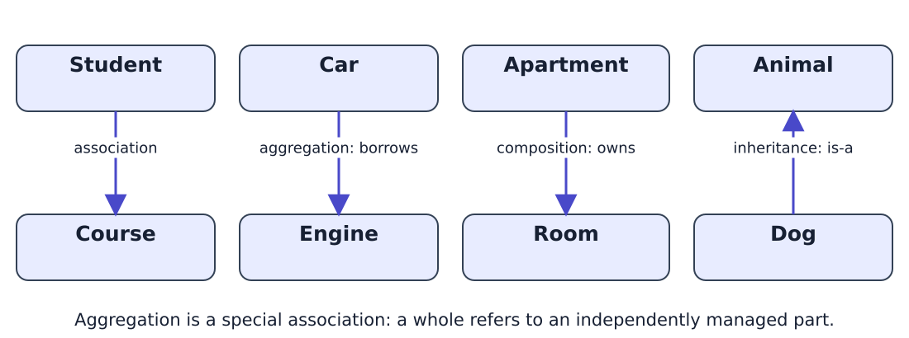
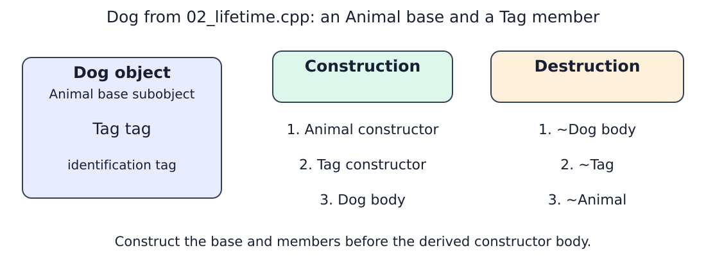
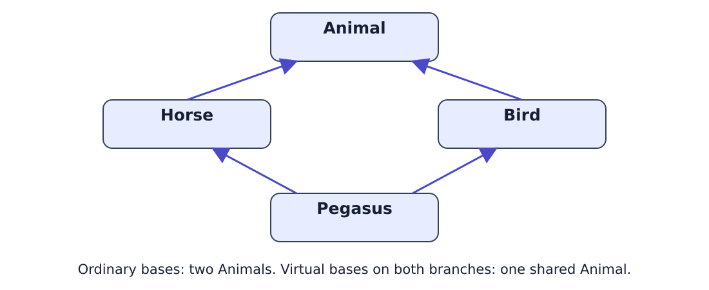
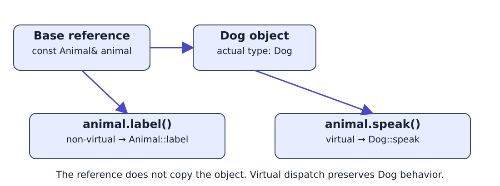
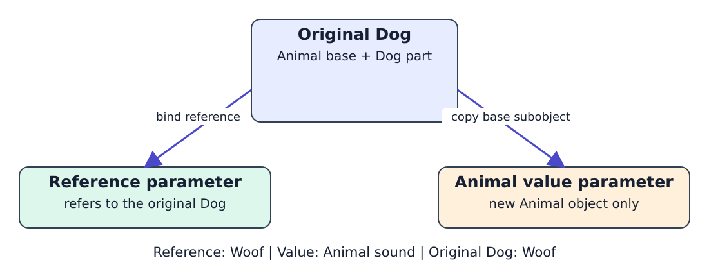
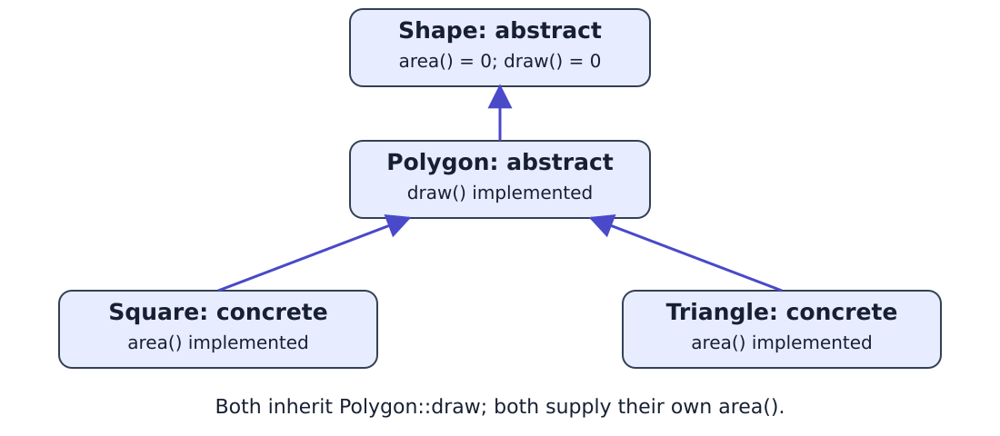

<!--
title: Lecture 04
paginate: true

_class: titlepage
-->

# Lecture 04
<br>

## Inheritance and polymorphism in C++.
<br>

#### Advanced Programming for Computational Science<br>SISSA, UniTS, 2026-2027

###### Valentin Nkana Ngan

###### 20 Oct 2026

###### Reference: *Sams Teach Yourself C++ in One Hour a Day*, lessons 11–12.

<!--
Timing: 00–02.
Prerequisites: classes, constructors, const methods, references, pointers, arrays, new/delete. No templates, STL containers, smart pointers, or explicit constructor keyword are required. Reading: attached oop.pdf, lessons 11–12.
-->

---

# Outline

1. **Part I: Inheritance (00–40)**
   - Class relationships, aggregation and composition.
   - Access control, constructors and object lifetime.
   - Multiple inheritance and the diamond.
2. **Part II: Polymorphism (40–90)**
   - Base pointers/references, virtual functions and slicing.
   - Abstract classes, virtual destructors and factories.
   - Checked downcasts with `dynamic_cast`.

**Design rule:** a car **has an** engine; public inheritance expresses **is-a**.

<!--
Timing: 02–04.
State the design rule: a Car has an Engine; it is not an Engine. The whole lecture, including multiple inheritance, factories and dynamic_cast, fits in the stated 90 minutes.
-->

---

<!--
_class: titlepage
-->

# Part I<br>Inheritance

<!--
Timing: 04–05.
Introduce the first part: relationships, class structure, construction and lifetime. Section divider follows the existing course titlepage convention.
-->

---

# Relationships between classes



**Association** is the general relationship; **aggregation** is a non-owning whole–part association. **Composition** gives the whole ownership of its parts.

<!--
Timing: 05–07.
Explain arrows as relationship labels, not a formal UML notation. Public inheritance promises substitutability. Aggregation and composition express different ownership contracts. The same Engine type can be aggregated or composed depending on the program design.
-->

---

# Aggregation · a car borrows an engine

```cpp
class Car {
public:
    Car(Engine& e) : engine(&e) {}
    void drive() { engine->start(); }
private:
    Engine* engine; // Borrowed: do not delete it in ~Car().
};
Engine engine;
{ Car car{engine}; car.drive(); }
engine.start(); // Engine still exists after Car is destroyed.
```

The engine is managed independently and must remain alive while the car uses it.
Complete example: `examples/01_aggregation.cpp`.

<!--
Timing: 07–10.
Engine::start is defined in the complete source. A reference parameter requires an existing engine; its address is stored in the member pointer. This is aggregation: a special whole–part association. No template is involved.
-->

---

# Composition · an apartment owns its rooms

```cpp
class Room {
public:
    void clean() { /* ... */ }
};
class Apartment {
public:
    void clean() { living.clean(); kitchen.clean(); }
private:
    Room living;
    Room kitchen;
};
```

These particular rooms share the apartment's lifetime.
Other `Room` objects can still exist independently.

<!--
Timing: 10–12.
The public clean() fixes the original access error. Contrast a value member with the borrowed engine. The ownership relationship concerns these objects, not whether their class can be used elsewhere.
-->

---

# Public inheritance · a Dog is an Animal

```cpp
class Animal {
public:
    Animal(int initial_age) : age(initial_age) {}
    int get_age() const { return age; }
private:
    int age;
};
class Dog : public Animal {
public:
    Dog(int age) : Animal(age) {}
};
```

A `Dog` includes an `Animal` base subobject and can use its public interface.

<!--
Timing: 12–15.
Explain the colon after class Dog as inheritance and the colon in Dog(int age) as the initializer list. No dynamic dispatch yet. Public inheritance represents the behavioral is-a promise.
-->

---

# Access control · what is accessible?

| Inheritance | Base public members become | Base protected members become |
|---|---|---|
| `public` | public | protected |
| `protected` | protected | protected |
| `private` | private | private |

- Base **private** members exist but are not directly accessible to derived code.
- Public inheritance allows a `Dog*` to be used as an `Animal*`, and a `Dog&` as an `Animal&`.
- Omitted inheritance access: private for `class`, public for `struct`.

These conversions give access to the base interface of the same object.

<!--
Timing: 15–18.
Differentiate access to members from access to the derived-to-base conversion. Protected/private inheritance restricts conversions in client code; virtual functions can still be overridden within the hierarchy. Use public inheritance for the remaining examples.
-->

---

# Constructors · initialize the base first

```cpp
class Dog : public Animal {
public:
    Dog(int age) : Animal(age) {
        // Animal has already been constructed here.
    }
};
Dog dog{4};
```

`Animal(age)` initializes the base subobject; it is not an ordinary call in the body.
If it is omitted, `Animal` must have an accessible default constructor.
Here `Animal` has no default constructor, so omitting it is an error.

<!--
Timing: 18–21.
Required material, not a reference topic. Link to the previously defined Animal(int). The Animal constructor initializes its own private age; Dog does not directly assign Animal::age.
-->

---

# Derived constructors · choose how to initialize

```cpp
class Dog : public Animal {
public:
    Dog(int age) : Animal(age) {}
    Dog() : Dog(1) {} // Delegate to another Dog constructor.
};
class Cat : public Animal {
public:
    using Animal::Animal; // Inherit eligible base constructors.
};
Dog puppy;  // Dog() delegates to Dog(1), then initializes Animal.
Cat cat{2}; // Uses the inherited constructor.
```

**Base initialization**, **delegation**, and **inheriting constructors** are different mechanisms.

<!--
Timing: 21–24.
Derived constructors are taught in the core. using Animal::Animal does not mean that every kind of constructor is inherited unchanged. Inherited constructors still initialize derived members using their default member initialization/default initialization. Keep the example free of additional members here.
-->

---

# Lifetime example · code before the picture

```cpp
class Tag {
public:
    Tag()  { std::cout << "Tag constructed\n"; }
    ~Tag() { std::cout << "Tag destroyed\n"; }
};
class Dog : public Animal {
public:
    Dog(int age) : Animal(age), tag() { /* print Dog body */ }
    ~Dog() { /* print Dog destructor body */ }
private:
    Tag tag; // This dog's identification tag: a member object.
};
```

Complete tracing program: `examples/02_lifetime.cpp`.

<!--
Timing: 24–27.
Introduce Tag and the member named tag before drawing them. This source uses ordinary member names, not the unexplained collar_ convention. Animal constructor/destructor also print in the complete demo.
-->

---

# How a derived object comes to life



Write the initializer list **in the same order as initialization**: base first, then members in declaration order. A mismatch is bad practice; enable `-Wreorder`.

<!--
Timing: 27–29.
The picture identifies the Animal base, the Tag member and their construction/destruction order. Actual initialization order is fixed even if a list is written differently. With GCC -Wall includes -Wreorder; a mismatch warning can be shown with two member initializers if asked.
-->

---

# Live demo 1 · compile, predict, run

From `lectures/04/examples`:

```bash
g++ -std=c++17 -Wall -Wextra 02_lifetime.cpp -o /tmp/lifetime
/tmp/lifetime
```

- Predict the first three construction messages.
- Predict whether `~Dog` runs before or after `~Tag`.
- Explain why the derived constructor body runs last.

`-std=c++17`: language version · `-Wall -Wextra`: warnings · `-o`: output file.

<!--
Timing: 29–33.
Expected: Animal constructed, age=4; Tag constructed; Dog constructor body; Dog age=4; Dog destructor body; Tag destroyed; Animal destroyed. Allocate 1 minute for command explanation, 1 for prediction/run and 2 for explanation. No run.sh, Python script or -D flag.
```bash
g++ -std=c++17 -Wall -Wextra 02_lifetime.cpp -o /tmp/lifetime
/tmp/lifetime
```

```text
Animal constructed, age=4
Tag constructed
Dog constructor body
Dog age=4
Dog destructor body
Tag destroyed
Animal destroyed
```
-->

---

# Multiple inheritance · two base classes

```cpp
class Copier : public Printer, public Scanner {
public:
    void copy() const {
        Printer::start();
        Scanner::start();
    }
};
```

A `Copier` contains a base subobject of each type.
If both bases define `start()`, `copier.start()` is ambiguous.
Qualification selects the intended base implementation.

Runnable source: `examples/03_multiple.cpp`.

<!--
Timing: 33–37.
Show Printer and Scanner definitions from the source before discussing the derived class. Their start methods print different messages. Base classes are constructed in base-list order, and destroyed in reverse. This is core material, not postponed because of timing.
-->

---

# The diamond · a shared ancestor



`class Horse : virtual public Animal` and `class Bird : virtual public Animal`
share one `Animal` base in `Pegasus`. **Pegasus initializes that shared base.**

<!--
Timing: 37–40.
Without virtual inheritance there are two Animal base subobjects; qualification alone does not merge them. With virtual on both branches, one is shared. This use of virtual concerns base subobjects, not virtual function dispatch. Show the complete diamond code in the instructor guide if the constructor rule is queried.
-->

---

<!--
_class: titlepage
-->

# Part II<br>Polymorphism

<!--
Timing: 40–41.
Bridge from class structure to runtime behavior through a common base interface. The following slide defines polymorphism before demonstrating it.
-->

---

# What is runtime polymorphism?

**Runtime polymorphism:** one base interface can select different implementations for different object types.

```cpp
void make_speak(const Animal& animal) {
    animal.speak();
}
// In main():
Animal animal;
Dog dog;
make_speak(animal); // Animal sound
make_speak(dog);    // Woof (speak is virtual)
```

Public inheritance permits the reference binding; virtual dispatch selects the behavior.
Complete example: `examples/04_polymorphic_function.cpp`.

<!--
Timing: 41–42.
Preview a reusable client function; distinguish implicit derived-to-base conversion from virtual dispatch. The full source provides the class definitions introduced in the following slides.
-->

---

# Pointer or reference · which should I use?

```cpp
Dog dog;
const Animal& reference = dog;
const Animal* pointer = &dog;
reference.speak();
if (pointer != nullptr) pointer->speak();
```

- **Reference:** an existing object is required; cannot be reseated.
- **Pointer:** may be null and can be reassigned to another object.
- `const` prevents modification through that handle; it does not freeze the object globally.
- Both examples **borrow** the dog; neither should delete it.

<!--
Timing: 42–45.
A stack object needs no delete. For owning pointers, state ownership separately. A reference must not outlive its object; a pointer must be valid before dereference. Polymorphism is independent of allocating on the heap.
-->

---

# Non-virtual and virtual calls

```cpp
class Animal {
public:
    virtual ~Animal() = default; // Explained before factory ownership.
    void label() const { std::cout << "Animal label\n"; }
    virtual void speak() const { std::cout << "Animal sound\n"; }
};
class Dog : public Animal {
public:
    void label() const { std::cout << "Dog label\n"; }
    void speak() const override { std::cout << "Woof\n"; }
};
```

`label()` is selected using the expression's declared type.
Virtual `speak()` can select the derived object's implementation.

<!--
Timing: 45–47.
Avoid saying the derived label is hidden only when allocated polymorphically. A base expression does not acquire the derived non-virtual method. Explain the destructor declaration as safe setup, then teach its purpose in depth before new/delete.
-->

---

# See which implementation is selected



<!--
Timing: 47–48.
A base reference is a different way to access the same Dog, not a new object. Trace the non-virtual and virtual calls, then open the complete source.
-->

---

# Live demo 2 · predict four calls

```cpp
Dog dog;
const Animal& animal = dog;
dog.label();           // Dog label
animal.label();        // Animal label: non-virtual
animal.speak();        // Woof: virtual
dog.Animal::speak();   // Animal sound: qualified call
```

```bash
g++ -std=c++17 -Wall -Wextra 05_dispatch.cpp -o /tmp/dispatch
/tmp/dispatch
```

Then remove `const` from **Dog::speak only**, keep `override`, and compile again.

<!--
Timing: 48–53.
Five minutes: predict, run, make the one-word edit, read the compile error, restore const, recompile and run the original command. Use a temporary copy for the edit, or undo it immediately. No preprocessor flags. Expected diagnostic: marked override but does not override. This is what the earlier phrase “return to the normal demo” meant; the slide now gives exact actions.

Demo reference:
**Live commands**

```bash
g++ -std=c++17 -Wall -Wextra 05_dispatch.cpp -o /tmp/dispatch
/tmp/dispatch
cp 05_dispatch.cpp /tmp/05_dispatch_edit.cpp
```

In the temporary copy, remove `const` only from `Dog::speak()`; leave `override` and the base method unchanged. Compile to observe the expected rejection:

```bash
g++ -std=c++17 -Wall -Wextra /tmp/05_dispatch_edit.cpp -o /tmp/dispatch_edit
```

Restore `const`, rerun that compilation, and then run `/tmp/dispatch_edit`. The repaired output is:

```text
Dog label
Animal label
Woof
Animal sound
```
-->

---

# Hiding is not virtual dispatch

- `dog.label()` finds `Dog::label`.
- `animal.label()` through `Animal&` uses `Animal::label` because it is **not virtual**.
- Separately, a derived declaration can hide base names during lookup:

```cpp
struct Base { void f(int) {} };
struct Derived : Base {
    void f() {}      // Hides Base::f during lookup in Derived.
};
// Derived d; d.f(1); // Error: Base::f is hidden in this scope.
// d.Base::f(1);      // OK; or add using Base::f inside Derived.
```

**Overloading:** different parameter lists. **Overriding:** replace virtual behavior.

<!--
Timing: 53–56.
Name hiding means base declarations are not found by unqualified lookup in the derived scope; it is not conditional on allocating or accessing the object polymorphically. The base method still exists and remains accessible by qualification. Avoid “hidden pointers”: vtable layout is not needed here. override checks const as well as parameters; it is optional syntax, strongly recommended.
-->

---

# Passing by value copies only the base part



Here `Animal` has a normal `speak()` implementation and can be instantiated.
The original Dog is unchanged. The new Animal copy has Animal behavior.

<!--
Timing: 56–58.
Do not use abstract/concrete terminology before defining it. Passing a derived object to a by-value base parameter is legal here; slicing occurs. Calls remain virtual, but the copied object is an Animal. No assertion that virtual functions only ever work with pointer/ref syntax.
-->

---

# Live demo 3 · reference versus value

```cpp
void by_reference(const Animal& animal) { animal.speak(); }
void by_value(Animal animal) { animal.speak(); }
```

```bash
g++ -std=c++17 -Wall -Wextra 06_slicing.cpp -o /tmp/slicing
/tmp/slicing
```

**Predict:** `reference:`, `value:`, `original:`.
Which function creates a new object?

<!--
Timing: 58–61.
Output: reference: Woof; value: Animal sound; original: Woof. Explain copying before virtual dispatch, not a disabled virtual mechanism. Three minutes: brief prediction, run, compare the two parameters.

Demo reference:
**Live command and expected output**

```bash
g++ -std=c++17 -Wall -Wextra 06_slicing.cpp -o /tmp/slicing
/tmp/slicing
```

```text
reference: Woof
value: Animal sound
original: Woof
```
-->

---

# Keep the objects · store pointers in an array

```cpp
Animal animal;
Dog dog;
Animal* animals[2] = {&animal, &dog};
for (int i = 0; i < 2; ++i)
    animals[i]->speak(); // Animal sound, then Woof.
```

A regular array of pointers preserves the existing objects.
An array of `Animal` **values** would copy only base objects.

For runtime behavior through the base interface, use pointers/references.
In any program, restricting base copying can also prevent accidental slicing.

<!--
Timing: 61–63.
No STL container or template. Both objects are automatic, so none of these pointers is deleted. Base copying can be controlled with protected/deleted operations, but that syntax is not needed in this lecture. Do not imply this is solely a library technique.
-->

---

# Abstract and concrete classes · definitions

```cpp
class Shape {
public:
    virtual ~Shape() = default;
    virtual double area() const = 0;
    virtual void draw() const = 0;
};
```

- A **pure virtual** function is declared with `= 0`.
- An **abstract** class still has a pure virtual operation: no objects of that class can be created.
- A **concrete** class provides/inherits implementations for all such operations and can be instantiated.

`Shape shape;` is an error; `Shape* pointer = nullptr;` is legal.

<!--
Timing: 63–66.
Introduce terminology here, before using it elsewhere. Pure virtual functions can have out-of-class definitions; pure virtual destructors need a definition. Use ordinary implementation language rather than advanced override-selection terminology.
-->

---

# A derived class can remain abstract

```cpp
class Polygon : public Shape {
public:
    void draw() const override {
        std::cout << "Drawing a polygon\n";
    }
};
```

`Polygon` implements `draw()` but leaves `area()` pure: it is **still abstract**.
`Polygon polygon;` is therefore illegal.

A further-derived class can implement `area()` and become concrete.
A subclass may implement only part of the interface and remain abstract.

<!--
Timing: 66–67.
This is the actual intermediate class in 07_shapes.cpp. It demonstrates partial implementation, not a claim that every immediate subclass must implement all pure virtual functions.
-->

---

# Partial implementation · one hierarchy



<!--
Timing: 67–68.
Inheritance arrows point toward the base. No extra class specifier is needed. Polygon supplies drawing; each leaf supplies its area formula. Trace both operations in the same hierarchy used by the demo.
-->

---

# A concrete shape · constructor and override

```cpp
class Square : public Polygon {
public:
    Square(double s) : side(s) {}
    double area() const override { return side * side; }
    double get_side() const { return side; }
private:
    double side;
};
```

`Square` inherits `draw()` and supplies `area()`: it can be instantiated.
`Triangle(base, height)` similarly implements its own area formula.
The factory demo supplies fixed positive dimensions.

<!--
Timing: 68–70.
The complete demo also prints from destructors. Derived construction remains central. No new constructor or class specifier is introduced. The inherited draw implementation satisfies Shape::draw without being redefined in Square.
-->

---

# Virtual destructors · safe deletion is essential

```cpp
Shape* shape = new Square{3.0};
// Use shape through the base interface.
delete shape;
```

For this deletion to be valid, `Shape` must have a **virtual destructor**.
Then destruction runs `~Square`, `~Polygon`, and `~Shape`.

Without a virtual base destructor, deletion has **undefined behavior**, even if the derived class adds no fields.

Once a base destructor is virtual, derived destructors are virtual automatically.

<!--
Timing: 70–73.
In demo 4, only Square and Shape print messages; the implicitly generated Polygon destructor still runs in between. Do not demonstrate undefined behavior as if output were predictable. -Wnon-virtual-dtor and -Wdelete-non-virtual-dtor are useful compiler checks. Deleting through Shape* remains valid with the intermediate Polygon.
-->

---

# Build a polymorphic factory

```cpp
Shape* make_shape(int choice) {
    if (choice == 1) return new Square{3.0};
    if (choice == 2) return new Triangle{4.0, 2.0};
    return nullptr;
}
Shape* shape = make_shape(choice);
if (shape != nullptr) {
    std::cout << shape->area() << '\n';
    delete shape;
}
```

The factory selects and constructs a type; the client uses `Shape`.
**Ownership contract:** the caller deletes the returned object exactly once.
`nullptr` means the choice was unsupported.

<!--
Timing: 73–75.
Raw pointers are deliberate for this audience. The complete main checks input before calling the factory and checks nullptr before use. New can throw if allocation fails; handling that exceptional resource failure is not part of this example. Do not describe raw pointers as automatically safe ownership handles.
-->

---

# dynamic_cast · a checked downcast

```cpp
Square* square = dynamic_cast<Square*>(shape);
if (square != nullptr)
    std::cout << square->get_side() << '\n';
```

- `shape` is a `Shape*`; is its object actually a `Square`?
- A failed **pointer** downcast returns `nullptr`.
- Runtime-checked downcasts require a polymorphic base (a virtual function).
- A failed **reference** downcast throws `std::bad_cast`.

Use this for operations specific to a derived type. For shared behavior, prefer the virtual interface. `square` is only an alias: do not delete it separately.

<!--
Timing: 75–78.
The factory demo uses exactly this check. static_cast would not check the runtime type. RTTI must be enabled (default here). Ordinary upcasts do not require a polymorphic class. dynamic_cast does not allocate or change ownership.
-->

---

# Live demo 4 · choose, call, inspect, delete

```bash
g++ -std=c++17 -Wall -Wextra 07_shapes.cpp -o /tmp/shapes
/tmp/shapes
```

Run with input **1**, then **2**, then **9**, then non-numeric input.

1. Which object does the factory create?
2. Which `area()` runs through the `Shape*`?
3. Does the cast succeed? Who owns the returned alias?
4. Which destructors print after `delete shape`?

Open `07_shapes.cpp`: trace the single owning pointer from factory to deletion.

<!--
Timing: 78–84.
Six minutes: trace source, predict square, run square/triangle, test bad input, explain ownership. Both valid choices first print Drawing a polygon. Square then prints area=9; side=3; ~Square; ~Shape. Triangle: area=4; Not a square; ~Triangle; ~Shape. 9 exits 1 with Choose 1 or 2; text input exits 1 with Invalid input. Polygon destructor runs but prints nothing. No exceptions are added for input parsing.

Demo reference:
**Live command**

```bash
g++ -std=c++17 -Wall -Wextra 07_shapes.cpp -o /tmp/shapes
/tmp/shapes
```

Enter `1`, `2`, `9`, and `x` in four separate runs. Each run first prints `1: square, 2: triangle`.

| Input | Output after the menu | Exit status |
|---|---|---|
| `1` | `Drawing a polygon`, `area=9`, `side=3`, `~Square`, `~Shape` | 0 |
| `2` | `Drawing a polygon`, `area=4`, `Not a square`, `~Triangle`, `~Shape` | 0 |
| `9` | `Choose 1 or 2` on stderr | 1 |
| `x` | `Invalid input` on stderr | 1 |

The cast result is borrowed: delete only `shape`. Polygon’s implicit destructor runs without printing.
-->

---

# Setters, invariants and substitutability

A setter can validate input and reject changes that break an invariant.
For a square, rejecting unequal width and height can protect equal sides.

But consider a base `Rectangle` contract that promises **independent** valid updates:

```cpp
r.set_width(4);
r.set_height(3); // Contract: both calls succeed, width=4 and height=3.
```

A Square cannot keep equal sides and satisfy that particular contract.
Validation is useful; public inheritance must also preserve the base promises.
Our shapes share a smaller contract: `area()` and `draw()`.

<!--
Timing: 84–87.
Acknowledge the value of setters explicitly. If rejection is allowed by the base contract, or dimensions are immutable, this design discussion changes. Neither always forbidding Square/Rectangle inheritance nor claiming setters are pointless is correct. The issue is the stated independent-update guarantee.
-->

---

# Two parts · exit questions

**Inheritance**
1. How does aggregation differ from composition?
2. What runs before the derived constructor body?
3. Why can two base classes make a name ambiguous?

**Polymorphism**
4. Why does a copied Animal fail to preserve Dog behavior?
5. Why does a polymorphic owning base need a virtual destructor?
6. What happens when a pointer `dynamic_cast` fails?

**Take away:** model relationships, preserve objects through pointers/references,
and make ownership and destruction explicit.

<!--
Timing: 87–90.
Answers: non-owning independent part versus owned lifetime; base and members; same-name members in both bases; it is a separate base object; deletion through the base pointer must destroy the derived object safely; nullptr. Finish with questions. Reading connections and exact demo outputs are in docs/lecture04-instructor.md. No required topic is relegated outside the scheduled lecture.
-->
