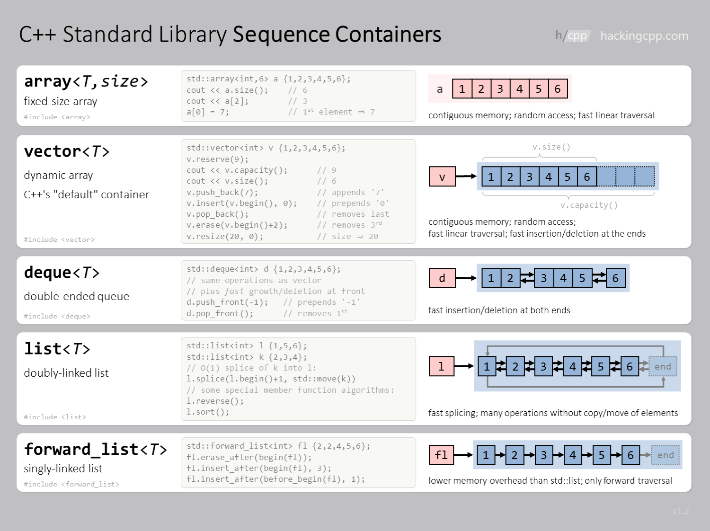
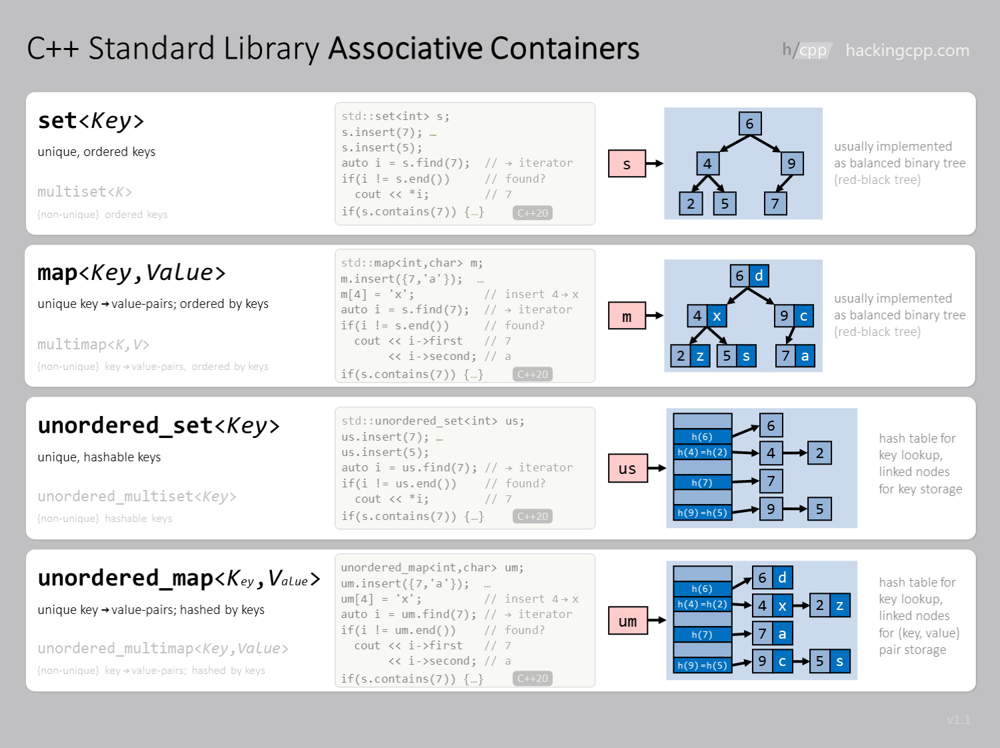
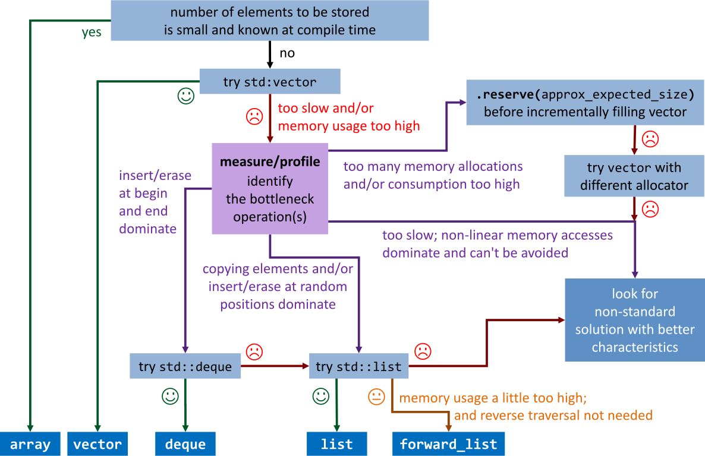
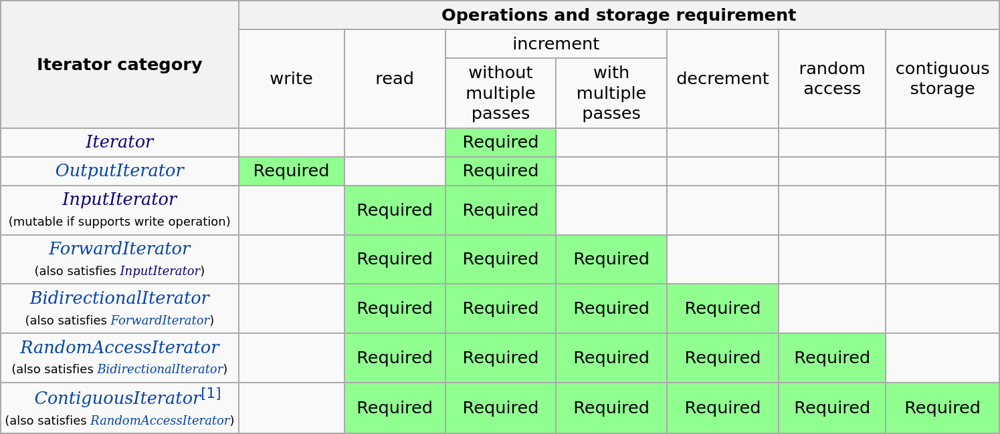
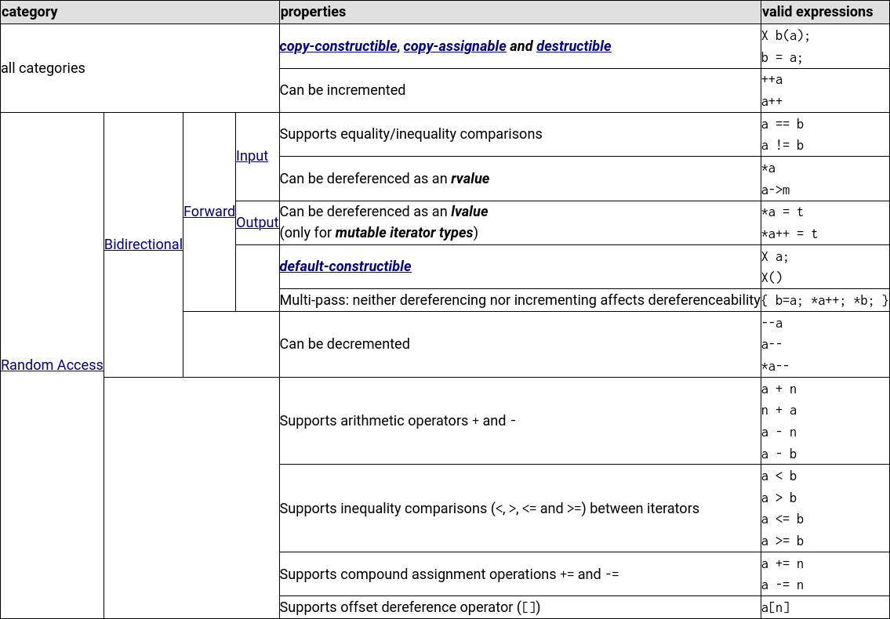
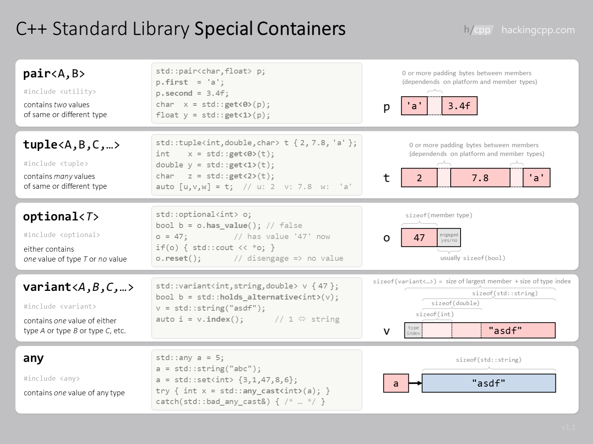

<!--
title: Lecture 06
paginate: true

_class: titlepage
-->

# Lecture 06
<br>

## The Standard Template Library.
<br>

#### Advanced Programming for Computational Science<br>SISSA, UniTS, 2026-2027

###### Pasquale Claudio Africa

###### 10 Nov 2026

---

# Outline

1. Library overview and container structures
2. Containers, iterators and algorithms
3. Parallel execution policies (C++17)
4. Utility types: `pair`, `tuple`, `optional`, `variant` and `any`
5. C++ evolution and loop styles
6. Hands-on challenge: C++17 and C++20

**Examples use C++17**, unless explicitly marked C++20.

**Appendix:** container adaptors and examples.

---

<!--
_class: titlepage
-->

# Library overview

---

# The STL and the C++ Standard Library

- **STL:** generic containers, iterators, algorithms and function objects.
- **Standard Library:** the STL plus strings, I/O, numerics, resource management and other facilities.
- Standard C++ library names are generally in `std::` or its sub-namespaces. Macros and C compatibility headers have additional rules.

In November 1993, Alexander Stepanov presented the STL to the C++ standardization committee. Its generic design became a core part of the Standard Library.

---

# An overview of the C++ Standard Library (1/2)

- **C library facilities:** C++ headers such as `<cmath>` provide declarations in `std::`; compatibility headers and macros have additional rules.
- **Containers and iterators:** generic storage and traversal.
- **Algorithms:** search, sort, transform and copy; some offer parallel execution policies.
- **Utilities:** smart pointers, pairs, tuples, clocks and function wrappers.
- **Text:** the `basic_string` family (`string`, `wstring`), regular expressions and string views.
- **I/O and diagnostics:** streams, standard exception classes and exception-handling support.

---

# An overview of the C++ Standard Library (2/2)

- **Numerics:** complex numbers, numeric limits, random engines and distributions.
- **Generic programming:** type traits and utilities such as `declval`.
- **References and resource transfer:** reference wrappers, `move`, `forward`.
- **Concurrency:** threads, mutexes, locks and parallel algorithms.
- **Internationalization:** locales and wide-character support (`wchar_t`).
- **Filesystem:** paths, directories and file metadata.
- **Allocation:** allocators and memory resources.
- **Utility types:** `optional`, `variant` and `any`.

---

# The Boost libraries

Many Standard Library facilities originated in [Boost](https://www.boost.org/), a collection of open-source C++ libraries.

The [Boost Graph Library](https://www.boost.org/doc/libs/latest/libs/graph/doc/html/graph/index.html) provides generic graph data structures and algorithms, useful for scientific networks and meshes.

Installation depends on the platform and selected components; on Ubuntu, `sudo apt-get install libboost-all-dev` installs the packaged collection. Some components are header-only; others require building or linking libraries.

---

<!--
_class: titlepage
-->

# Containers

---

# Sequence containers

A sequence stores elements in a position that does not depend on their value.

| Container              | Storage and main use                             |
|------------------------|--------------------------------------------------|
| `std::vector<T>`       | Contiguous, dynamic size; a usual starting point |
| `std::array<T, N>`     | Contiguous, size fixed at compile time           |
| `std::deque<T>`        | Random access; efficient growth at both ends     |
| `std::list<T>`         | Doubly linked nodes; bidirectional traversal     |
| `std::forward_list<T>` | Singly linked nodes; forward traversal           |

`vector` and `array` own their elements and release their storage automatically. The contiguous-storage statement for `vector` excludes its special `bool` specialization.

---

# Example: `std::vector`

```cpp
#include <vector>
#include <iostream>

std::vector<double> readings{2.0, 4.0, 5.0};

readings.push_back(6.0);  // 2, 4, 5, 6
readings.pop_back();      // 2, 4, 5
readings[1] = 3.0;        // 2, 3, 5

for (double x : readings) std::cout << x << ' ';

std::cout << '\n';                // 2 3 5
```

`pop_back()` requires a nonempty vector. `readings[i]` requires `i < readings.size()`.
`at(i)` checks the index and throws `std::out_of_range` if it is invalid; exceptions are covered next lecture.

---

# Size, capacity, reserve and resize

```cpp
#include <vector>
#include <iostream>

std::vector<double> readings{2.0, 3.0, 5.0};

readings.reserve(8); // Capacity >= 8; size remains 3.

std::cout << readings.size() << '\n'; // 3

readings.resize(5, 0.0);

for (double x : readings) std::cout << x << ' ';
// 2 3 5 0 0; size is now 5, capacity is still >= 8.
```

**Size:** number of existing elements. **Capacity:** how many fit without reallocation.
`reserve` prepares storage; `resize` adds or removes elements. Reserved storage beyond `size()` is not accessible through `[]`.

---

# Example: `std::array`

```cpp
#include <array>
#include <iostream>

std::array<double, 4> quadrature_weights{1, 3, 3, 1};

std::cout << quadrature_weights.size() << '\n';   // 4
std::cout << quadrature_weights[1] << '\n';       // 3
std::cout << quadrature_weights.front() << '\n';  // 1
std::cout << quadrature_weights.back() << '\n';   // 1
// quadrature_weights = std::array<double, 3>{1, 4, 1};
// Error: arrays of different sizes have different types.
```

The size is part of the type and cannot change at runtime. `std::array<T, 0>` is allowed, but has no element to access.

---



[Source: Hacking C++](https://hackingcpp.com/cpp/std/sequence_containers.png).

---

# Range-based loops: values and references

```cpp
#include <vector>
#include <iostream>

std::vector<double> readings{1.0, 2.0, 3.0};

for (double x : readings) std::cout << x << ' ';

for (double& x : readings) x *= 2.0;

for (const auto& x : readings) std::cout << x << ' ';
// Prints: 1 2 3 2 4 6
```

- `double x`: a copy of each element.
- `double& x`: access the element and allow modification.
- `const auto& x`: read the element without copying it.

Copying a container copies its elements; a reference borrows the existing container.

---

# Associative containers

Retrieve values by **key**, rather than by a numerical position.

| Family                    | One element per equivalent key | Multiple equivalent keys |
|---------------------------|--------------------------------|--------------------------|
| Ordered key–value pairs   | `map`                          | `multimap`               |
| Ordered keys              | `set`                          | `multiset`               |
| Unordered key–value pairs | `unordered_map`                | `unordered_multimap`     |
| Unordered keys            | `unordered_set`                | `unordered_multiset`     |

Use the `std::` prefix. In a set, the element itself is the key; in a map, each element is a key–value pair.

---

# `std::pair` and structured bindings (C++17)

```cpp
#include <utility>
#include <iostream>

std::pair<double, double> sample{0.5, 1.25};

std::cout << sample.first << ' ' << sample.second << '\n';

const auto& [time, amplitude] = sample;

std::cout << time << ' ' << amplitude << '\n'; // 0.5 1.25
```

A **pair** groups two values, possibly of different types.
A **structured binding** gives names to its components.
`const auto&` reads the original pair; `auto [t, a] = sample` would copy it.

A map element has type `std::pair<const Key, T>`: its key cannot be changed in place.

---

# Ordered associative containers

- Keys are kept sorted by `<`, or by a custom comparator.
- A comparator must define a **strict weak ordering**: `comp(x, x)` is false; ordering and the induced equivalence are transitive.
- Two keys are equivalent when both `comp(a, b)` and `comp(b, a)` are false. This need not mean `a == b`.
- `map` and `set` keep one element per equivalent key.
- Typically implemented as balanced search trees, often red-black trees.

Search and ordinary single-element insertion take $O(\log n)$ comparisons. Erasing by key can also depend on how many elements match.

Here $n$ is the number of stored elements.

---

# Example: `std::map`

```cpp
std::map<std::string, int> samples_per_sensor;

samples_per_sensor["S1"] = 25;
samples_per_sensor["S2"] = 30;
samples_per_sensor.insert({"S3", 35});

std::cout << samples_per_sensor.at("S2") << '\n'; // 30

for (const auto& [sensor, count] : samples_per_sensor) {
    std::cout << sensor << ": " << count << '\n';
} // S1: 25, S2: 30, S3: 35, on separate lines.
```

`m[key]` inserts an absent key with an initialized value (`0` for `int`).
`m.at(key)` throws `std::out_of_range` if absent. `m.find(key)` reports absence through an iterator, introduced next.

---

# Positions and half-open ranges

An **iterator** describes a position and provides access to an element.

- `begin()` points to the first element, if one exists.
- `end()` is **past the end**: it does not refer to an element.
- `[begin, end)` includes the first position and excludes the last.
- For an empty container, `begin() == end()`.
- A failed `find` returns `end()`; check before dereferencing.

Advance through a range with `++it`, access an element with `*it`, and compare compatible iterators from the same sequence.

---

# Example: `std::set`

```cpp
#include <set>
#include <iostream>

std::set<int> sensor_ids{5, 2, 8, 2, 1}; // 1, 2, 5, 8

sensor_ids.insert(3);  // 1, 2, 3, 5, 8
sensor_ids.erase(2);   // 1, 3, 5, 8

auto it = sensor_ids.find(5);

if (it != sensor_ids.end()) std::cout << *it << '\n'; // 5

std::cout << sensor_ids.count(3) << '\n';             // 1

for (int id : sensor_ids) std::cout << id << ' '; // 1 3 5 8
```

In a `set`, `count` is always 0 or 1. Iteration follows key order.
Keys cannot be modified through set iterators.

---

# Unordered associative containers

- Organize keys using **hash tables**, without sorted iteration.
- Need a hash function and an equality predicate for keys.
- Defaults: `std::hash<Key>` and `std::equal_to<Key>`.
- Equivalent keys must produce the same hash. Equal hashes do not imply equivalent keys: collisions are possible.
- Search and single-element insertion: $O(1)$ on average, $O(n)$ in the worst case. Erasing by key also depends on the number of matches.

Ordered containers group keys by comparison; unordered containers group keys using equality and hashing.

---

# Example: `std::unordered_map`

```cpp
#include <unordered_map>
#include <string>
#include <iostream>

std::unordered_map<std::string, int> samples_per_sensor;

samples_per_sensor["S1"] = 25;
samples_per_sensor["S2"] = 30;
samples_per_sensor["S3"] = 35;

std::cout << samples_per_sensor.at("S1") << '\n'; // 25

for (const auto& [sensor, count] : samples_per_sensor) {
    std::cout << sensor << ": " << count << '\n';
} // All three pairs; their iteration order is unspecified.
```

Lookup by key is constant time on average. `[]`, `at` and `find` have the same access/insertion distinctions as in `map`.

---



[Source: Hacking C++](https://hackingcpp.com/cpp/std/associative_containers.png).

---

# Performance comparison: sequences

| Operation               | `vector`         | `list`                   | `deque` |
|-------------------------|------------------|--------------------------|---------|
| Access position $i$     | $O(1)$           | $O(n)$ traversal         | $O(1)$  |
| Append one element      | $O(1)$ amortized | $O(1)$                   | $O(1)$  |
| Remove last element     | $O(1)$           | $O(1)$                   | $O(1)$  |
| Insert/remove at front  | $O(n)$           | $O(1)$                   | $O(1)$  |
| Insert/remove in middle | $O(n)$           | $O(1)$ at known position | $O(n)$  |
| Search by value         | $O(n)$           | $O(n)$                   | $O(n)$  |

Finding a position in `list` may take $O(n)$; it has no `[]`.
A vector append that reallocates costs $O(n)$, but a sequence of appends has constant amortized cost per append.

---

# Performance comparison: keys and container choice

| Single-key operation       | `map` / `set` | Unordered equivalents        |
|----------------------------|---------------|------------------------------|
| Find                       | $O(\log n)$   | Average $O(1)$; worst $O(n)$ |
| Insert                     | $O(\log n)$   | Average $O(1)$; worst $O(n)$ |
| Erase by key (unique keys) | $O(\log n)$   | Average $O(1)$; worst $O(n)$ |

These count operations as $n$ grows; comparison/hash costs also matter.
Node-based containers have per-element storage overhead.

**Choose by required operations:** fixed-size data → `array`; dynamic sequences → start with `vector`; key lookup → map/set families. Use `deque` for both ends, or `list` for suitable operations at known positions. Measure before optimizing.

---

# Which sequence container to choose?



[Source: Hacking C++](https://hackingcpp.com/cpp/std/sequence_containers).

---

<!--
_class: titlepage
-->

# Iterators

---

# Iterator categories and mutability

Readable iterator capabilities build on each other:

**Input → Forward → Bidirectional → Random access**

| Category      | Additional capability                   | Example           |
|---------------|-----------------------------------------|-------------------|
| Input         | Read, single pass                       | Input stream      |
| Forward       | Multiple passes                         | `forward_list`    |
| Bidirectional | Move backward with `--`                 | `list`, `map`     |
| Random access | Jump with `+`, `+=`, subtract positions | `vector`, `deque` |

**Output iterators** describe writable destinations separately.
Mutability is independent of this chain: `const_iterator` reads without modifying elements; set iterators also protect keys.

---

# Iterator capabilities at a glance



[Source: cppreference](https://en.cppreference.com/cpp/iterator#Iterator_categories). [C++17 requirements](https://timsong-cpp.github.io/cppwp/std17/iterator.requirements).

---

# Iterator example

```cpp
#include <vector>
#include <iostream>

std::vector<double> residuals{0.1, 0.2, 0.3};

for (auto it = residuals.begin(); it != residuals.end(); ++it) {
    *it *= 2.0;
}

for (auto it = residuals.cbegin(); it != residuals.cend(); ++it) {
    std::cout << *it << ' '; // 0.2 0.4 0.6
}

for (auto it = residuals.rbegin(); it != residuals.rend(); ++it) {
    std::cout << *it << ' '; // 0.6 0.4 0.2
}
```

`begin()` returns `std::vector<double>::iterator` here; `cbegin()` returns `std::vector<double>::const_iterator`. Reverse iterators visit elements backward.

---

# Common iterator operations

```cpp
std::vector<int> nodes{10, 20, 30, 40, 50};
auto it = nodes.begin();

++it;     // Points to 20.
it += 2;  // Points to 40.

std::cout << std::distance(nodes.begin(), it) << '\n'; // 3

std::advance(it, 1);

std::cout << *it << '\n';                // 50
```

`+=` and direct iterator subtraction require random access.
`distance` and `advance` are constant time for random access, but can be linear for other categories. Stay within valid positions; a negative advance requires bidirectional traversal.

---

# Iterator expressions at a glance



[Source: cplusplus.com](https://cplusplus.com/reference/iterator/).

---

# Iterator invalidation: erase safely

```cpp
#include <vector>
#include <iostream>

std::vector<int> sensor_ids{1, 3, 3, 2, 3};

for (auto it = sensor_ids.begin(); it != sensor_ids.end();) {
    if (*it == 3) {
        it = sensor_ids.erase(it);
    } else {
        ++it;
    }
}

for (int id : sensor_ids) std::cout << id << ' '; // 1 2
```

`vector::erase` invalidates iterators and references at or after the erased position. It returns the next valid position, possibly `end()`.
This loop also handles consecutive matches and an empty vector.

---

# Iterator invalidation: `std::vector` growth

- **Reallocation** invalidates all iterators, pointers and references to vector elements.
- `reserve(n)` reallocates when `n > capacity()`; otherwise it preserves them.
- `push_back` without reallocation preserves access to existing elements, but invalidates the previous `end()`.
- `erase` invalidates positions at and after the removal, including the previous `end()`.

Appending while traversing the same vector may invalidate your position and also changes the loop's endpoint. Keep traversal bounds and modifications consistent.

Invalidation rules depend on the container and operation.

---

<!--
_class: titlepage
-->

# Algorithms

---

# STL algorithms overview

Algorithms use half-open ranges and may modify values; container resizing is separate.

| Purpose               | Examples                                           |
|-----------------------|----------------------------------------------------|
| Inspect / search      | `find`, `find_if`, `count`, `binary_search`        |
| Sort / partition      | `sort`, `stable_sort`, `partial_sort`, `partition` |
| Modify / copy         | `copy`, `transform`, `replace`, `fill`, `reverse`  |
| Logical removal       | `remove`, `remove_if`, `unique`                    |
| Extrema               | `min`, `max`, `min_element`, `max_element`         |
| Sorted set operations | `set_union`, `set_intersection`, `set_difference`  |
| Numeric operations    | `accumulate`, `inner_product`, `partial_sum`       |

Headers: `<algorithm>`; numeric functions use `<numeric>`.

---

# Example: Searching algorithms

```cpp
std::vector<int> sensor_ids{1, 2, 3, 4, 5};
auto it = std::find(sensor_ids.begin(), sensor_ids.end(), 3);

if (it != sensor_ids.end())
    std::cout << "Found: " << *it << '\n';

auto count = std::count(sensor_ids.begin(), sensor_ids.end(), 3);

std::cout << "Count: " << count << '\n'; // 1

bool found = std::binary_search(sensor_ids.begin(), sensor_ids.end(), 3);

std::cout << "Binary search: " << found << '\n'; // 1
```

`find` and `count` scan the range; `auto` preserves the count's return type.
Use `binary_search` on a range sorted with the same ordering used for the search. Its number of comparisons is logarithmic; iterator traversal may be linear without random access.

---

# Example: Sorting algorithms

```cpp
#include <algorithm>
#include <vector>
#include <functional>
#include <cmath>

std::vector<double> residuals{-0.3, 0.1, -0.1, 0.2};

std::sort(residuals.begin(), residuals.end());
// -0.3, -0.1, 0.1, 0.2
std::sort(residuals.begin(), residuals.end(), std::greater<double>{});
// 0.2, 0.1, -0.1, -0.3
std::sort(residuals.begin(), residuals.end(), [](double a, double b) {
    return std::abs(a) < std::abs(b);
}); // Magnitudes: 0.1, 0.1, 0.2, 0.3
```

`sort` needs random-access iterators and movable/assignable elements; `list` provides its own `sort()` member. C++17 guarantees $O(n \log n)$ comparisons.

---

# Comparators and stability

The comparator must define a strict weak ordering (as for ordered containers).

- `comp(x, x)` must be false; ordering and equivalence must be transitive.
- For magnitude comparison, `-0.1` and `0.1` are equivalent even though they are unequal.
- `std::sort` may change the relative order of equivalent elements.
- `std::stable_sort` preserves their relative order from its input range.

The final order of the two equal-magnitude residuals is not specified by `sort`.

---

# Example: Modifying algorithms

```cpp
#include <algorithm>
#include <vector>

std::vector<double> readings{1, 2, 3, 4, 5};
std::vector<double> result(readings.size());

std::copy(readings.begin(), readings.end(), result.begin());
std::transform(readings.begin(), readings.end(), result.begin(),
               [](double x) { return x * 1e-3; });
// result: 0.001, 0.002, 0.003, 0.004, 0.005 (mm to m)
std::replace(readings.begin(), readings.end(), 3.0, 3.5);
// readings: 1, 2, 3.5, 4, 5
```

The destination must have enough existing writable elements. `reserve` alone would not create them. Here `result` has the same size as `readings`; these algorithms do not resize it.

---

# Example: Removing algorithms

```cpp
#include <algorithm>
#include <vector>

std::vector<int> sensor_ids{1, 2, 3, 2, 4, 2, 5};
auto new_end = std::remove(sensor_ids.begin(), sensor_ids.end(), 2);
// Size is still 7; [begin, new_end) contains 1, 3, 4, 5.
sensor_ids.erase(new_end, sensor_ids.end());  // Size is now 4.
sensor_ids = {1, 2, 3, 4, 5, 6};
new_end = std::remove_if(sensor_ids.begin(), sensor_ids.end(),
                         [](int id) { return id % 2 == 0; });
sensor_ids.erase(new_end, sensor_ids.end());  // 1, 3, 5
```

`remove` / `remove_if` compact retained elements stably and return the new logical end. Values in the remaining tail are unspecified.
The container's `erase` operation then changes its size.

---

# Example: Numeric algorithms

```cpp
#include <numeric>
#include <vector>
#include <functional>
#include <iostream>

std::vector<double> samples{0.5, 1.5, 2.5};
double sum = std::accumulate(samples.begin(), samples.end(), 0.0);
double product = std::accumulate(samples.begin(), samples.end(),
                                  1.0, std::multiplies<double>{});

std::vector<double> weights{1.0, 2.0, 1.0};
double dot = std::inner_product(samples.begin(), samples.end(),
                                weights.begin(), 0.0);

std::cout << sum << ' ' << product << ' ' << dot << '\n';
// 4.5 1.875 6
```

The second range of `inner_product` must contain at least as many elements as the first. The products are evaluated before being accumulated.

---

# Choose the accumulator type

```cpp
#include <numeric>
#include <vector>
#include <iostream>

std::vector<double> samples{0.5, 1.5};
auto truncated = std::accumulate(samples.begin(), samples.end(), 0);
auto sum = std::accumulate(samples.begin(), samples.end(), 0.0);

std::cout << truncated << ' ' << sum << '\n'; // 1 2
```

- The initial value selects the accumulator type: `0` → `int`, `0.0` → `double`.
- Each step stores the result back into that type; integer accumulation truncates these fractional intermediate results.
- Empty ranges return the initial value (`0.0` for sums, `1.0` for products).
- Integer products can overflow before reaching a wider accumulator.

---

# Why use STL algorithms?

```cpp
std::vector<double> samples{0.5, 1.5, 2.5};
double manual_sum = 0.0;

for (std::size_t i = 0; i < samples.size(); ++i) {
    manual_sum += samples[i];
}

double algorithm_sum = std::accumulate(samples.begin(), samples.end(), 0.0);

std::cout << (manual_sum == algorithm_sum) << '\n'; // 1
```

Algorithms express intent and reuse standard implementations. This sum performs the same ordered additions as the loop.
`accumulate` itself has no execution-policy overload.

---

# Parallel algorithms (C++17)

```cpp
#include <execution>
#include <algorithm>
#include <vector>

std::vector<double> residuals{0.3, -0.2, 0.1, -0.4};

std::sort(std::execution::seq, residuals.begin(), residuals.end());
std::sort(std::execution::par, residuals.begin(), residuals.end());
std::sort(std::execution::par_unseq, residuals.begin(), residuals.end());
```

- `seq`: sequential execution in the calling thread.
- `par`: permits parallel execution; `par_unseq` also permits unsequenced execution for vectorization.
- Policies permit parallelism, without guaranteeing a speedup; measure larger inputs.
- Support and linking requirements depend on the library/backend.

---

# Parallel algorithms: functions and guarantees

- Functions invoked by parallel algorithms must avoid data races. For `par_unseq`, they must also avoid operations such as blocking synchronization.
- A comparator that only reads its arguments, as in our residual example, does not share mutable state.
- The overload with `seq` is sequential, but differs from the overload without a policy in exception handling: an uncaught exception from a user function causes termination for the standard policies.
- Select a policy only after checking the algorithm's requirements and measuring a sufficiently large workload.

Exception handling and time measurement are covered next lecture.

---

# Common pitfalls: copies and `std::map` access

- A by-value container parameter copies an lvalue argument; an rvalue may be moved. Use `const std::vector<double>&` to inspect an existing vector without copying it.
- A reference borrows the container; the original must remain alive.
- `m[key]` inserts an absent key. Use `at` for checked access (throws if absent), or `find` to test existence.
- A failed `find` returns `end()`: check it before accessing the element.
- After `std::remove`, pass the returned logical end to container `erase` to change the size.
- Compare iterator positions only within their valid comparison domain, normally the same sequence.

Move semantics and smart pointers are next-lecture topics.

---

# Select data and grow the output

```cpp
#include <algorithm>
#include <iterator>
#include <vector>
#include <iostream>

std::vector<double> readings{1.0, -2.0, 3.0};
std::vector<double> positive;

std::copy_if(readings.begin(), readings.end(),
             std::back_inserter(positive),
             [](double x) { return x > 0.0; });

for (double x : positive) std::cout << x << ' '; // 1 3
```

`copy_if` copies only elements satisfying the predicate.
`back_inserter` returns an **output iterator** that appends assigned values using `push_back`; the vector grows as needed.

---

<!--
_class: titlepage
-->

# Utility types

---

# Utility types: `std::tuple` and `std::optional`

```cpp
std::tuple<int, double, double> sample{7, 0.5, 1.25};

const auto& [sensor, time, amplitude] = sample;

std::cout << sensor << ' ' << time << ' ' << amplitude << '\n';
std::cout << std::get<0>(sample) << '\n'; // 7

std::optional<double> measurement = 1.25;

if (measurement.has_value()) std::cout << *measurement << '\n';
```

`tuple` groups values, possibly of different types. `optional<T>` (C++17) stores either a `T` or no value, for example a missing measurement. An empty optional must not be dereferenced.
These are utility types, not iterable STL containers.

---

# Utility types: `std::variant` (C++17)

```cpp
std::variant<int, double, std::string> value = 42;

value = 3.14;
value = "missing";

if (std::holds_alternative<std::string>(value)) {
    std::cout << std::get<std::string>(value) << '\n';
}

if (auto* ptr = std::get_if<double>(&value)) {
    std::cout << *ptr << '\n'; // Not reached: holds a string.
}

std::visit([](const auto& arg) {
    std::cout << arg << '\n';
}, value);
```

Alternatives are fixed at compile time. `get_if` returns `nullptr` for a different active type; `visit` handles each alternative. Output: `missing`, twice.

---

# Utility types: `std::any` (C++17)

```cpp
#include <any>
#include <string>
#include <typeinfo>
#include <iostream>

std::any metadata = 42;

metadata = std::string("calibrated");

if (metadata.has_value() && metadata.type() == typeid(std::string)) {
    std::cout << std::any_cast<std::string>(metadata) << '\n';
}

std::cout << std::any_cast<std::string>(metadata) << '\n';
```

`any` stores a value of a copy-constructible type.
The value-returning `any_cast<T>` throws `std::bad_any_cast` if the stored type does not match. Here both casts succeed and print `calibrated`.

---



[Source: Hacking C++](https://hackingcpp.com/cpp/std/special_containers.png).

---

<!--
_class: titlepage
-->

# Evolution of C++

---

# A milestone: C++11

- **Language:** lambdas, `auto`, range-based loops and initializer lists.
- **Ownership tools:** `unique_ptr`, `shared_ptr` and `weak_ptr` became standard library facilities.
- **Resource transfer:** move semantics and rvalue references.
- **Library growth:** new containers, algorithms and utilities.
- **Concurrency:** standardized threads and synchronization.

Later standards extend these facilities. Using a language version does not imply every library feature is available in every implementation.

---

# C++11

1. [Move semantics](https://github.com/AnthonyCalandra/modern-cpp-features/blob/master/CPP11.md#move-semantics)
2. [Variadic templates](https://github.com/AnthonyCalandra/modern-cpp-features/blob/master/CPP11.md#variadic-templates)
3. [Rvalue references](https://github.com/AnthonyCalandra/modern-cpp-features/blob/master/CPP11.md#rvalue-references)
4. [Lambda expressions](https://github.com/AnthonyCalandra/modern-cpp-features/blob/master/CPP11.md#lambda-expressions)
5. [`auto`](https://github.com/AnthonyCalandra/modern-cpp-features/blob/master/CPP11.md#auto)
6. [`nullptr`](https://github.com/AnthonyCalandra/modern-cpp-features/blob/master/CPP11.md#nullptr)
7. [Range-based for loops](https://github.com/AnthonyCalandra/modern-cpp-features/blob/master/CPP11.md#range-based-for-loops)
8. [Smart pointers](https://github.com/AnthonyCalandra/modern-cpp-features/blob/master/CPP11.md#smart-pointers)
9. [Type traits](https://github.com/AnthonyCalandra/modern-cpp-features/blob/master/CPP11.md#type-traits)
10. ...

---

# C++14

1. [Binary literals](https://github.com/AnthonyCalandra/modern-cpp-features/blob/master/CPP14.md#binary-literals)
2. [Generic lambdas](https://github.com/AnthonyCalandra/modern-cpp-features/blob/master/CPP14.md#generic-lambda-expressions)
3. [Return type deduction](https://github.com/AnthonyCalandra/modern-cpp-features/blob/master/CPP14.md#return-type-deduction)
4. [`decltype(auto)`](https://github.com/AnthonyCalandra/modern-cpp-features/blob/master/CPP14.md#decltypeauto)
5. [Variable templates](https://github.com/AnthonyCalandra/modern-cpp-features/blob/master/CPP14.md#variable-templates)
6. [User-defined literals for standard library types](https://github.com/AnthonyCalandra/modern-cpp-features/blob/master/CPP14.md#user-defined-literals-for-standard-library-types)
7. ...

---

# C++17

1. [Template argument deduction for class templates](https://github.com/AnthonyCalandra/modern-cpp-features/blob/master/CPP17.md#template-argument-deduction-for-class-templates)
2. [Fold expressions](https://github.com/AnthonyCalandra/modern-cpp-features/blob/master/CPP17.md#folding-expressions)
3. [Lambda capture `this` by value](https://github.com/AnthonyCalandra/modern-cpp-features/blob/master/CPP17.md#lambda-capture-this-by-value)
4. [Structured bindings](https://github.com/AnthonyCalandra/modern-cpp-features/blob/master/CPP17.md#structured-bindings)
5. [`constexpr if`](https://github.com/AnthonyCalandra/modern-cpp-features/blob/master/CPP17.md#constexpr-if)
6. [UTF-8 character literals](https://github.com/AnthonyCalandra/modern-cpp-features/blob/master/CPP17.md#utf-8-character-literals)
7. [New library features like `std::variant`, `std::optional`, and `std::any`](https://github.com/AnthonyCalandra/modern-cpp-features/blob/master/CPP17.md#c17-library-features)
8. ...

---

# C++20

1. [Coroutines](https://github.com/AnthonyCalandra/modern-cpp-features/blob/master/CPP20.md#coroutines)
2. [Concepts](https://github.com/AnthonyCalandra/modern-cpp-features/blob/master/CPP20.md#concepts)
3. [Ranges](https://en.cppreference.com/w/cpp/ranges)
4. [Modules](https://en.cppreference.com/w/cpp/language/modules)
5. [Designated initializers](https://github.com/AnthonyCalandra/modern-cpp-features/blob/master/CPP20.md#designated-initializers)
6. [Template syntax for lambdas](https://github.com/AnthonyCalandra/modern-cpp-features/blob/master/CPP20.md#template-syntax-for-lambdas)
7. [`constexpr` virtual functions](https://github.com/AnthonyCalandra/modern-cpp-features/blob/master/CPP20.md#constexpr-virtual-functions)
8. [New library features, including `std::span` and math constants](https://github.com/AnthonyCalandra/modern-cpp-features/blob/master/CPP20.md#c20-library-features)
9. ...

---

# C++23

Selected additions, for reference:

- **`std::expected<T, E>`:** stores an expected result or an error value.
- **`std::ranges::to`:** constructs a container from a range.
- **Ranges:** additional views and algorithms.

These require C++23 library support and are not used in the core examples.

[Expected objects (C++23 draft)](https://timsong-cpp.github.io/cppwp/n4950/expected)
[Range conversions (C++23 draft)](https://timsong-cpp.github.io/cppwp/n4950/range.utility.conv)

---

# Example: the evolution of `for` loops (1/5)

```cpp
#include <vector>
#include <cstddef>
#include <iostream>

std::vector<double> samples{1, 2, 3, 4, 5};

for (std::size_t i = 0; i < samples.size(); ++i) {
    std::cout << samples[i] << ' ';
}
```

The indexed loop predates C++11; this initializer-list construction uses C++11.
It provides the position as well as the value, but requires indexable data and careful bounds. `vector::size()` and `array::size()` take constant time.

---

# Example: the evolution of `for` loops (2/5)

```cpp
#include <vector>
#include <iostream>

std::vector<double> samples{1, 2, 3, 4, 5};

for (std::vector<double>::iterator it = samples.begin();
     it != samples.end(); ++it) {
    std::cout << *it << ' ';
}
```

The iterator loop predates C++11; this construction uses C++11.
It supports non-indexable containers such as `list`, provided they expose the necessary iterators. Container adaptors do not expose this interface.

---

# Example: the evolution of `for` loops (3/5)

```cpp
#include <vector>
#include <iostream>

std::vector<double> samples{1, 2, 3, 4, 5};

for (const auto& value : samples) {
    std::cout << value << ' ';
}
```

Range-based loops (C++11) express traversal without spelling out iterators.
Use `auto&` to modify elements, `const auto&` to read without copying, or `auto` for copies. They do not directly provide an index.

---

# Example: the evolution of `for` loops (4/5)

```cpp
std::tuple<int, double, double> sample{7, 0.5, 1.25};

const auto& [sensor, time, amplitude] = sample;

std::cout << sensor << ' ' << time << ' ' << amplitude << '\n';

std::map<int, double> temperatures{{1, 20.5}, {2, 21.0}};

for (const auto& [id, temperature] : temperatures) {
    std::cout << id << ": " << temperature << '\n';
}
```

Structured bindings (C++17) name components of arrays, tuple-like objects and suitable classes. In loops they depend on the element type, not the container family. `const auto&` here binds to the originals.

---

# Example: the evolution of `for` loops (5/5)

```cpp
#include <ranges>
#include <vector>
#include <iostream>

std::vector<double> samples{1, 2, 3, 4, 5};

for (double value : samples | std::views::reverse) {
    std::cout << value << ' '; // 5 4 3 2 1
}
```

**C++20:** a view provides a different traversal of the original range.
`views::reverse` reverses the visit order without reordering `samples`.
Other adaptors can filter or transform values during traversal; range adaptors introduce additional requirements and lifetime considerations.

---

# Top 10 must-know algorithms

A reference checklist for the core data-processing patterns.

1. **`std::sort`**: Sorting elements
2. **`std::find` / `std::find_if`**: Searching for elements
3. **`std::copy`**: Copying elements between containers
4. **`std::transform`**: Applying functions to ranges
5. **`std::accumulate`**: Summing or reducing elements
6. **`std::count` / `std::count_if`**: Counting elements
7. **`std::remove` / `std::remove_if`**: Logical removal; combine with container `erase`
8. **`std::for_each`**: Applying function to each element
9. **`std::max_element` / `std::min_element`**: Finding extrema
10. **`std::reverse`**: Reversing element order

---

<!--
_class: titlepage
-->

# Hands-on challenge

---

# Hands-on challenge

```cpp
#include <vector>

std::vector<double> lengths_mm{1, -2, 3, 0, 5};
std::vector<double> lengths_m;

for (double length : lengths_mm) {
    if (length > 0.0) lengths_m.push_back(length * 1e-3);
}
```

Refactor the loop to select positive measured lengths and convert millimetres to metres using STL algorithms.

**Expected:** `{0.001, 0.003, 0.005}`; input remains unchanged.
**Hint:** `copy_if` with `back_inserter`, followed by `transform` on the output.
Also consider empty input or no positive measurements.

---

# Hands-on challenge: solution

```cpp
#include <algorithm>
#include <iterator>
#include <vector>
#include <iostream>

std::vector<double> lengths_mm{1, -2, 3, 0, 5};
std::vector<double> lengths_m;

std::copy_if(lengths_mm.begin(), lengths_mm.end(),
             std::back_inserter(lengths_m),
             [](double length) { return length > 0.0; });
std::transform(lengths_m.begin(), lengths_m.end(), lengths_m.begin(),
               [](double length) { return length * 1e-3; });

for (double length : lengths_m) std::cout << length << ' ';
// 0.001 0.003 0.005
```

Both algorithms handle empty ranges. Transforming this range in place is valid.
Selection and conversion each take linear time in the range they traverse.

---

# Hands-on challenge: C++20 alternative

```cpp
#include <algorithm>
#include <iterator>
#include <ranges>
#include <vector>
#include <iostream>

std::vector<double> lengths_mm{1, -2, 3, 0, 5};
std::vector<double> lengths_m;
auto converted = lengths_mm
    | std::views::filter([](double x) { return x > 0.0; })
    | std::views::transform([](double x) { return x * 1e-3; });
std::ranges::copy(converted, std::back_inserter(lengths_m));

for (double x : lengths_m) std::cout << x << ' ';
```

**C++20:** the views select and convert on traversal; the copy materializes `{0.001, 0.003, 0.005}` in the output vector. The input must remain alive while its views are used.

---

# Useful references

- [cppreference.com](https://en.cppreference.com) - Comprehensive C++ reference
- [Hacking C++](https://hackingcpp.com/) - Many visual cheat sheets
- [ISO C++](https://isocpp.org/) - Official C++ standards site
- [C++ Core Guidelines](https://isocpp.github.io/CppCoreGuidelines/CppCoreGuidelines) - As the name says
- [C++20/17/14/11](https://github.com/AnthonyCalandra/modern-cpp-features) - List of modern features for each standard version, with examples
- [Compiler Explorer](https://godbolt.org/) - Test and analyze C++ code online

---

# Conclusion and next lecture

1. Choose containers by required operations, storage and access costs.
2. Use valid half-open ranges, check returned iterators and track invalidation.
3. Express data operations with algorithms; check iterator requirements, output storage, ordering and numeric types.

**Next lecture:** smart pointers and reference wrappers, move semantics, exceptions, I/O streams, random numbers, time measurement and filesystem.

The following appendix gives optional details on container adaptors.

---

<!--
_class: titlepage
-->

# Appendix<br>Container adaptors

Optional interface details and examples.

---

# Container adaptors

Adaptors restrict the interface of an underlying container.

| Adaptor             | Retrieval order           | Main operations                | Default storage |
|---------------------|---------------------------|--------------------------------|-----------------|
| `stack<T>`          | LIFO: last in, first out  | `push`, `pop`, `top`           | `deque<T>`      |
| `queue<T>`          | FIFO: first in, first out | `push`, `pop`, `front`, `back` | `deque<T>`      |
| `priority_queue<T>` | Largest first by default  | `push`, `pop`, `top`           | `vector<T>`     |

Use the `std::` prefix. These adaptors do not expose `begin/end` iterators.
Accessing the front/back/top and calling `pop` require a nonempty adaptor. `pop` removes an element without returning it.

---

# Example: `std::stack`

```cpp
#include <stack>
#include <iostream>

std::stack<int> pending_nodes;

pending_nodes.push(1);
pending_nodes.push(2);
pending_nodes.push(3);

std::cout << pending_nodes.top() << '\n'; // 3

pending_nodes.pop();

std::cout << pending_nodes.top() << '\n'; // 2
```

A LIFO stack can store nodes awaiting a depth-first traversal.

---

# Example: `std::priority_queue`

```cpp
#include <queue>
#include <iostream>

std::priority_queue<double> error_estimates;

error_estimates.push(0.3);
error_estimates.push(0.1);
error_estimates.push(0.5);

while (!error_estimates.empty()) {
    std::cout << error_estimates.top() << ' ';
    error_estimates.pop();
} // 0.5 0.3 0.1
```

For example, process the largest pending error estimate first in an adaptive computation.
