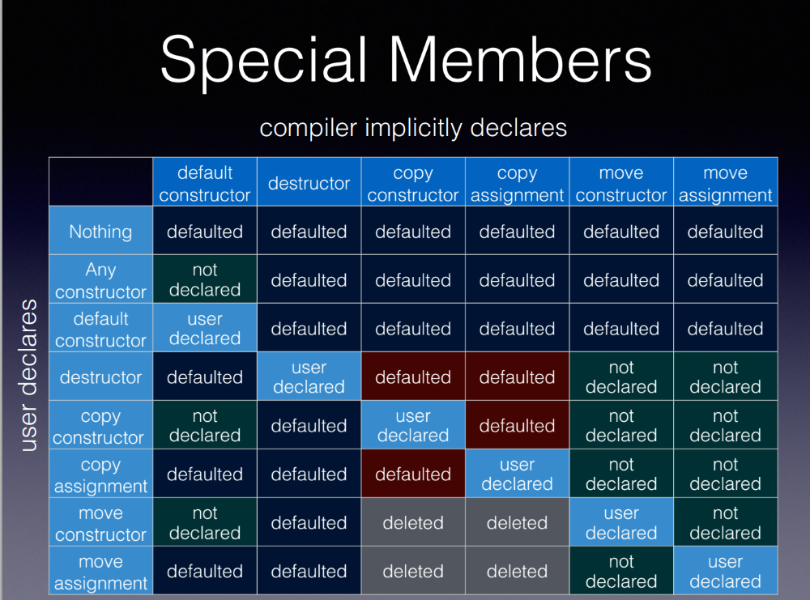

<!--
title: Lecture 07
paginate: true

_class: titlepage
-->

# Lecture 07
<br>

## Move semantics, smart pointers, exceptions, Standard Library utilities.
<br>

#### Advanced Programming for Computational Science<br>SISSA, UniTS, 2026-2027

###### Pasquale Claudio Africa

###### 11 Nov 2026

---

# Outline

1. RAII, move semantics, value categories and elision
2. Smart pointers and reference wrappers
3. Assertions, exceptions and RAII
4. Standard Library utilities
   - Streams
   - Random numbers
   - Time measurement
   - Filesystem

**C++17** unless stated otherwise.

**Appendix:** `weak_ptr` and ownership cycles, `Matrix` copy assignment, custom exceptions.

---

# RAII: tie resources to object lifetime

Recall RAII from Lecture 03: an owning object acquires a resource and releases it when its lifetime ends.

| Resource                        | Owner                   | Automatic cleanup         |
|---------------------------------|-------------------------|---------------------------|
| Sequence of measurements        | A vector class          | Releases element storage  |
| One dynamically selected object | A *smart pointer* class | Destroys the owned object |
| An open data file               | A file stream class     | Closes its file           |

Prefer owners that perform cleanup in their destructors. A raw pointer alone does not record who must release the object.

---

<!--
_class: titlepage
-->

# Move semantics

---

# A copyable `Matrix` (1/3)

```cpp
class Matrix {
    std::size_t rows, cols;
    std::vector<double> values; // Size rows * cols.

public:
    Matrix(std::size_t r, std::size_t c);
    Matrix(const Matrix& other);
    Matrix& operator=(const Matrix& other);

    std::size_t size() const { return values.size(); }
    double& operator[](std::size_t i) { return values[i]; }
    const double* storage() const { return values.data(); }
};
```

**Version 1.** `values` owns the matrix entries and handles allocation/destruction. `storage()` borrows a pointer to that buffer.
Assume `r * c` is representable; indexing requires `i < size()`.

---

# A copyable `Matrix` (2/3)

```cpp
Matrix::Matrix(std::size_t r, std::size_t c)
    : rows(r), cols(c), values(r * c, 0.0) {}

Matrix::Matrix(const Matrix& other)
    : rows(other.rows), cols(other.cols), values(other.values) {}
```

The ordinary constructor creates a zero-filled buffer.
The copy constructor copies dimensions and the vector's **elements**, allocating independent storage.

For a matrix with $n$ entries, this copy costs $O(n)$. The copy-assignment definition is provided in the appendix; the vector supplies automatic destruction.

---

# A copyable `Matrix` (3/3)

```cpp
Matrix field(1'000, 1'000);
field[0] = 1.25;

Matrix copied = field;
copied[0] = 2.50;

std::cout << field[0] << ' ' << copied[0] << '\n';           // 1.25 2.5
std::cout << (field.storage() == copied.storage()) << '\n';  // 0
```

Two independent matrices need two buffers. Copying a million entries is appropriate when both values are needed.

**Next problem:** when the original value is no longer needed, can a new owner reuse its buffer instead of copying the entries?

---

# What changes when we move?

We want to transfer ownership of the **same buffer** to a destination.

| Copy                           | Move in our next `Matrix` version |
|--------------------------------|-----------------------------------|
| New buffer with copied entries | Reuse the source buffer           |
| Source keeps its value         | Source becomes empty              |
| $O(n)$ work for $n$ entries    | $O(1)$ buffer transfer            |

The source object remains alive. We must express that its old value may be consumed and provide an operation that performs the transfer.

---

# Which expressions can select a move?

For an existing `Matrix field`, distinguish:

| Expression     | Category | Meaning                       |
|----------------|----------|-------------------------------|
| `field`        | lvalue   | Refers to the existing matrix |
| `field[0]`     | lvalue   | Refers to one of its entries  |
| `Matrix(2, 2)` | rvalue   | Creates a temporary matrix    |

An **lvalue** identifies an object. **Rvalues** include temporary values and, as we show next, expressions allowing reuse of an existing object.

Functions can overload on these categories. A function call need not be an rvalue: `std::min(i, j)` for integer arguments returns a reference and is an lvalue.

---

# Rvalue references: two overloads

**Rvalue** describes an expression (`Matrix(2, 2)`); **rvalue reference** describes a type (`Matrix&&`). Binding a reference does not copy or move the object.

```cpp
void identify(const Matrix&) {
    std::cout << "const reference\n";
}

void identify(Matrix&&) {
    std::cout << "rvalue reference\n";
}
```

```cpp
Matrix field(2, 2);

identify(field);         // const reference
identify(Matrix(2, 2));  // rvalue reference
```
For the temporary, both overloads are viable; `Matrix&&` is preferred.

---

# `std::move` enables a choice; it does not move

```cpp
#include <utility>

Matrix field(2, 2);
const double* buffer = field.storage();

identify(std::move(field));         // rvalue reference
std::cout << field.size() << '\n';  // Still 4: identify only prints.

Matrix attempted = std::move(field); // Version 1 still COPIES.
std::cout << (attempted.storage() == buffer) << '\n';  // 0
std::cout << field.size() << '\n';                     // Still 4.
```

`std::move(field)` casts to an rvalue reference without changing `field`.
Version 1 has no move constructor, so construction still selects its copy constructor. We now add the missing operation.

---

# Implicit special member functions



[Source: Howard Hinnant](https://howardhinnant.github.io/classdecl.html). Declaring a copy constructor suppresses implicit moves.

---

# Adding move operations (1/5)

```cpp
class Matrix {
    std::size_t rows, cols;
    std::vector<double> values;

public:
    Matrix(std::size_t r, std::size_t c);
    Matrix(const Matrix& other);
    Matrix& operator=(const Matrix& other);

    Matrix(Matrix&& other);
    Matrix& operator=(Matrix&& other);

    std::size_t size() const { return values.size(); }
    double& operator[](std::size_t i) { return values[i]; }
    const double* storage() const { return values.data(); }
};
```

**Version 2 replaces Version 1**, adding a move constructor and move assignment.

---

# Adding move operations (2/5)

```cpp
Matrix::Matrix(Matrix&& other)
    : rows(other.rows), cols(other.cols),
      values(std::move(other.values)) {
    other.rows = other.cols = 0;
    other.values.clear();
}
```

The vector's move constructor transfers its buffer; no matrix entries are copied. `clear()` removes any remaining entries, making our source state explicitly empty.

The named parameter `other` is an **lvalue expression**, even though its type is `Matrix&&`. This is why the member transfer uses `std::move(other.values)`.

---

# Adding move operations (3/5)

```cpp
#include <utility>

Matrix field(2, 2);
field[0] = 1.25;
const double* buffer = field.storage();

Matrix moved = std::move(field);

std::cout << moved[0] << '\n';                     // 1.25
std::cout << (moved.storage() == buffer) << '\n';  // 1
std::cout << field.size() << '\n';                 // 0
```

Compare this with Version 1: the destination now owns the **original buffer**, and the source is empty.
This initializes a new object, so it calls the **move constructor**.

---

# Adding move operations (4/5)

```cpp
Matrix& Matrix::operator=(Matrix&& other) {
    if (this != &other) {
        rows = other.rows;
        cols = other.cols;
        values = std::move(other.values);

        other.rows = other.cols = 0;
        other.values.clear();
    }

    return *this;
}
```

Move assignment updates an **existing** matrix. The vector releases the destination's previous buffer and takes ownership of the source buffer.
The identity check handles self-move; our source becomes empty, just as after move construction.

---

# Adding move operations (5/5)

```cpp
#include <utility>

Matrix source(2, 2);
source[0] = 1.25;
const double* buffer = source.storage();

Matrix target(3, 3); // Already owns a different buffer.
target = std::move(source);

std::cout << target.size() << ' ' << source.size() << '\n';  // 4 0
std::cout << (target.storage() == buffer) << '\n';           // 1
```

`Matrix target = std::move(source)` initializes a new object.
`target = std::move(source)` assigns to an existing object.
Both reuse the source buffer, but assignment must also release the destination's old resource.

---

# After a move, and when copying is still needed

```cpp
#include <utility>

Matrix source(2, 2);
Matrix moved = std::move(source);

source = Matrix(1, 1);           // A moved-from Matrix can be assigned again.
source[0] = 4.0;
std::cout << source[0] << '\n';  // 4

const Matrix fixed(2, 2);
Matrix copied = std::move(fixed); // Const source selects COPY.
std::cout << (copied.storage() == fixed.storage()) << '\n';  // 0
```

Our class defines an empty moved-from state. Check its size before indexing, or assign a new value.
In general, use moved-from objects according to their type's documented guarantees. A cast does not force a move: `Matrix&&` cannot bind to the const source above.

---

# The same example: copy-based and move-based swap

```cpp
void copy_swap(Matrix& a, Matrix& b) {
    Matrix temporary = a;
    a = b;
    b = temporary;
}

void move_swap(Matrix& a, Matrix& b) {
    Matrix temporary = std::move(a);
    a = std::move(b);
    b = std::move(temporary);
}
```

The first version copies the matrix entries; its cost is linear in their count. The second version uses the move constructor and both move assignments to exchange buffers in constant time.

Ordinary code can use `std::swap(a, b)`. No universal timing or allocation count follows from these examples.

---

# Returning by value: observe construction (1/3)

A minimal `MatrixTrace` makes constructor calls visible; it stores no numerical data.

```cpp
struct MatrixTrace {
    MatrixTrace() {
        std::cout << "Construction\n";
    }

    MatrixTrace(const MatrixTrace&) {
        std::cout << "Copy\n";
    }

    MatrixTrace(MatrixTrace&&) {
        std::cout << "Move\n";
    }

    MatrixTrace& operator=(MatrixTrace&&) = default;
};
```

---

# Returning by value: RVO (2/3)

```cpp
MatrixTrace make_trace() {
    return MatrixTrace{};
}
```

```cpp
MatrixTrace field = make_trace();
```

Output in C++17:

```text
Construction
```

**Elision** avoids a copy/move construction: the object is built directly in its destination, here `field`.

This is commonly called **RVO** (Return Value Optimization). In C++17 this case is **guaranteed copy elision**: no separate intermediate object is created, and no copy/move constructor is called.

---

# Returning by value: NRVO (3/3)

```cpp
MatrixTrace make_named_trace() {
    MatrixTrace local;

    return local;
}
```

```cpp
MatrixTrace field = make_named_trace();
```

**NRVO** (Named Return Value Optimization) builds `local` directly as `field`. It is **optional** in C++17.

- With NRVO, output: `Construction`.
- Without NRVO, output: `Construction`, then `Move`.
- Write `return local;`: `return std::move(local);` prevents NRVO.

**Assignment is different:** `field = make_named_trace();` still calls move assignment.

---

# Moving matrices into a container

```cpp
#include <vector>

std::vector<Matrix> fields;
fields.push_back(Matrix(2, 2));

fields.reserve(fields.capacity() + 1); // Forces reallocation.
```

The temporary is moved into the vector. Reallocation may copy existing matrices even though a move constructor is available: exception guarantees also affect this choice (explained in the exceptions section).

- Containers and algorithms retain their own requirements: `std::copy` still copies.
- Not every move is constant time: `std::array` moves its elements.
- Keep the distinction: **cast**, **selected move operation**, **elision**.

---

<!--
_class: titlepage
-->

# Smart pointers and reference wrappers

---

# Pointer roles in modern C++

| Type                 | Role                              | Keeps the object alive?     |
|----------------------|-----------------------------------|-----------------------------|
| `T*`, `T&`           | Observe/access an existing object | No                          |
| `std::unique_ptr<T>` | Exclusive ownership               | Yes                         |
| `std::shared_ptr<T>` | Shared ownership                  | Yes, while an owner remains |

A borrowed pointer/reference may be used only while its target exists. It can be useful even when the variable storing it lives longer, provided the expired target is not accessed.

The next examples reuse Lecture 04's `Polygon` hierarchy with a virtual destructor.

---

# Owning a polygon: raw pointer version

```cpp
class MeshCell {
    Polygon* polygon = nullptr;

public:
    void set_polygon(Polygon* p) { polygon = p; }
};

Polygon* create_polygon(const std::string& type) {
    if (type == "Triangle") return new Triangle(2.0, 1.0);
    if (type == "Square") return new Square(2.0);
    return nullptr;
}
```

```cpp
MeshCell cell;

cell.set_polygon(create_polygon("Triangle"));
cell.set_polygon(create_polygon("Square"));
```

This owner leaks polygons on replacement and destruction.

---

# Owning a polygon with `std::unique_ptr`

```cpp
class MeshCell {
    std::unique_ptr<Polygon> polygon;

public:
    void set_polygon(std::unique_ptr<Polygon> p) {
        polygon = std::move(p);
    }
};

std::unique_ptr<Polygon> create_polygon(const std::string& type) {
    if (type == "Triangle") return std::make_unique<Triangle>(2.0, 1.0);
    if (type == "Square") return std::make_unique<Square>(2.0);
    return nullptr;
}
```

```cpp
MeshCell cell;
cell.set_polygon(create_polygon("Triangle"));
cell.set_polygon(create_polygon("Square"));
```

---

# Passing ownership with `std::unique_ptr`

```cpp
#include <memory>
#include <utility>

class MeshCell {
    std::unique_ptr<Polygon> polygon;

public:
    void set_polygon(std::unique_ptr<Polygon> p) {
        polygon = std::move(p);
    }
};
```

The by-value argument receives ownership. Inside the setter, the named parameter `p` is an lvalue; `std::move(p)` enables move assignment into the member.

For an existing unique owner, the caller must explicitly transfer it. A temporary returned by `create_polygon` can initialize the parameter directly.

---

# Using `std::unique_ptr`

```cpp
auto sample = std::make_unique<double>(1.25);

if (sample) std::cout << *sample << '\n'; // 1.25

std::unique_ptr<double> result;
result = std::move(sample); // Releases any previously owned object.

std::cout << static_cast<bool>(sample) << '\n'; // 0
```

- Default construction gives an empty owner; test it before dereferencing.
- Copying is disabled; moves transfer ownership; `swap` exchanges owners.
- `get()` borrows a pointer; `reset()` destroys the owned object and empties the owner.
- `release()` returns the pointer and gives up ownership **without deleting**; responsibility must pass to another owner or appropriate cleanup.

---

# Shared ownership with `std::shared_ptr`

Use shared ownership when several objects must independently keep the same resource alive, for example a dataset used by preprocessing and a solver.

- Copies share ownership; the last owner destroys the resource.
- A **control block** stores ownership information, including counts.
- Counting and the control block add cost; `unique_ptr` is usually lighter with its default deleter. Its size can depend on a custom deleter.
- `make_shared` normally combines object/control-block allocation; constructing from a separately allocated object commonly uses two allocations.
- `get`, `reset`, assignment and `swap` are available. Use `get()` only to borrow access.

Prefer `make_unique` / `make_shared` for ordinary construction.

---

# Sharing numerical data (1/2)

```cpp
struct Data { std::vector<double> values{1.0, 2.0, 3.0}; };

struct Preprocessor {
    std::shared_ptr<Data> data;
    void run() {
        for (double& x : data->values) x *= 2.0;
    }
};

struct NumericalSolver {
    std::shared_ptr<Data> data;
    double run() const {
        const auto& v = data->values;
        return std::accumulate(v.begin(), v.end(), 0.0);
    }
};
```

Both classes store an owning copy. Each `run()` requires a nonempty `data`.

---

# Sharing numerical data (2/2)

```cpp
auto data = std::make_shared<Data>();
Preprocessor preprocessor{data};
NumericalSolver solver{data};

preprocessor.run();

std::cout << solver.run() << '\n';      // 12
std::cout << data.use_count() << '\n';  // 3

preprocessor.data.reset();

std::cout << data.use_count() << '\n'; // 2
```

Three owners initially share the dataset; resetting `preprocessor.data` leaves two.

Thread safety of ownership counts does not protect the dataset: modifying it concurrently requires synchronization. Different `shared_ptr` instances can share ownership safely; concurrent modification of the same instance also needs synchronization.

---

# `std::shared_ptr`: assignment and counts

```cpp
auto first = std::make_shared<double>(1.25);
auto observer_owner = first;

std::cout << first.use_count() << '\n'; // 2

auto second = std::make_shared<double>(2.50);

first = second;

std::cout << first.use_count() << '\n';  // 2
std::cout << *observer_owner << '\n';    // 1.25
```

Assignment releases one ownership share in the old object and acquires one in the new object. The old value survives through `observer_owner`; neither pointer variable has left its scope.

`std::weak_ptr` observes a shared object without keeping it alive. See the appendix for its use and for ownership cycles.

---

# Smart pointer ownership pitfalls

```cpp
auto owner = std::make_unique<double>(1.25);

double* borrowed = owner.get();
delete borrowed; // Intentional error: owner would delete it again.
```

A borrowed pointer is useful for access, but does not acquire responsibility for deletion.

```cpp
double* raw = new double(1.25);

std::shared_ptr<double> first(raw);
std::shared_ptr<double> second(raw); // Intentional error: independent owners. Use std::make_shared instead.
```

Copy an existing shared pointer to share its control block.

---

# Borrowing with `std::reference_wrapper`

```cpp
double t1 = 20.0, t2 = 21.0, t3 = 22.0, t4 = 23.0;
std::vector<std::reference_wrapper<double>> temperatures{t1, t2};

for (auto ref : temperatures) ref.get() += 0.5;
temperatures[0] = std::ref(t3); // Rebind; does not change t1.
temperatures[0].get() = 23.0;
temperatures.push_back(std::ref(t4));

std::cout << t1 << ' ' << t2 << ' ' << t3 << ' ' << t4 << '\n';
// 20.5 21.5 23 23
```

A wrapper must be initialized; it stores a reference, not an owned value. Its target must outlive every access through it. Containers cannot store reference types directly.

Binding a local const reference directly to a temporary can extend its lifetime; returning/rebinding references does not generally propagate that extension.

---

<!--
_class: titlepage
-->

# Assertions and exceptions

---

# Preconditions, postconditions and invariants

- A **precondition** specifies what the caller must supply.
- A **postcondition** specifies the result promised for valid inputs and successful completion.
- A **class invariant** specifies a consistent object state at its public operation boundaries; internal updates may temporarily alter it.

For our `Matrix`, dimensions and the owned buffer must agree, including after copy/move and assignment.

These conditions describe correctness. Assertions and exceptions provide different ways to check or report conditions.

---

# Example: Cholesky factorization

```cpp
Matrix cholesky(const Matrix& matrix);
```

- **Precondition:** a symmetric positive-definite matrix.
- **Postcondition:** a lower-triangular factor $L$ satisfying $M \approx LL^T$, within the required numerical accuracy.
- Symmetry is an input requirement of this algorithm; it is not an invariant of every general `Matrix` object.
- The storage invariant of our `Matrix` remains independent of which mathematical matrices the algorithm accepts.

This declaration illustrates a specification; implementing the factorization is outside this example.

---

# Run-time assertions

```cpp
#include <cassert>

double density(double mass, double volume) {
    assert(mass >= 0.0 && volume > 0.0);
    const double result = mass / volume;
    assert(result >= 0.0);
    return result;
}
```

Assume finite inputs and representable division. The checks document positive volume, nonnegative mass and nonnegative density.

`assert` checks programmer assumptions; it is not a substitute for validating external input. Its expression is not evaluated with `NDEBUG` defined:
```bash
g++ -std=c++17 -DNDEBUG program.cpp -o program
```

---

# Compile-time assertions

```cpp
#include <array>
#include <type_traits>
#include <cstddef>

template<class T, std::size_t N>
struct Samples {
    static_assert(std::is_arithmetic_v<T>, "Numeric samples required");
    static_assert(N > 0, "Positive sample count required");
    std::array<T, N> values{};
};
```

```cpp
Samples<double, 4> samples;

std::cout << samples.values.size() << '\n'; // 4
// Samples<double, 0> empty; // Intentional compile-time failure.
```
`is_arithmetic_v` is a type trait, a compile-time query about `T`.
These conditions are checked when this class specialization is instantiated.

---

# Exception handling and RAII

A C++ exception is an object used to signal a condition and transfer control to a handler. It can report runtime failures or detected programming errors.

- `throw` signals the condition; `try` identifies protected code.
- A matching `catch` handles it. Otherwise propagation continues to the caller.
- During **stack unwinding**, already-constructed automatic objects in exited scopes are destroyed. Their RAII owners release resources.
- An uncaught exception leads to `std::terminate`.

A scientific application can report a failed file operation or invalid input to its caller, which decides whether recovery is possible.

---

# Example: checked integer division

```cpp
#include <limits>
#include <stdexcept>

int safe_divide(int dividend, int divisor) {
    if (divisor == 0) throw std::domain_error("Zero divisor");
    if (divisor == -1 && dividend < -std::numeric_limits<int>::max())
        throw std::overflow_error("Integer quotient not representable");
    return dividend / divisor;
}
```

```cpp
try {
    std::cout << safe_divide(10, 0) << '\n';
} catch (const std::exception& error) {
    std::cerr << error.what() << '\n'; // Zero divisor
}
```

Both a zero divisor and an unrepresentable quotient are rejected before division.

---

# Standard exception classes

Catch by const reference; `what()` provides the diagnostic message.

| Class                   | Purpose             | Header        |
|-------------------------|---------------------|---------------|
| `std::exception`        | Common interface    | `<exception>` |
| `std::runtime_error`    | Runtime failure     | `<stdexcept>` |
| `std::invalid_argument` | Invalid argument    | `<stdexcept>` |
| `std::domain_error`     | Invalid domain      | `<stdexcept>` |
| `std::out_of_range`     | Invalid index/range | `<stdexcept>` |
| `std::overflow_error`   | Reported overflow   | `<stdexcept>` |
| `std::bad_alloc`        | Allocation failure  | `<new>`       |

Ordinary arithmetic does not automatically throw these exceptions.

---

# Exceptions, status results and `noexcept`

- A status is often appropriate for an expected outcome, such as an iterative solver not converging within its iteration budget.
- Exceptions can propagate failures that prevent the requested operation from completing. The caller decides how to handle them.
- The `noexcept` **specifier** promises that no exception escapes a function; violating this promise calls `std::terminate`.
- **Move semantics:** since move constructors and assignment operators typically don't involve allocating memory, calling other code, or anything like that, it's a good practice to mark them as `noexcept`.
- Exception overhead depends on the implementation and execution path.

Keep an error-reporting policy consistent across the application. `exit`, `abort` and `terminate` end execution rather than allowing an ordinary recovery handler.

---

# Floating-point flags and C++ exceptions

Floating-point exception flags and C++ `throw`/`catch` are different mechanisms.

- On IEEE-style implementations, invalid operations may produce NaN and overflow may produce infinity; underflow/inexact can accompany finite values or zero.
- `<cfenv>` provides standard facilities such as `feclearexcept` and `fetestexcept` for inspecting supported floating-point flags.
- Trapping selected events is platform-dependent; `feenableexcept` is an extension, not a standard C++ function.
- A floating-point flag or trap is not automatically a C++ exception caught by a normal `catch`.

[Reference: floating-point environment](https://en.cppreference.com/w/cpp/numeric/fenv)

---

<!--
_class: titlepage
-->

# Standard Library utilities: I/O streams

---

# I/O streams

- `std::istream` and `std::ostream` support input and output.
- `std::cin` is a standard input object; `std::cout` and `std::cerr` are output objects.
- `std::iostream` is an alias for `std::basic_iostream<char>`, combining input and output.

```cpp
double measurement = 0.0;

if (std::cin >> measurement) {
    std::cout << "Measurement: " << measurement << '\n';
} else {
    std::cerr << "Expected a numeric measurement\n";
}
```

Check extraction before using the value. Streams normally report failure through their state; they do not throw for every input error.

---

# File streams: open modes

The class `std::ios_base` defines flags that can be combined with `|`.

| Flag     | Meaning                                   |
|----------|-------------------------------------------|
| `in`     | Open for input                            |
| `out`    | Open for output                           |
| `binary` | Binary rather than text mode              |
| `ate`    | Seek to the end immediately after opening |
| `app`    | Seek to the end before every write        |
| `trunc`  | Discard previous contents when opening    |

`std::ofstream("results.txt")` normally replaces the file's previous contents. `binary` alone does not define a portable format for storing C++ objects.

---

# String streams: parse and format a measurement

```cpp
#include <sstream>

std::istringstream row("0.5 1.25");
double time = 0.0, value = 0.0;

if (row >> time >> value) {
    std::ostringstream description;
    description << "t = " << time << ", value = " << value;
    std::cout << description.str() << '\n';
} else {
    std::cerr << "Expected two numeric columns\n";
}
```

Output: `t = 0.5, value = 1.25`.
`istringstream` reads a string; `ostringstream` builds one; `stringstream` supports both directions. Each stream maintains its own state.

---

# Write results and check for errors

```cpp
#include <fstream>
#include <stdexcept>

std::ofstream output("measurements.txt");

if (!output) throw std::runtime_error("Cannot open measurements.txt");
output << 0.5 << ' ' << 1.25 << '\n';
output << 1.0 << ' ' << 2.50 << '\n';
output.close();

if (!output) throw std::runtime_error("Writing or closing failed");
```

Opening successfully does not guarantee that later writes succeed.
Streams close automatically on destruction; the explicit `close()` here allows checking for errors before continuing.

---

# Read a file of measurements

```cpp
std::ifstream input("measurements.txt");

if (!input) throw std::runtime_error("Cannot open measurements.txt");

std::string line;

while (std::getline(input, line)) {
    std::istringstream row(line);
    double time = 0.0, value = 0.0;
    if (!(row >> time >> value))
        throw std::runtime_error("Expected: time value");
    std::cout << time << ' ' << value << '\n';
}

if (input.bad()) throw std::runtime_error("Reading failed");
```

Each row starts with two numeric columns. The stream closes automatically when destroyed; normal end-of-file ends the loop.

---

# I/O formatting

```cpp
const double residual = 1.23456789e-3;

std::cout << residual << '\n';
std::cout << std::fixed << std::setprecision(2) << residual << '\n';
std::cout << std::scientific << residual << '\n';
std::cout << std::defaultfloat << std::setprecision(6);
std::cout << std::left << std::setw(12) << residual << ";\n";
std::cout << std::right << std::setw(12) << std::setfill('*')

          << residual << '\n';
```

```text
0.00123457
0.00
1.23e-03
0.00123457  ;
**0.00123457
```

Formatting persists; `setw` affects only the next field.

---

<!--
_class: titlepage
-->

# Standard Library utilities: random numbers

---

# Random engines and distributions

An **engine** generates pseudo-random integers from its state. A **distribution** transforms them into values with a specified probability law.

- `std::mt19937`: Mersenne Twister with a specified algorithm.
- `std::default_random_engine`: implementation-selected engine.
- `std::random_device`: source for seeding; may be deterministic.
- Other families: linear congruential and subtract-with-carry engines.

```cpp
#include <random>

std::mt19937 engine{12345};
std::normal_distribution<double> noise{0.0, 0.1};
double perturbation = noise(engine);
```

Here the normal distribution has mean `0.0` and standard deviation `0.1`.

---

# Seeds and scientific reproducibility

```cpp
#include <random>

std::mt19937 reproducible{12345}; // Fixed seed for a repeatable engine sequence.

std::random_device source;
std::mt19937 non_reproducible{source()};
```

- A seed initializes state; it need not contain fresh entropy.
- Record the engine, seed and software environment for a simulation.
- Equal seeds reproduce an engine sequence for the same engine type. Distribution and shuffle/sample implementations can differ across libraries.
- `random_device` is not guaranteed to obtain hardware randomness; it can also fail.

---

# Standard distributions

- **Uniform:** `uniform_int_distribution`, `uniform_real_distribution`.
- **Continuous:** `normal_distribution`, `lognormal_distribution`, `exponential_distribution`.
- **Counts and trials:** `binomial_distribution`, `poisson_distribution`, `geometric_distribution`, `bernoulli_distribution`.
- **Weighted choices:** `discrete_distribution`.
- **Piecewise densities:** `piecewise_constant_distribution`, `piecewise_linear_distribution`.

Use the `std::` prefix and `<random>`. Choose parameters that satisfy the distribution's requirements: for example, normal standard deviation must be positive.

---

# Example: randomized numerical inputs

```cpp
#include <random>

std::mt19937 engine{12345};
std::uniform_int_distribution<int> node{0, 9};
std::normal_distribution<double> noise{0.0, 0.1};

for (int i = 0; i < 5; ++i) {
    std::cout << node(engine) << ' ' << noise(engine) << '\n';
}
```

The first column selects a grid-node index in **[0, 9]**, including both endpoints. The second is a Gaussian perturbation.
`uniform_real_distribution<double>(a, b)` instead specifies **[a, b)**. Do not infer statistical quality from a few printed samples.

---

# Seed sequences

```cpp
#include <array>
#include <cstdint>
#include <random>

std::array<std::uint32_t, 4> seed_data{12345, 67890, 13579, 24680};
std::seed_seq sequence(seed_data.begin(), seed_data.end());
std::mt19937 engine{sequence};
```

`seed_seq` spreads the supplied integer data through an engine's state; it does not create entropy.

`mt19937` has 624 state words, but initialization does not require 624 independent seed values. Filling a larger seed array from `random_device` is one possible choice, with additional cost and different reproducibility properties.

Distinct seeds alone do not prove independence of multiple simulation streams.

---

# Shuffling

```cpp
#include <algorithm>
#include <random>
#include <vector>

std::vector<int> nodes{0, 1, 2, 3, 4, 5};
std::mt19937 engine{12345};

std::shuffle(nodes.begin(), nodes.end(), engine);
```

`shuffle` requires random-access iterators and swappable elements. It permutes positions without changing the multiset of values; all permutations have equal probability under its random-generator model.

A run can produce a previously seen ordering, including the original one. With repeated values, different permutations of positions can look identical.

---

# Sampling

```cpp
std::vector<double> measurements{1.0, 1.0, 2.0, 3.0, 5.0};
std::vector<double> sample;
std::mt19937 engine{12345};
const int n = 3;

std::sample(measurements.begin(), measurements.end(),
            std::back_inserter(sample), n, engine);
```

**C++17:** select `min(n, N)` input positions without replacement; equal values may still appear more than once. `n` must be nonnegative.
With vector input, the selected elements retain their input order. `back_inserter` grows the output. Empty input or `n == 0` produces an empty sample; repetitions between runs are possible.

---

<!--
_class: titlepage
-->

# Standard Library utilities: time measurement

---

# Time measurement: choose a clock

| Clock                                | Meaning                                            |
|--------------------------------------|----------------------------------------------------|
| `std::chrono::system_clock`          | Calendar time; may be adjusted                     |
| `std::chrono::steady_clock`          | Monotonic time; suitable for elapsed intervals     |
| `std::chrono::high_resolution_clock` | Shortest tick period; may alias either clock above |

Use `steady_clock` for the measurements that follow. A short tick period is not a guarantee of measurement accuracy or benchmark stability.

---

# Measure a numerical kernel

```cpp
#include <chrono>
#include <numeric>
#include <vector>

double timed_squared_norm(const std::vector<double>& values) {
    const auto start = std::chrono::steady_clock::now();
    const double norm = std::inner_product(values.begin(), values.end(),
                                            values.begin(), 0.0);
    const auto end = std::chrono::steady_clock::now();
    const std::chrono::duration<double, std::micro> elapsed = end - start;
    std::cout << elapsed.count() << " microseconds\n";
    return norm;
}
```

The caller uses the returned norm. The measured interval excludes printing; an empty input has squared norm zero. Timings depend on workload, hardware and build options.

---

# Repeated measurements

```cpp
std::vector<double> values(100'000, 1.0);
const int repetitions = 100;
double checksum = 0.0;
const auto start = std::chrono::steady_clock::now();

for (int i = 0; i < repetitions; ++i) {
    values[i] += 0.001;
    checksum += std::inner_product(values.begin(), values.end(),
                                   values.begin(), 0.0);
}

const std::chrono::duration<double, std::micro> elapsed =
    std::chrono::steady_clock::now() - start;

std::cout << "Checksum: " << checksum << '\n';
std::cout << "Mean: " << elapsed.count() / repetitions << " us\n";
```

Use the previous headers. The interval includes input updates. Floating-point duration preserves fractional means; the checksum makes the result observable.

---

# Duration literals (C++14)

| Explicit duration                | Literal |
|----------------------------------|---------|
| `std::chrono::milliseconds{100}` | `100ms` |
| `std::chrono::seconds{2}`        | `2s`    |
| `std::chrono::minutes{5}`        | `5min`  |

```cpp
#include <chrono>

using namespace std::chrono_literals;

auto limit = 100ms;
auto total = 1h + 30min + 45s;
```

Durations of different units can be combined. `total` represents 5445 seconds. No clock reading is needed to construct a duration.

---

<!--
_class: titlepage
-->

# Standard Library utilities: filesystem

---

# Filesystem paths and operations (C++17)

Include `<filesystem>`. `std::filesystem::path` represents a path; `/` joins its components.

| Operation                   | Purpose                           |
|-----------------------------|-----------------------------------|
| `exists(path)`              | Test existence                    |
| `file_size(path)`           | Obtain the size of a regular file |
| `space(path).available`     | Inspect currently available space |
| `create_directory(path)`    | Create one directory              |
| `copy_file(source, target)` | Copy a regular file               |

Use the `std::filesystem::` prefix. These forms can throw `filesystem_error`.
Existence alone does not imply a regular file; available space is a snapshot, not a reservation guaranteeing a later copy.

---

# Example: copy a measurements file

```cpp
#include <filesystem>

const std::filesystem::path source{"measurements.txt"};
const std::filesystem::path directory{"copied_data"};

try {
    std::filesystem::create_directory(directory);
    std::filesystem::copy_file(source, directory / "measurements.txt");
    std::cout << std::filesystem::file_size(directory / "measurements.txt")
              << " bytes copied\n";
} catch (const std::filesystem::filesystem_error& error) {
    std::cerr << "Filesystem error: " << error.what() << '\n';
}
```

The working directory must be writable. The default copy reports an error if the destination already exists; it does not overwrite it. Missing source files and other filesystem failures are caught here.

---

# Take-home messages

- Make ownership explicit: unique by default, shared only when needed; references and ordinary pointers can observe resources.
- Let RAII members manage resources; this often removes the need for custom special member functions.
- Choose exceptions or status results according to the operation; assertions check programming assumptions.
- Check input/output state and record seeds and software context for reproducible numerical experiments.
- Use `steady_clock` and floating-point durations for elapsed-time reports; handle filesystem failures.

**Correct results are the first requirement**; measure before optimizing.

---

<!--
_class: titlepage
-->

# Appendix<br>Ownership details and implementations

Optional: weak observers, ownership cycles and implementation details.

---

# Cycles of `std::shared_ptr` owners

```cpp
#include <memory>

struct Node {
    std::shared_ptr<Node> next;
    std::shared_ptr<Node> prev;
};

auto node1 = std::make_shared<Node>();
auto node2 = std::make_shared<Node>();

node1->next = node2;
node2->prev = node1;
```

This is an **intentional ownership cycle**: each node has two owners, its local pointer and the other node.
When both local pointers are destroyed, the two links keep the nodes alive. Reference counting alone does not reclaim this cycle.

---

# Break ownership cycles with `std::weak_ptr`

```cpp
struct Node {
    std::shared_ptr<Node> next;
    std::weak_ptr<Node> prev;
};

auto node1 = std::make_shared<Node>();
auto node2 = std::make_shared<Node>();

node1->next = node2;
node2->prev = node1;

if (auto previous = node2->prev.lock()) {
    std::cout << (previous == node1) << '\n'; // 1
}
```

`weak_ptr` does not keep the resource alive. `lock()` returns an owning `shared_ptr`, empty if the resource has expired. Leaving the local-owner scope now destroys both nodes.

---

# Expired `std::weak_ptr` observers

```cpp
#include <memory>

auto current = std::make_shared<double>(1.25);
std::weak_ptr<double> old = current;

current = std::make_shared<double>(2.50);

std::weak_ptr<double> recent = current;
auto expired = old.lock(); // An empty shared_ptr<double>.

std::cout << static_cast<bool>(expired) << '\n'; // 0

if (auto live = recent.lock()) {
    std::cout << *live << '\n'; // 2.5
}
```

Replacing the only owner destroys the first value, so `old` expires. The successful `lock()` keeps the second value alive while `live` exists.

---

# `Matrix` copy assignment

```cpp
Matrix& Matrix::operator=(const Matrix& other) {
    if (this != &other) {
        Matrix copy(other);

        std::swap(rows, copy.rows);
        std::swap(cols, copy.cols);
        values.swap(copy.values);
    }

    return *this;
}
```

This definition completes both versions of the main example. Build the copy first, then exchange dimensions and storage. If copying fails, the destination is unchanged; the temporary later releases the old buffer.

The vector's destructor automatically releases storage.

---

# Example: custom exception handling in C++ (1/3)

```cpp
class InsufficientFundsException : public std::exception {
public:
    InsufficientFundsException(double balance, double withdrawal_amount)
        : balance(balance), withdrawal_amount(withdrawal_amount) {}
    const char * what() const noexcept override {
        return "Insufficient funds: Cannot complete the withdrawal.";
    }

    double get_balance() const { return balance; }
    double get_withdrawal_amount() const { return withdrawal_amount; }

private:
    double balance;
    double withdrawal_amount;
};
```

Diagnostic data accompany the message. Requires `<exception>`.

---

# Example: custom exception handling in C++ (2/3)

```cpp
class BankAccount {
public:
    BankAccount(double initial_balance) : balance(initial_balance) {
        if (!std::isfinite(initial_balance) || initial_balance < 0)
            throw std::invalid_argument("Invalid initial balance");
    }

    void withdraw(double amount) {
        if (!std::isfinite(amount) || amount <= 0)
            throw std::invalid_argument("Amount must be finite and positive.");
        if (amount > balance)
            throw InsufficientFundsException(balance, amount);
        balance -= amount;
    }

private:
    double balance;
};
```

Requires `<cmath>` and `<stdexcept>`.

---

# Example: custom exception handling in C++ (3/3)

```cpp
BankAccount account(1000.0);

try {
    account.withdraw(1500.0); // Or: account.withdraw(-500.0);
} catch (const InsufficientFundsException& e) {
    std::cerr << "Exception caught: " << e.what() << std::endl;
    std::cerr << "Balance: " << e.get_balance()
              << ", Withdrawal amount: " << e.get_withdrawal_amount() << std::endl;
} catch (const std::invalid_argument& e) {
    std::cerr << "Exception caught: " << e.what() << std::endl;
} catch (...) {
    std::cerr << "Unknown exception caught." << std::endl;
}
```

The specific handler precedes the general handlers. Failed withdrawals leave the account unchanged; the custom exception stores the relevant values.

---

# Further exception classes and references

| Class                  | Reference purpose                                          | Header        |
|------------------------|------------------------------------------------------------|---------------|
| `std::logic_error`     | Base for invalid-argument/domain/access errors             | `<stdexcept>` |
| `std::range_error`     | Explicitly reported range error                            | `<stdexcept>` |
| `std::underflow_error` | Explicitly reported underflow                              | `<stdexcept>` |
| `std::bad_cast`        | Failed checked cast to a reference                         | `<typeinfo>`  |
| `std::bad_typeid`      | Invalid `typeid` access through a null polymorphic pointer | `<typeinfo>`  |
| `std::bad_exception`   | Exception-handling support                                 | `<exception>` |

[Exception support](https://timsong-cpp.github.io/cppwp/n4659/support.exception) - [Program termination](https://timsong-cpp.github.io/cppwp/n4659/support.start.term) - [Eigen numerical library](https://libeigen.gitlab.io/)

---

<!--
_class: titlepage
-->

# :arrow_right: Static and shared libraries.
