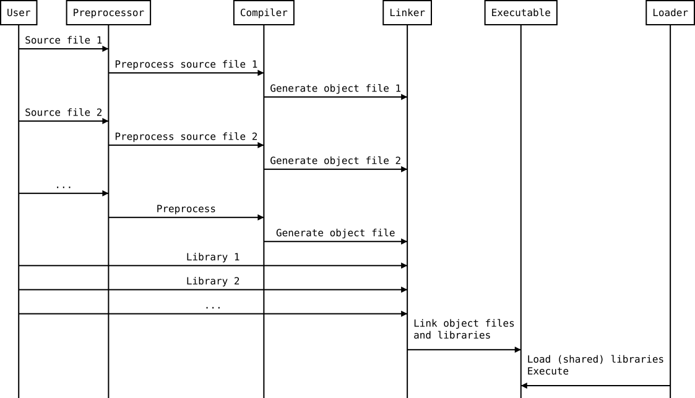

<!--
title: Lecture 08
paginate: true

_class: titlepage
-->

# Lecture 08
<br>

## Libraries: principles, building and use.
<br>

#### Advanced Programming for Computational Science<br>SISSA, UniTS, 2026-2027

###### Pasquale Claudio Africa

###### 24 Nov 2026

---

# Outline

1. Libraries: interfaces and implementations
2. Header-only libraries
3. Static libraries
4. Shared libraries
5. Third-party libraries
6. Hands-on and the next session

**Optional appendix:** weak symbols, loader configuration, plugins and building GSL.

---

<!--
_class: titlepage
-->

# What is a library?

---

# What is a library?

A **library** is reusable code that provides functions and classes for other programs.

- The **C++ Standard Library** provides containers, algorithms and other utilities.
- **Third-party libraries** provide additional tools, such as Eigen for linear algebra and GSL for numerical methods.

The public interface tells us what we can call. The implementation performs the work.

---

# Why are libraries useful?

- **Reuse:** solve a problem once and use the code in several projects.
- **Modularity:** separate a numerical method from the application using it.
- **Abstraction:** call a documented interface without studying every implementation detail.
- **Collaboration:** share improvements and tests with other users.
- **Performance:** use implementations designed and tested for demanding workloads.

Check that a library's accuracy, behavior and license fit your application.

---

# Components of a C++ library

- **Headers** declare the public interface. Templates and `inline` functions can also have their definitions there.
- **Compiled libraries** contain object code, packaged as static or shared libraries.

| Library type | Needed to compile/link the application | Needed to run it                    |
|--------------|----------------------------------------|-------------------------------------|
| Header-only  | Headers                                | Code is already in the executable   |
| Static       | Headers and archive                    | Archive is no longer needed         |
| Shared       | Headers and shared library             | Shared library and its dependencies |

The executable may have other runtime dependencies, regardless of how one library was linked.

---

<!--
_class: titlepage
-->

# Types of library

---

# The build process



---

# Header-only libraries

The implementation is available through the headers, commonly using templates and `inline` functions. Recall the template organization patterns from Lecture 05.

For example, [Eigen](https://libeigen.gitlab.io/) provides matrices, vectors and numerical solvers.

Use **`-I`** to add the directory containing the library's headers:

```bash
c++ -I/path/to/library/include ...
```

No separate binary library is linked for a pure header-only library. The application still needs to be compiled.

---

# Header-only libraries: Eigen

From `lectures/08/examples`, download and extract Eigen into a user directory:

```bash
wget https://gitlab.com/libeigen/eigen/-/archive/5.0.1/eigen-5.0.1.tar.gz
mkdir -p "$HOME/Desktop"
tar xzf eigen-5.0.1.tar.gz -C "$HOME/Desktop"

c++ -std=c++17 -Wall -Wextra -Wpedantic \
    -I"$HOME/Desktop/eigen-5.0.1" example_eigen.cpp -o main_eigen
./main_eigen
```

[The supplied example](examples/example_eigen.cpp) prints the matrix $\begin{pmatrix}3 & -1\\2.5 & 1.5\end{pmatrix}$.

The following examples use libraries with separately compiled implementations.

---

# Static vs. shared libraries

|                   | Static library                                     | Shared library                                 |
|-------------------|----------------------------------------------------|------------------------------------------------|
| Typical file      | `libname.a`                                        | `libname.so`                                   |
| At link time      | Needed object files are copied into the executable | A dependency on the shared library is recorded |
| At runtime        | The archive is no longer needed                    | The loader must find the library               |
| Compatible update | Relink the application                             | Replace the library used at the next launch    |

On Windows the common extensions are `.lib` and `.dll`; macOS uses `.dylib` for shared libraries.

Linking one archive does not make all other dependencies static.

---

# Static vs. shared: a practical example

Suppose an application uses a math library. These sizes are **illustrative**, not measured results:

|                         | Static link            | Shared link                |
|-------------------------|------------------------|----------------------------|
| Executable              | 2.5 MB                 | 50 KB                      |
| Math library at runtime | Code in the executable | `libmath.so`, 2.0 MB       |
| Compatible update       | Relink                 | Replace the shared library |

Exact sizes depend on the code and build options. Processes can share library code; ordinary writable data belongs to each process.

We will discuss binary compatibility before updating a shared library.

---

# A guided example

Use [main.cpp](examples/example_math/main.cpp), [math.hpp](examples/example_math/math/math.hpp) and [math.cpp](examples/example_math/math/math.cpp). Run the following build commands from `examples/example_math`.

```text
main.cpp
math/
    math.hpp
    math.cpp
```

`math.hpp` declares `add` and `multiply`; `math.cpp` defines them. The application calls both:

```cpp
#include "math.hpp"
#include <iostream>

int main() {
    std::cout << "Addition result: " << add(5, 3) << "\n";
    std::cout << "Multiplication result: " << multiply(4, 6) << "\n";
}
```

---

# Compile first, then resolve references

```bash
c++ -std=c++17 -Wall -Wextra -Wpedantic -Imath -c main.cpp -o main.o
nm -C main.o
```

The output includes these symbols (addresses may vary):

```text
0000000000000000 T main
                 U add(int, int)
                 U multiply(int, int)
```

**`T`** marks a function defined in the code section; **`U`** marks an undefined reference. `-C` prints readable C++ names.

```bash
c++ main.o -o main
```

This link fails with **undefined references to `add` and `multiply`**: a declaration allowed compilation, but the linker still needs the definition.

---

# Link an implementation object

Compile the library source, then link the two object files:

```bash
c++ -std=c++17 -Wall -Wextra -Wpedantic \
    -c math/math.cpp -o math/math.o

c++ main.o math/math.o -o main_object
./main_object
```

The application prints:

```text
Addition result: 8
Multiplication result: 24
```

`nm -C main_object` now lists definitions for `main`, `add(int, int)` and `multiply(int, int)`.

The same `main.o` can later be linked against an archive or a shared library.

---

# Why distribute a compiled library?

1. A library can contain many source and object files.
2. Compiling it takes time; applications can reuse the compiled result.
3. A provider may distribute headers and binaries without distributing source.
4. Dependencies can themselves be libraries.

A library file packages the implementation so applications do not have to list every object file.

When the implementation changes, rebuild the library. A statically linked application must then be relinked; a shared-library update depends on binary compatibility.

---

<!--
_class: titlepage
-->

# Static libraries: build and use

---

# How to build a static library

An archive collects object files. From `examples/example_math`:

```bash
c++ -std=c++17 -Wall -Wextra -Wpedantic \
    -c math/math.cpp -o math/math.o
ar rcs math/libmath.a math/math.o

c++ main.o math/libmath.a -o main_static
./main_static
```

- `r` inserts or replaces archive members; `c` creates the archive without a warning.
- `s` creates a symbol index for the linker.
- The linker extracts the object files needed to resolve references.

After linking, `main_static` no longer needs `libmath.a`. Other shared dependencies may remain: inspect them with `ldd main_static`.

---

# Inspecting and extending an archive

```bash
ar -t math/libmath.a
nm -C math/libmath.a
```

The first command lists archive members; the second includes `T` definitions for `add(int, int)` and `multiply(int, int)`.

For a library with several source files, the general pattern is:

```bash
c++ -std=c++17 -Wall -Wextra -Wpedantic -c a.cpp b.cpp c.cpp d.cpp
ar rcs libxx.a a.o b.o c.o
ar rs libxx.a d.o # Add one more object file.
```

`nm` also reports data and weak symbols; these details are in the appendix.

---

# Finding headers and libraries

| Option    | Used for                             |
|-----------|--------------------------------------|
| `-I<dir>` | Finding headers during preprocessing |
| `-L<dir>` | Finding library files during linking |
| `-lname`  | Requesting a library named `libname` |

```bash
c++ main.o -Lmath -lmath -o main
```

Within each searched directory, a suitable shared library normally takes precedence over an archive. Directory order also matters.

To select this archive explicitly, use `math/libmath.a` as above. `-static` instead requests static linking for the executable's libraries as a whole.

---

# Order matters for archives

Place each library **after** the object files or libraries that use it:

```bash
c++ myprogram.o -llibrary1 -llibrary2 -o myprogram
```

If `myprogram` calls library 1, and library 1 calls library 2:

1. `myprogram.o` introduces references to library 1.
2. Library 1 provides definitions and introduces references to library 2.
3. Library 2 provides the remaining definitions.

An archive is searched when encountered. Putting it before the references it should satisfy can leave those references unresolved.

---

# Pros and cons of static libraries

**Advantages**

- No need to install that archive alongside the finished executable.
- The executable keeps the linked implementation until it is rebuilt or relinked.

**Costs**

- Each executable contains the library code it needs.
- Library fixes require relinking the application.
- A compiled-in implementation cannot be selected later by loading a different library.

Runtime selection through plugins is an optional topic in the appendix.

---

<!--
_class: titlepage
-->

# Shared libraries

---

# Linker and loader have different jobs

- The **linker** checks references and records which shared libraries the program needs.
- The **loader** finds and maps those libraries when the program starts.
- References into shared libraries are resolved at runtime; some function lookups may be deferred until the first call.

The library's code is not copied into the executable as it is with an archive.

**A successful link does not guarantee that the loader will find the library.** We will reproduce this with `math`.

---

# Compatibility when updating a library

- **API** (Application Programming Interface): declarations and behavior used by source code.
- **ABI** (Application Binary Interface): interface used by compiled code, including function calls and object layout.

Consider changing a function's parameter types:

- Original: `int multiply(int, int);`
- Changed: `int multiply(long, long);`

The caller's source still compiles: its `int` arguments convert to `long`.
The old executable still requests `multiply(int, int)`, which the changed library no longer defines: rebuild the application.

See [Semantic Versioning](https://semver.org/) for API versioning.

---

# Three names for a shared library

| Name      | Example           | Purpose                                    |
|-----------|-------------------|--------------------------------------------|
| Link name | `libmath.so`     | Found by `-lmath` during linking          |
| SONAME    | `libmath.so.1`   | Dependency name recorded in the executable |
| Real file | `libmath.so.1.0` | File containing the implementation         |

A common arrangement is:

```text
libmath.so -> libmath.so.1 -> libmath.so.1.0
```

The SONAME identifies a binary-compatibility series. Its number is chosen by the library developer; it need not match the package's release number.

---

# How to build a shared library

From `examples/example_math`, compile position-independent code and create the library:

```bash
c++ -std=c++17 -Wall -Wextra -Wpedantic -fPIC \
    -c math/math.cpp -o math/math.pic.o

c++ -shared math/math.pic.o \
    -Wl,-soname,libmath.so.1 -o math/libmath.so.1.0

ln -s libmath.so.1.0 math/libmath.so.1
ln -s libmath.so.1 math/libmath.so
```

**PIC** means Position-Independent Code: suitable for mapping a shared library at different addresses. `-shared` creates the shared library; `-Wl,` passes the SONAME option to the linker.

The symbolic links above are created once; an update is shown shortly.

---

# Linking succeeds; launching can fail

Both library types now exist. `-lmath` selects the shared one here:

```bash
c++ main.o -Lmath -lmath -o main_shared
objdump -p main_shared | grep NEEDED
```

The dependencies include `libmath.so.1`, the SONAME stored in the library. Inspect it directly with:

```bash
objdump -p math/libmath.so.1.0 | grep SONAME
./main_shared
```

The launch fails with **`libmath.so.1: cannot open shared object file`** if the loader cannot find it. **`-L` only configured the linker.**

---

# Directing the loader

For one launch, give the loader an explicit directory:

```bash
LD_LIBRARY_PATH="$PWD/math" ./main_shared
```

Or relink with a search path stored in the executable:

```bash
c++ main.o -Lmath -lmath \
    -Wl,-rpath,'$ORIGIN/math' -o main_shared
./main_shared
```

**`$ORIGIN`** is expanded by the loader to the executable's directory. Single quotes protect it from shell expansion. This works even when launched from another working directory.

An ordinary relative path, such as `math`, instead depends on the working directory.

---

# Runtime and development packages

For our shared-library example, running and building require different files:

| Task | Files needed from `math` |
|------|--------------------------|
| Run the application | `libmath.so.1` and the real library file it points to |
| Compile the application | `math.hpp` |
| Link the application | `libmath.so` and the library file it points to |

A **runtime package** supplies files needed to run applications. A **development package** also supplies headers and files used for linking.

The two library names above lead to the same implementation; they are used at different stages.

---

# Where else does the loader search?

The loader can use environment settings, paths recorded in the executable, a system cache, and standard library directories.

- `LD_LIBRARY_PATH` changes the search for a process; `export` also makes it available to subsequent commands in that shell.
- The linker option `-rpath` records a runtime search path in an executable.
- System installations are commonly managed by the package manager and `ldconfig`.

For local examples, the previous slide's commands are sufficient.

The full search order and system configuration are optional appendix material. [Loader documentation](https://man7.org/linux/man-pages/man8/ld.so.8.html).

---

# Releasing a compatible update

After an ABI-compatible implementation change, rebuild `math` while keeping SONAME `libmath.so.1`:

```bash
c++ -std=c++17 -Wall -Wextra -Wpedantic -fPIC \
    -c math/math.cpp -o math/math.pic.o

c++ -shared math/math.pic.o \
    -Wl,-soname,libmath.so.1 -o math/libmath.so.1.1
ln -sfn libmath.so.1.1 math/libmath.so.1

readlink math/libmath.so.1
./main_shared
```

The link now points to `libmath.so.1.1`. The unchanged executable uses it at its next launch. The unversioned link still points to `libmath.so.1`.

---

# Library versions in action

For an installed numerical application:

```bash
ldd /usr/bin/octave-cli | grep fftw3.so
```

Illustrative output (paths depend on the installation):

```text
libfftw3.so.3 => /lib/x86_64-linux-gnu/libfftw3.so.3 (...)
```

Inspect the actual link:

```bash
ls -l /lib/x86_64-linux-gnu/libfftw3.so.3
```

A real file such as `libfftw3.so.3.6.10` belongs to the `libfftw3.so.3` compatibility series. Its suffix is not the FFTW package release number.

---

# Libraries can depend on other libraries

```bash
ldd /usr/lib/x86_64-linux-gnu/libumfpack.so
objdump -p /usr/lib/x86_64-linux-gnu/libumfpack.so | grep SONAME
```

Depending on the installation, these show a dependency on `libblas.so.3` and an UMFPACK SONAME such as `libumfpack.so.6`.

- The loader also needs the shared library's dependencies.
- `.so.3` identifies the BLAS binary interface, not a general BLAS package release.
- The library developer must preserve the compatibility promised by a SONAME.

Changing a symlink selects a different file; it does not make incompatible binaries compatible.

---

# Pros and cons of shared libraries

**Advantages**

- A compatible update can serve existing executables at the next launch.
- Executables refer to shared code rather than containing a separate copy of it.
- Applications can also load libraries explicitly for plugins (appendix).

**Costs**

- The runtime must provide the required libraries and their dependencies.
- Linking and loading use different search paths.
- Updates require attention to binary compatibility.

Use `ldd main_shared` to inspect the dependencies selected in the current environment.

---

# Common issues and troubleshooting

| Message                          | What to check                                           |
|----------------------------------|---------------------------------------------------------|
| `cannot find -l...`              | Library filename and the linker's `-L` directories      |
| `undefined reference to...`      | Definition, signature, library choice and archive order |
| `cannot open shared object file` | Loader search path and runtime dependencies             |
| Missing symbols after an update  | Whether the selected library is binary-compatible       |

```bash
nm -D -C math/libmath.so.1.0
objdump -p main_shared | grep NEEDED
ldd main_shared
```

For shared-library symbols, `-D` selects the dynamic symbol table; `T` marks a code definition and `U` an external reference.

---

# Three searches to keep separate

| Stage         | Looking for                             | Main options in our examples              |
|---------------|-----------------------------------------|-------------------------------------------|
| Preprocessing | Header files                            | `-I`                                      |
| Linking       | Definitions in objects and libraries    | Object paths, `-L`, `-l`                  |
| Loading       | Shared libraries and their dependencies | `LD_LIBRARY_PATH`, recorded runtime paths |

- Static linking copies needed archive members into the executable.
- Shared linking records a dependency name, normally the SONAME.
- Updating a shared library without relinking requires binary compatibility.

---

<!--
_class: titlepage
-->

# Using and developing libraries

---

# Library development: best practices

1. **Interfaces:** document the API and binary-compatibility expectations.
2. **Versioning:** use a clear release scheme, such as [SemVer](https://semver.org/).
3. **Documentation:** provide short examples and build instructions.
4. **Testing:** test numerical results, failures and supported platforms.
5. **Installation:** provide headers, libraries and integration files (`pkg-config` or CMake).
6. **Licensing:** specify the license, for example [GPL](https://www.gnu.org/licenses/gpl-3.0.en.html), [LGPL](https://www.gnu.org/licenses/lgpl-3.0.en.html) or [MIT](https://opensource.org/license/mit).

An application should be able to identify which library installation it is using.

---

# GSL: use a numerical library

[examples/example_gsl/example_gsl.cpp](examples/example_gsl/example_gsl.cpp) approximates:

$$
\int_0^\pi \sin(x)\,dx = 2.
$$

- A callback supplies the integrand to GSL.
- A workspace holds temporary data used by the integration routine.
- The program checks the returned status, releases the workspace and reports the result and estimated error.

Typical output:

```text
Result: 2
Estimated error: 2.22045e-14
```

The error is an estimate and can vary across platforms. Optional: [build GSL locally](examples/example_gsl/README.md).

---

# The `pkg-config` tool

A library's **`.pc` file** describes its compilation and linking flags. From `examples/example_gsl`, using an installed GSL:

```bash
pkg-config --cflags gsl
pkg-config --libs gsl

c++ -std=c++17 -Wall -Wextra -Wpedantic example_gsl.cpp \
    $(pkg-config --cflags --libs gsl) -o main_gsl
./main_gsl
```

The shell replaces `$(pkg-config ...)` with the flags printed by that command, normally including `-lgsl -lgslcblas -lm`.

`pkg-config` supplies build flags. The loader still needs to find the selected shared libraries. See the [GSL instructions](examples/example_gsl/README.md) for a local installation.

---

# Hands-on: use the same library in two ways

Return to `examples/example_math` and use the files from the guided example.

1. Build the archive and link **`main_static`**, naming the archive explicitly.
2. Build the shared library and link **`main_shared`** with a suitable runtime path.
3. Run both programs and compare their output, file sizes and `ldd` results.
4. Update the compatible shared-library link to version 1.1; run the same executable again.

**Checks:** both programs print the same results, 8 and 24; the static executable does not need `libmath.a` at runtime; the shared executable needs the library named by its SONAME.

The file-size comparison is an observation about these builds, not a universal size ratio.

---

# Useful resources

- [Eigen](https://libeigen.gitlab.io/) and [GSL](https://www.gnu.org/software/gsl/)
- [GCC linking options](https://gcc.gnu.org/onlinedocs/gcc/Link-Options.html)
- [GNU Binutils](https://sourceware.org/binutils/docs/binutils/)
- [Popular C++ repositories](https://github.com/search?q=stars%3A%3E500+language%3AC%2B%2B&type=repositories)
- [awesome-cpp](https://github.com/fffaraz/awesome-cpp)
- [awesome-python](https://github.com/vinta/awesome-python)
- [awesome-scientific-python](https://github.com/rossant/awesome-scientific-python)
- [awesome-scientific-computing](https://github.com/nschloe/awesome-scientific-computing)

---

<!--
_class: titlepage
-->

# Appendix<br>Optional details

---

# More symbol types and `inline`

[GNU `nm`](https://sourceware.org/binutils/docs/binutils/nm.html) also reports:

- `D` / `G`: initialized data; `G` refers to small-data sections on some platforms.
- `W` / `V`: weak definitions; `V` is used for weak objects.

The linker can replace a weak definition with an ordinary, non-weak definition of the same symbol. C++ definitions must still obey the One Definition Rule from Lecture 02.

The C++ keyword `inline` does not guarantee that the compiler replaces a function call with the function's body.

The compiler may keep a separate function implementation. Therefore, an `inline` function can still appear in the output of `nm`.

---

# Without a SONAME

A library can be built without setting a SONAME:

```bash
c++ -shared math/math.pic.o -o math/libplain.so
```

When linking against it:

- `-Lmath -lplain` normally records `libplain.so`.
- An explicit path can be recorded as that path in the executable.
- A recorded dependency containing `/` is interpreted as a path by the loader.

For a simple unversioned library, the link name, SONAME and real filename can also all be `libplain.so`. Setting a SONAME explicitly makes the intended dependency name clear.

---

# System loader configuration

`ldconfig` maintains links and the system library cache. It scans configured directories, including those listed in `/etc/ld.so.conf`, and trusted system locations.

- Updating system configuration/cache normally requires administrator access.
- A directory added to the system configuration can be indexed with `ldconfig`.
- **`ldconfig -n directory`** processes only that directory and updates links; it does **not** rebuild the cache.
- Package managers normally maintain their installed libraries and cache entries.

The [loader manual](https://man7.org/linux/man-pages/man8/ld.so.8.html) describes the exact search order, including differences between older `RPATH` and newer `RUNPATH` entries. The [ldconfig manual](https://man7.org/linux/man-pages/man8/ldconfig.8.html) documents its options.

---

# Dynamic loading and plugins

With ordinary shared linking, the executable records its dependencies and the loader maps them at startup. Some function-symbol lookups may happen later.

A plugin application instead chooses a library explicitly during execution:

| Function from `<dlfcn.h>` | Role                               |
|---------------------------|------------------------------------|
| `dlopen`                  | Open a library and obtain a handle |
| `dlsym`                   | Look up a symbol's address         |
| `dlclose`                 | Release the handle                 |

This requires a documented interface between the application and plugin.

Further example: [C++ dynamic loading](https://blog.theopnv.com/posts/cpp-dynamic-loading/) and its [source code](https://github.com/theo-pnv/Dynamic-Loading).

---

# A local GSL installation

Follow the [GSL example instructions](examples/example_gsl/README.md) to build into `$HOME/.local/gsl`. This does not require a system-wide installation.

To select that installation's metadata:

```bash
export PKG_CONFIG_PATH="$HOME/.local/gsl/lib/pkgconfig"
pkg-config --cflags --libs gsl
```

`PKG_CONFIG_PATH` locates `.pc` files; **`LD_LIBRARY_PATH` locates shared libraries at runtime**. Set them separately for a user installation:

```bash
LD_LIBRARY_PATH="$HOME/.local/gsl/lib" ./main_gsl_shared
```

The example instructions also show explicit archive linking and a stored runtime search path.

---

<!--
_class: titlepage
-->

# Next session: automate the build with CMake

We have compiled sources, created libraries and linked applications manually.

CMake describes targets (libraries and executables) and their dependencies, then generates the build commands.
