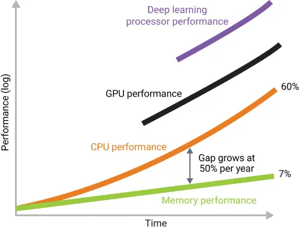
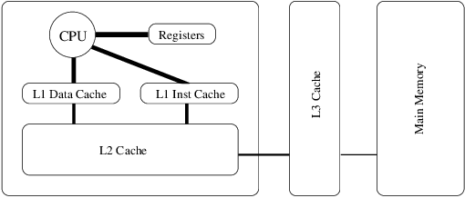
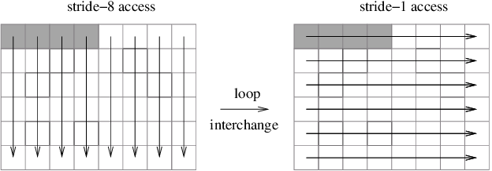
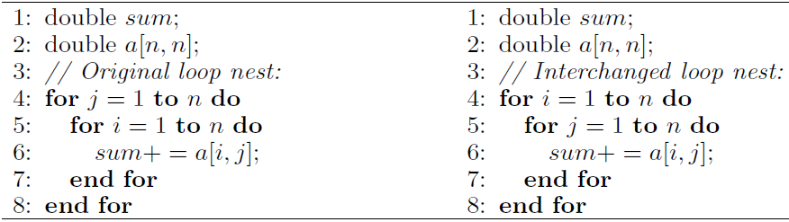
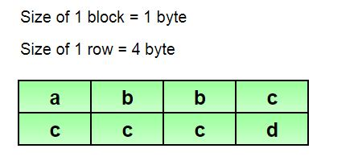
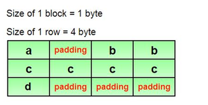

<!--
title: Lecture 09
paginate: true

_class: titlepage
-->

# Lecture 09
<br>

## Optimization, debugging, profiling, testing.
<br>

#### Advanced Programming for Computational Science<br>SISSA, UniTS, 2026-2027

###### Pasquale Claudio Africa

###### 01 Dec 2026

---

# Outline

1. Optimization: compiler options and memory access
2. Debugging: inspect program state and resource ownership
3. Profiling: locate expensive parts of the computation
4. Testing: check numerical results and detect regressions

Apply the workflow in [Exercise session 08](../../exercises/08/08-c++_optimization_debugging_testing.md).

**Appendix:** detailed optimization examples, additional tools, TDD, CI and coverage commands.

---

# The *Three versions* principle - Joe Armstrong

> **Every non-trivial program needs to be written three times.**
> First make it work, then make it beautiful, then if you really, really have to, make it fast.

1. **Make it work**
   - Focus on correctness and understanding the problem, no optimization
   - Implement straightforward, readable solutions
2. **Make it right and beautiful**
   - Refactor for clarity and maintainability, write tests to ensure correctness
   - Fix bugs, add proper error handling
3. **Make it fast**
   - Profile to find actual bottlenecks
   - Apply optimizations where needed, maintaining correctness through testing

**Premature optimization wastes time on code that may be rewritten anyway!**

---

<!--
_class: titlepage
-->

# Optimization

---

# Code optimization

Improve execution time or resource use while preserving the required results.

- **Algorithms and data structures:** reduce the amount of work or storage.
- **Compiler optimizations:** let the compiler simplify expressions, reuse registers and remove redundant work.
- **Memory access:** traverse data in an order suited to its storage layout.
- **Hardware features:** caches, branch prediction and SIMD (one instruction operating on several values).

Start from a correct, readable implementation. Profile it, change one relevant part, then check the results and measure again.

---

# Optimization and debugging options

| Option | Purpose |
|--------|---------|
| `-O0` | Disable most optimizations; straightforward source-level debugging |
| `-Og` | Optimize while retaining useful debugging information |
| `-O2`, `-O3` | Enable different sets of performance optimizations |
| `-Os` | Optimize for code size |

`-g` adds debug information independently of the optimization level. Use `-g -O0` or `-g -Og` for development; `-O2 -g` is useful for profiling.

`-DNDEBUG` disables `assert`, including evaluation of its expression.
`-Ofast` enables transformations that can change floating-point results.

More optimization does not always mean faster execution. [GCC options](https://gcc.gnu.org/onlinedocs/gcc/Optimize-Options.html).

---

# Processor and memory performance



A schematic illustration of the processor–memory performance gap. The percentages are illustrative historical trends, not measurements of current hardware.

[Source: original illustration](https://medium.com/@abruyns/memory-holds-the-keys-to-ai-adoption-5acd5e06508b)

---

# Memory hierarchy



Registers and caches hold smaller amounts of data close to the CPU. Main memory offers more storage, with greater access cost.

Access patterns influence how effectively a numerical kernel uses this hierarchy.

---

# Cache friendliness

Many CPUs use 64-byte cache lines: eight `double` values if `sizeof(double) == 8`. Sequential access can reuse loaded lines and help hardware prefetching.

For a **row-major** `mat`, compare two alternative traversals, starting `sum` at zero for each:

```cpp
for (std::size_t j = 0; j < n_cols; ++j)
  for (std::size_t i = 0; i < n_rows; ++i)
    sum += mat(i, j);

for (std::size_t i = 0; i < n_rows; ++i)
  for (std::size_t j = 0; j < n_cols; ++j)
    sum += mat(i, j);
```

The second traversal follows contiguous entries. Measure the difference for your matrix sizes; reordering floating-point additions can also change rounding.

Exercise 08 uses **column-major** storage, so contiguous traversal follows the other index.

---

# Loop interchange for row-major storage

A **stride** is the element spacing between accesses; the lower image uses pseudocode.






---

# Data structure alignment and padding

```cpp
class MyClass {
  char a;
  short int b;
  int c;
  char d;
};
```

2-byte `short`; 4-byte `int` aligned to 4 bytes. Packed left, padded right.

 

`sizeof` includes padding; `alignof` gives the required alignment. [Compare two member orders](examples/optimization/data_alignment.cpp) without allocating large vectors.

---

# Measure, optimize, verify

- **Premature optimization:** profile before spending effort on small code changes. Prefer algorithmic improvements when they reduce the dominant work.
- **Readability:** keep a clear baseline for comparison; a manual transformation may duplicate work already done by the compiler.
- **Measurement:** use the same inputs, repeat the experiment and report compiler options and hardware.
- **Correctness:** compare results after each change, including relevant numerical tolerances.

“Premature optimization is the root of all evil” — Donald Knuth.

Detailed unrolling and persistent-data benchmarks are in the appendix.

---

<!--
_class: titlepage
-->

# Debugging

---

# Static analysis and debugging

| Approach | How it examines the program |
|----------|-----------------------------|
| Static analysis | Inspects source code without executing it |
| Live debugging | Runs the program and pauses to inspect state |
| Post-mortem debugging | Examines a saved core dump after a failure |

Compiler warnings and tools such as `cppcheck` or `clang-tidy` can identify suspicious code. GDB and LLDB inspect execution state.

Use these techniques together: a warning can suggest a hypothesis, and a debugger can show how the relevant state changes.

---

# Build for debugging

From `examples/debug`, build the supplied program with symbols:

```bash
c++ -std=c++17 -Wall -Wextra -Wpedantic \
    -g -O0 student2.cpp -o student2

gdb ./student2
```

- `-g` records source locations and variable information.
- `-O0` keeps the execution closer to the source structure.
- `-Og` is another development option; optimized builds can still be debugged, but variables and statements may be transformed.

A normal process exit does not establish numerical correctness. Check results as well as crashes.

---

# Main GDB commands

| Command | Action |
|---------|--------|
| `run` / `continue` | Start / resume execution |
| `break function` | Pause when the function is reached |
| `print expression` / `list` | Inspect a value / show source |
| `next` | Execute the current source line, stepping over calls |
| `step` | Enter a call with available source |
| `backtrace` | Show the chain of active calls |
| `finish` / `quit` | Run until the function returns / leave GDB |

`where` is an alias for `backtrace`; `list` shows source and `help` explains commands. [Worked tutorial](examples/debug/README.md).

---

# Follow a failure with GDB

In the `student2` session:

```text
(gdb) run
(gdb) backtrace
```

The supplied program sets an owning `Name*` to `nullptr`, then uses it in `get_name()`.

- Find the frames belonging to `Name`, `Student` and `main`.
- Use `frame N` to select a frame from your backtrace and inspect `this` and its members.
- Set a breakpoint in `Student::Student`, restart, and follow how `name` changes.

Frame numbers and addresses depend on the build. The tutorial explains the same process; Exercise 08 applies it to a linked list.

---

# Check memory use with Memcheck

From `examples/debug`, after building the executable:

```bash
valgrind --tool=memcheck --leak-check=full \
    --track-origins=yes ./student2
```

Memcheck can report invalid accesses, uses of uninitialized values and memory that was not released.

The `student2` example loses the pointer returned by `new Name(...)`. Follow the allocation and the assignment that loses it; adding a destructor alone cannot recover a lost pointer.

Re-run the debugger and Memcheck after each fix. Heap-usage profiling with Massif is optional appendix material.

---

# A scientific debugging workflow

1. Reproduce the unexpected result or failure.
2. Reduce it to a small input and isolate the relevant code.
3. State a hypothesis about the cause.
4. Inspect values or add a focused check to test the hypothesis.
5. Fix the cause and re-run the relevant tests.

Print statements, assertions and debugger breakpoints answer different questions. Version control helps inspect and undo experiments; `git bisect` can locate a change associated with a regression.

Check development and optimized builds. Undefined behavior can produce different symptoms under different compiler settings.

---

<!--
_class: titlepage
-->

# Profiling

---

# What does a profiler measure?

A **hot spot** is a part of the program responsible for a large share of the measured cost.

Different tools measure different quantities:

- **Time sampling:** estimates where execution time is spent.
- **Instrumented event counts:** counts instructions or simulated cache events.
- **Memory profiling:** records allocations or heap usage over time.

Call graphs relate costs to functions and their callers. Choose the metric that answers your question; an instruction count is not elapsed time.

---

# A small Callgrind experiment

From a completed `exercises/08/hints/ex3` project (or `solutions/ex3` on branch `sol`), build with optimization, symbols and a small dataset:

```bash
cmake -S . -B build-profile -DCMAKE_CXX_COMPILER=c++ -DMATRIX_SIZE=20
cmake --build build-profile
valgrind --tool=callgrind --dump-line=yes \
    --callgrind-out-file=callgrind.out ./build-profile/ex3
callgrind_annotate --auto=yes callgrind.out
```

The default event `Ir` counts executed instruction reads. Add `--cache-sim=yes` to request simulated cache events.

The report is text. `kcachegrind callgrind.out` optionally provides a graphical view. Compare costs of the two matrix products, not the wall time printed while running under Valgrind.

---

# Profiling best practices

- Profile a correct program on a representative workload.
- Use optimization and symbols, for example `-O2 -g`.
- Focus on components with substantial measured cost.
- Keep inputs and compiler options comparable between versions.
- Re-run correctness checks and measurements after changing the code.

Native elapsed-time measurements, instruction counts and cache simulations complement one another. Record which quantity you measured.

The appendix introduces `gprof`, additional tools and their limitations.

---

<!--
_class: titlepage
-->

# Testing

---

# Verification and validation

- **Verification:** does the implementation correctly solve the mathematical model? Compare with analytical solutions, known results and expected convergence behavior.
- **Validation:** is the model an adequate representation of the real phenomenon for its intended use? Compare predictions with suitable experimental measurements.

For a heat-transfer simulation, an analytical temperature solution can help verify the numerical implementation. Measured temperatures help assess the physical model.

Both activities can occur throughout development. Unit tests are one tool within verification.

[Source: NASA verification and validation glossary](https://www.grc.nasa.gov/www/wind/valid/tutorial/glossary.html).

---

# Types of testing

- **Unit:** check one function, method or class.
- **Integration:** check interactions between components.
- **Regression:** re-run checks to detect unintended changes.
- **Numerical accuracy:** compare with analytical or trusted reference results.
- **Performance:** check workload-specific performance requirements.
- **Stress:** exercise large workloads or resource pressure.

Tests detect errors covered by their checks and document expected behavior. A passing suite is evidence about the cases tested; inspect what the tests actually verify.

---

# Unit tests with GoogleTest

Using the `Statistics` class from Exercise 08:

```cpp
#include "statistics.hpp"
#include <gtest/gtest.h>
#include <vector>

TEST(StatisticsTest, MeanTwoSamples) {
  const std::vector<double> data{1.0, 3.0};
  EXPECT_DOUBLE_EQ(Statistics::mean(data), 2.0);
}
```

`TEST(Suite, Name)` declares a test. An `EXPECT_...` assertion records whether a check succeeds.

GoogleTest supplies assertions and a runner (`GTest::gtest_main` supplies `main`). CTest launches the tests discovered by CMake. [Catch2](https://github.com/catchorg/Catch2) is another assertion/test framework.

---

# Testing numerical results

Within a GoogleTest case, using `<cmath>` for `std::abs`:

```cpp
const std::vector<double> data{0.1, 0.2};
const double result = Statistics::mean(data);
const double expected = 0.15;

EXPECT_NEAR(result, expected, 1e-12);

// Relative error: this reference is nonzero.
EXPECT_LT(std::abs(result - expected) / std::abs(expected), 1e-10);
```

`EXPECT_NEAR` uses an absolute tolerance; relative error requires a nonzero reference. For a zero reference, use an absolute check.

Choose tolerances from the numerical requirements. Exact checks are appropriate for exactly specified values; `EXPECT_DOUBLE_EQ` instead uses GoogleTest's floating-point comparison.

---

# Test-driven development

TDD develops behavior through a short cycle:

1. Write a test describing the required behavior.
2. Start from a declared function with a minimal stub and observe the failed check.
3. Implement the behavior and run the test again.
4. Refactor while keeping the test passing.

Thinking about how the function will be called can help design its interface. Test coverage still depends on the cases selected.

The appendix shows a complete small dot-product implementation and a refactoring. A change of implementation still needs measurement before claiming a performance gain.

---

# What coverage tells us

Coverage records which lines or branches were executed by a run or a test suite.

- A visited line may have been checked thoroughly, weakly, or not checked at all.
- Use uncovered branches to look for missing cases, such as empty input or failed operations.
- Select coverage goals according to requirements and risk; a universal percentage is not a correctness criterion.

Combine coverage with tests that verify the result and relevant failure behavior.

The optional matrix exercise and appendix show how to generate `gcov` and HTML reports.

---

# Apply the workflow

1. Build a clear baseline and check its results.
2. Reproduce failures and inspect the state that causes them.
3. Measure or profile the relevant workload.
4. Change the code, then re-check correctness and performance.

In **Exercise 08**, work first on debugging the list, then on tests for numerical statistics.

The matrix optimization exercise is an optional extension. It compares two correct implementations and includes profiling and coverage instructions.

---

<!--
_class: titlepage
-->

# Appendix<br>Optional details

---

# Optimization examples

From `examples/optimization`, build the supplied programs with `-O3`:

```bash
cmake -S . -B build -DCMAKE_CXX_COMPILER=c++
cmake --build build
```

Executables are placed in `build/`:

- `data_alignment`: reports size, alignment and estimated element storage for two member orders.
- `loop_unrolling`: compares sequential and order-preserving unrolled products; also demonstrates regrouped multiplication.
- `static`: compares rebuilding a lookup dataset with reusing an initialized static dataset.

The programs use their results and report measurements for the current build. Timings depend on workload, compiler options and hardware.

---

# Loop unrolling

Unrolling repeats the loop body to reduce loop-control work. For separate arrays `a`, `b` and `c`:

```cpp
for (int i = 0; i < n; ++i)
  for (int k = 0; k < 3; ++k)
    a[k] += b[k] * c[i];
```

The inner loop can be written explicitly:

```cpp
for (int i = 0; i < n; ++i) {
  a[0] += b[0] * c[i];
  a[1] += b[1] * c[i];
  a[2] += b[2] * c[i];
}
```

A compiler may unroll automatically. Larger code can also increase instruction-cache pressure: compare measurements.

---

# Multiply vector entries (1/2)

Using `<vector>`, start from a sequential product:

```cpp
double multiply(const std::vector<double>& data) {
  double result = 1.0;
  for (const auto value : data) result *= value;
  return result;
}
```

The empty product is `1.0`. Each iteration depends on the preceding result.

The next slide unrolls four iterations while retaining their multiplication order. The complete program is [loop_unrolling.cpp](examples/optimization/loop_unrolling.cpp).

---

# Multiply vector entries (2/2)

Using `<vector>` and `<cstddef>`:

```cpp
double multiply_with_unrolling(const std::vector<double>& data) {
  double result = 1.0;
  std::size_t i = 0;
  for (; data.size() - i >= 4; i += 4) {
    result *= data[i];
    result *= data[i + 1];
    result *= data[i + 2];
    result *= data[i + 3];
  }
  for (; i < data.size(); ++i) result *= data[i];
  return result;
}
```

The final loop handles fewer than four remaining elements. Measure both versions with the same data and compiler flags; no fixed speedup follows from this transformation.

---

# Grouping products changes numerical behavior

The file also supplies `multiply_grouped`, whose unrolled body uses:

```cpp
result *= data[i] * data[i + 1] * data[i + 2] * data[i + 3];
```

The four-value product is evaluated before multiplying the running result. This changes floating-point grouping.

With the program's finite, order-sensitive input, the sequential version produces approximately `1`, while the grouped version overflows to infinity on the tested IEEE-style platform.

Equal operation counts do not imply equal numerical results or equal execution time. The local optimized assembly uses scalar multiplies; SIMD execution cannot be inferred just from unrolling.

---

# Reuse a value within the loop

For non-overlapping arrays, this kernel can load `c[i]` once per iteration:

```cpp
for (int i = 0; i < n; ++i) {
  const auto x = c[i];
  a[0] += b[0] * x;
  a[1] += b[1] * x;
  a[2] += b[2] * x;
}
```

This reuses a loaded value; it is not an explicit cache-prefetch operation.

The writes to `a` must not change `c[i]` during the iteration. If the buffers overlap, replacing repeated loads by one load can change the result. The compiler may already perform the transformation when it can establish that it is valid.

---

# Move an invariant condition outside a loop

For separate arrays `a[10000][10]` and `c[10000]`:

```cpp
for (int i = 0; i < 10000; ++i) {
  for (int j = 0; j < 10; ++j) {
    if (c[i] > 0) a[i][j] = 0;
    else a[i][j] = 1;
  }
}
```

The row's condition can be computed once:

```cpp
for (int i = 0; i < 10000; ++i) {
  const int value = (c[i] > 0) ? 0 : 1;
  for (int j = 0; j < 10; ++j)
    a[i][j] = value;
}
```

Compiler transformations and branch prediction affect the benefit. Measure it.

---

# Static analysis tools

- [cppcheck](https://cppcheck.sourceforge.io/): checks suspicious C/C++ code patterns.
- [clang-tidy](https://clang.llvm.org/extra/clang-tidy/): compiler-based analysis and modernization checks.
- [cpplint](https://github.com/cpplint/cpplint): style checks.

Depending on the tool and configuration, checks can report uninitialized values, invalid accesses, unused code, resource-management problems and inappropriate library use.

Warnings may need investigation; the absence of warnings does not establish correctness.

---

# Other useful tools

- [Cling](https://root.cern/cling/) is an interactive C++ interpreter, built on LLVM and Clang. It's part of the ROOT project at CERN and can be integrated into a Jupyter workspace ([see here](https://github.com/jupyter-xeus/xeus-cling/)). While experimental, an interpreter aids in code prototyping.

- [Compiler Explorer](https://godbolt.org/) to check how code translates into assembly language. Useful for understanding optimization effects and assembly code generation.

- [C++ Insights](https://cppinsights.io/) allows viewing source code through a compiler's eyes.

---

# Debug information levels

`-g` selects the normal level of debug information, usually level 2.

| Option | Information |
|--------|-------------|
| `-g0` | No debug information |
| `-g1` | Minimal information, useful for backtraces |
| `-g2` | Normal source and variable information |
| `-g3` | Extra information, including macro definitions |

These levels are independent of `-O0`, `-Og` or `-O2`.
Optimized builds may omit variables, inline functions or rearrange statements. [GCC debugging options](https://gcc.gnu.org/onlinedocs/gcc/Debugging-Options.html).

---

# Additional debugging examples

From `examples/debug` ([tutorial](examples/debug/README.md), [source material](https://github.com/cme212/course/tree/master/notes/lecture-01)), build with `-O0 -g`:

```bash
cmake -S . -B build -DCMAKE_CXX_COMPILER=c++
cmake --build build
```

- `defensive.cpp`: express an intention with const-correctness.
- `print.cpp`, `debug_macro.cpp`: inspect values and macro expansion.
- `assert1.cpp`, `assert2.cpp`: check assumptions and observe `NDEBUG`.
- `pause.cpp`: pause an interactive run with `std::cin.get()`.
- `student1.cpp`, `student2.cpp`: inspect objects, pointers and the call stack.
- `undefined_behaviour.cpp`: compare conversion before addition with integer overflow.

[GDB cheat sheet](https://users.ece.utexas.edu/~adnan/gdb-refcard.pdf), [GDB tutorial](https://gist.github.com/jakelevi1996/6d0add3452eb65bee9210967760a7d30), [LLDB](https://lldb.llvm.org/). Further reading: [defensive programming](https://gjbex.github.io/Defensive_programming_and_debugging/), [undefined behavior](https://mohitmv.github.io/blog/Cpp-Undefined-Behaviour-101/), [an optimization example](https://mohitmv.github.io/blog/Shocking-Undefined-Behaviour-In-Action/).

---

# Heap usage with Massif

From the completed matrix project, after building the small example in `build-profile`:

```bash
valgrind --tool=massif --massif-out-file=massif.out \
    --demangle=yes ./build-profile/ex3
ms_print massif.out > massif.txt
```

Massif records a heap-usage profile. Read `massif.txt` to see how the reported memory usage changes during execution.

This answers a different question from Memcheck's search for invalid accesses and leaks.

---

# GNU gprof

`gprof` combines time sampling with instrumented call information. From `examples/optimization`, compile and link the supplied product benchmark with `-pg`:

```bash
c++ -std=c++17 -O2 -g -pg loop_unrolling.cpp -o product_profile
./product_profile
gprof --demangle ./product_profile gmon.out > profile.txt
```

For separate compilation, pass `-pg` at both compilation and linking. Normal termination writes `gmon.out` in the working directory.

Sampling may collect too few samples for short runs. Instrumentation adds overhead, and multithreaded programs have limitations.

---

# Reading gprof output

- The **flat profile** attributes sampled time to functions.
- The **call graph** relates functions to their callers and callees.
- `--demangle` displays readable C++ names.
- `--graph` requests call-graph output.
- `--display-unused-functions` includes functions with zero recorded use.
- `--annotated-source` requests source annotation where supported; `-I` adds source-search directories.

The historical `--line` option targets older GCC profiling formats. Use `gcov` for current GCC source-line execution coverage, or Callgrind for line-level event counts.

[GNU gprof manual](https://sourceware.org/binutils/docs/gprof/Line_002dby_002dline.html).

---

# Other profiling tools

- [perf](https://perf.wiki.kernel.org/index.php/Main_Page): sampling and hardware performance counters on Linux; access depends on system configuration.
- [gperftools](https://github.com/gperftools/gperftools): CPU and heap profiling tools.
- [TAU](https://www.cs.uoregon.edu/Research/tau/home.php): profiling and tracing for parallel programs.
- [Scalasca](https://www.scalasca.org/): performance analysis of parallel applications.
- [LIKWID](https://github.com/RRZE-HPC/likwid): command-line tools for performance measurements on supported architectures.

Choose by the question, workload and available measurements. Callgrind's simulated events and a native profiler's sampled time are different quantities.

---

# TDD example: a failing test (1/2)

Assume `dot_product` is declared and starts as a stub returning `0.0`.

```cpp
TEST(VectorOps, DotProduct) {
  const std::vector<double> a{1.0, 2.0, 3.0};
  const std::vector<double> b{4.0, 5.0, 6.0};

  EXPECT_DOUBLE_EQ(dot_product(a, b), 32.0);
}
```

The test builds, then fails because the returned result is zero.
The next slide implements the equal-length case; add cases for empty input and mismatched sizes as required by the interface.

---

# TDD example: implement and refactor (2/2)

Using `<vector>`, `<cstddef>` and `<stdexcept>`:

```cpp
double dot_product(const std::vector<double>& a,
                   const std::vector<double>& b) {
  if (a.size() != b.size())
    throw std::invalid_argument("Vector sizes differ");

  double result = 0.0;
  for (std::size_t i = 0; i < a.size(); ++i)
    result += a[i] * b[i];
  return result;
}
```

The test now passes. An optional refactoring uses `std::inner_product` from `<numeric>` after the same size check. Re-run the tests and measure before claiming a performance improvement.

---

# Continuous integration and testing

Continuous integration combines frequent code integration with automated builds and checks.

- Build and test changes consistently.
- Detect failures covered by the checks early.
- Test interactions between components and supported configurations.

Tools include [GitHub Actions](https://github.com/features/actions), [GitLab CI/CD](https://docs.gitlab.com/ci/), [Jenkins](https://www.jenkins.io/) and [Travis CI](https://www.travis-ci.com/).

A successful CI run reports the outcome of its configured checks. Maintain the tests as the software evolves.

---

# Coverage with gcov

From the completed matrix project, configure a separate coverage build:

```bash
cmake -S . -B build-coverage -DCMAKE_CXX_COMPILER=c++ \
    -DENABLE_COVERAGE=ON -DMATRIX_SIZE=20
cmake --build build-coverage
./build-coverage/ex3
gcov --branch-probabilities --function-summaries \
    build-coverage/CMakeFiles/ex3.dir/matrix.cpp.gcno
```

The CMake project passes `--coverage` during compilation and linking, with `-O0 -g` for a direct source mapping.

- Compilation produces `.gcno` files describing the code structure.
- Execution produces `.gcda` files containing counters.
- `gcov` reads them and writes annotated `.gcov` files.

[Source: GCC coverage data files](https://gcc.gnu.org/onlinedocs/gcc/Gcov-Data-Files.html).

---

# HTML coverage with lcov and genhtml

Using the same `build-coverage` directory, this target runs the program, captures counters and generates HTML:

```bash
cmake --build build-coverage --target coverage
```

Its main commands are:

```bash
cd build-coverage
lcov --capture --directory . --exclude "*/include/c++/*" \
    --output-file test_coverage.info
genhtml test_coverage.info --output-directory test_coverage
```

Open `build-coverage/test_coverage/index.html` from the project directory. Inspect which branches and behaviors were checked, not only the percentage. Keep performance measurements in a separate optimized build.

---

<!--
_class: titlepage
-->

# :arrow_right: Introduction to Python. Object-oriented programming in Python. Modules and packages.
