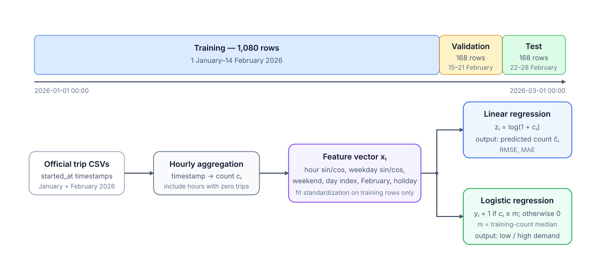

# Project 2 — Bike-sharing demand: regression and classification

## Purpose

Develop a C++ machine-learning program that predicts hourly demand for a public bicycle-sharing service. The same dataset supports regression, which predicts a number, and binary classification, which predicts one of two categories.

No previous knowledge of machine learning, regression, classification, data leakage, third-party C++ libraries, or Python bindings is assumed. The required models and formulas are specified below.

---

## 1. Dataset and prediction problems

### 1.1 Basic terminology

In **supervised learning**, examples are supplied together with their correct answers. A **feature** is a numerical input given to the model, a **target** is the value to predict, and an **observation** is one feature vector paired with one target.

This project uses two tasks:

- regression: predict the number of rides starting during an hour;
- classification: predict whether that hour has low or high demand.

### 1.2 Provided data and official source

The project distribution includes `assets/citibike_hourly_2026_01_02.csv`. Students must use this provided file and are **not** required to download or process the much larger trip archives.

The file was derived from the official [Citi Bike System Data](https://citibikenyc.com/system-data), following the official [NYCBS Data Use Policy](https://citibikenyc.com/data-sharing-policy). Citi Bike states that its trip-history files contain ride start times and that months with more than one million trips may be divided into multiple CSV shards. The provided table aggregates every valid `started_at` value from the non-Jersey-City January and February 2026 files into local New York hours.

The README must cite Citi Bike as the source and state that the hourly file is a course-provided derivative. Reconstructing the file from the raw archives is outside the mandatory project.

### 1.3 Hourly table

The provided CSV contains one row for every local New York hour in

```text
[2026-01-01 00:00:00, 2026-03-01 00:00:00)
```

This interval contains 1,416 hours and no daylight-saving transition. Count every valid trip by its start hour; include hours with zero trips.

The `timestamp` field uses the fixed format `YYYY-MM-DD HH:00:00`. Because this year-month-day format is ordered from the largest time unit to the smallest, ordinary string comparison also gives chronological order.

The columns must be

```text
timestamp,count,hour_sin,hour_cos,dow_sin,dow_cos,
is_weekend,day_index,is_february,is_holiday
```

For hour $h\in\{0,\ldots,23\}$, define

$$
\text{hour\_sin}=\sin(2\pi h/24),
\qquad
\text{hour\_cos}=\cos(2\pi h/24).
$$

For weekday $d\in\{0,\ldots,6\}$, with Monday equal to zero, define

$$
\text{dow\_sin}=\sin(2\pi d/7),
\qquad
\text{dow\_cos}=\cos(2\pi d/7).
$$

Sine and cosine encode a cycle without making hour 23 appear far from hour 0. Both are required because either one alone maps different times to the same value.

- `is_weekend` is 1 on Saturday or Sunday;
- `day_index` is 0 on 1 January and increases at local midnight;
- `is_february` is 1 only in February;
- `is_holiday` is 1 on 1 January, 19 January, and 16 February 2026;
- the timestamp is metadata and is not passed directly to a model.

Each row is one observation. Number the observations with $i=1,\ldots,N$, where $N$ is the number of rows currently being considered. For observation $i$, place the eight model inputs in this fixed order:

$$
\mathbf x_i=
\begin{bmatrix}
x_{i1} & x_{i2} & x_{i3} & x_{i4} &
x_{i5} & x_{i6} & x_{i7} & x_{i8}
\end{bmatrix}^{T}
=
\begin{bmatrix}
\text{hour\_sin} & \text{hour\_cos} &
\text{dow\_sin} & \text{dow\_cos} &
\text{is\_weekend} & \text{day\_index} &
\text{is\_february} & \text{is\_holiday}
\end{bmatrix}^{T}.
$$

Thus, this project has exactly eight features. The symbol $x_{ij}$ means feature $j$ of observation $i$; for example, $x_{i1}$ is `hour_sin` and $x_{i8}$ is `is_holiday`. The superscript $T$ means transpose: it indicates that the eight values are treated as a column vector. The `timestamp` and `count` columns are not features.

The C++ loader must:

1. verify the exact header and exactly ten fields per data row;
2. parse a valid calendar date and hour in the exact 19-character format above;
3. parse `count` and `day_index` as non-negative integers;
4. parse the four cyclic features as finite floating-point values;
5. require `is_weekend`, `is_february`, and `is_holiday` to be exactly 0 or 1;
6. require exactly 1,416 rows; for zero-based row `r`, require its timestamp to be `2026-01-01 00:00:00` plus exactly `r` local hours, through `2026-02-28 23:00:00`;
7. recompute the eight calendar features from the timestamp and compare the four cyclic values within `1e-9` absolute error and the four integer-valued features exactly;
8. report the first invalid row, column, and reason.

After validation, split by row position: rows 1–1,080 are training, the next 168 are validation, and the final 168 are test. Row numbers here exclude the CSV header.

### 1.4 Chronological split

Do not randomly mix different time periods.

| Split      | Inclusive dates            |  Rows |
|------------|----------------------------|------:|
| Training   | 1 January–14 February 2026 | 1,080 |
| Validation | 15–21 February 2026        |   168 |
| Test       | 22–28 February 2026        |   168 |

The training set fits coefficients. The validation set monitors the fixed training procedure; no learning-rate search is required. The test set is evaluated only after the model is fixed. Using validation or test information during fitting is **data leakage** and produces an unreliable estimate of performance.

### 1.5 Targets

Let $c_i\ge 0$ be the `count` value in observation $i$.

For regression, do not fit the raw count directly. Define the transformed target

$$
z_i=\log(1+c_i).
$$

Here `log` is the natural logarithm. If the regression model predicts $\widehat z_i$, where the hat denotes a predicted rather than observed value, convert it back to a predicted ride count with

$$
\widehat c_i=\max\{0,\exp(\widehat z_i)-1\}.
$$

Implement this conversion with `std::expm1` for accuracy near zero; reject a score whose converted count is not finite instead of silently reporting an infinite RMSE or MAE.

For classification, sort only the training counts. Because the training set contains an even number of observations, define $m$ as the arithmetic mean of the two central sorted counts. Do not recompute $m$ on validation or test data. The class label for observation $i$ is

$$
y_i=
\begin{cases}
1, & c_i\ge m,\\
0, & c_i<m.
\end{cases}
$$

Thus $y_i=0$ means low demand and $y_i=1$ means high demand. Store $m$ with the fitted classifier. At prediction time, predict class 1 when the estimated probability is at least 0.5 and class 0 otherwise.

The leftmost two boxes in the following figure explain the origin of the provided hourly CSV; students begin with that CSV and do not implement raw-trip aggregation. The two models share its features and chronological boundaries. Quantities fitted from data are computed from training rows only.*



---

## 2. Methods needed to solve the problems

### 2.1 Standardization

Standardization changes the scale of a feature without changing the order of its values. It must be fitted on training data only.

Let $n$ be the number of training observations: $n=240$ for the synthetic data in Checkpoint 1 and $n=1080$ for the provided CSV. For one of the five non-binary feature columns $j\in\{1,2,3,4,6\}$, compute its training mean

$$
\mu_j=\frac{1}{n}\sum_{i=1}^{n}x_{ij}
$$

and its training standard deviation

$$
s_j=\sqrt{\frac{1}{n}\sum_{i=1}^{n}(x_{ij}-\mu_j)^2}.
$$

Use the divisor $n$, not $n-1$. Then transform that column in the training, validation, and test sets with the same two training values:

$$
x'_{ij}=\frac{x_{ij}-\mu_j}{s_j}.
$$

Here $x'_{ij}$ is the standardized value. Standardize `hour_sin`, `hour_cos`, `dow_sin`, `dow_cos`, and `day_index`. Copy the three binary features `is_weekend`, `is_february`, and `is_holiday` unchanged. If $s_j=0$, set the entire transformed column to zero and report the condition. Never compute $\mu_j$ or $s_j$ from validation or test rows.

In the model formulas below, $x_{ij}$ denotes the value actually supplied to the model: the standardized value $x'_{ij}$ for the five columns listed above, and the unchanged zero-or-one value for a binary column.

### 2.2 Linear regression

The linear-regression model has one adjustable weight for each of the eight features:

$$
\mathbf w=
\begin{bmatrix}w_1&w_2&\cdots&w_8\end{bmatrix}^{T}.
$$

It also has one adjustable scalar $b$, called the intercept. For observation $i$, using its standardized feature values where required, predict

$$
\widehat z_i
=\mathbf w^T\mathbf x_i+b
=\sum_{j=1}^{8}w_jx_{ij}+b.
$$

The dot product $\mathbf w^T\mathbf x_i$ is therefore just the sum of eight weight-times-feature products. During training there are $n$ observations. For example, if only $w_1=2$ and $w_6=0.1$ are nonzero, $x_{i1}=0.5$, $x_{i6}=3$, and $b=1$, then $\widehat z_i=2(0.5)+0.1(3)+1=2.3$.

For each one, define the prediction error $e_i=\widehat z_i-z_i$. The training loss is one half of the mean squared error:

$$
L=\frac1{2n}\sum_{i=1}^n(\widehat z_i-z_i)^2.
$$

The loss $L$ is one number: smaller values mean that predictions are closer to the known training targets. Its derivatives, also called gradients, tell the optimizer how each adjustable parameter changes the loss. For every weight $j=1,\ldots,8$, and for the intercept, compute

$$
\frac{\partial L}{\partial w_j}=\frac1n\sum_{i=1}^{n} e_i x_{ij},
\qquad
\frac{\partial L}{\partial b}=\frac1n\sum_{i=1}^{n} e_i.
$$

### 2.3 Logistic regression

Logistic regression uses the same eight features, eight weights, and one intercept, but predicts the probability of class 1 rather than a ride count. For observation $i$, first compute the real-valued score

$$
a_i=\mathbf w^T\mathbf x_i+b
=\sum_{j=1}^{8}w_jx_{ij}+b.
$$

Convert the score into a probability $\pi_i$ with the sigmoid function:

$$
\pi_i=\sigma(a_i)=\frac1{1+\exp(-a_i)}.
$$

The value $\pi_i$ is always between zero and one and represents the model's estimated probability that $y_i=1$. For $n$ training observations, use the mean binary cross-entropy loss

$$
L=-\frac1n\sum_{i=1}^{n}
\left[y_i\log \pi_i+(1-y_i)\log(1-\pi_i)\right].
$$

For an observation with $y_i=1$, its contribution is $-\log(\pi_i)$; for $y_i=0$, it is $-\log(1-\pi_i)$. A confident wrong probability therefore gives a large loss.

For every weight $j=1,\ldots,8$, and for the intercept, its gradients are

$$
\frac{\partial L}{\partial w_j}
=\frac1n\sum_{i=1}^{n}(\pi_i-y_i)x_{ij},
\qquad
\frac{\partial L}{\partial b}
=\frac1n\sum_{i=1}^{n}(\pi_i-y_i).
$$

Avoid numerical overflow: evaluate the sigmoid as $1/(1+\exp(-a_i))$ when $a_i\ge0$, and as $\exp(a_i)/(1+\exp(a_i))$ otherwise. For training and validation, evaluate the mathematically equivalent loss directly from the score: $L=n^{-1}\sum_i[\log(1+\exp(a_i))-y_i a_i]$, computing the summand stably as $\max(0,a_i)+\log(1+\exp(-|a_i|))-y_i a_i$. This avoids `log(0)` and keeps the implemented loss consistent with the gradient above; do not clamp probabilities for the training loss.

### 2.4 Batch gradient descent

Gradient descent repeatedly moves each adjustable parameter in the direction that reduces the training loss. Let $\eta>0$ be the learning rate, which controls the update size. For either model:

1. Set all eight weights and the intercept to zero.
2. Use the current parameters to predict all $n$ training observations.
3. Compute the training loss and the nine gradients: one for each of the eight weights and one for the intercept.
4. Update all weights and then the intercept:

   $$
   w_j\leftarrow w_j-\eta\frac{\partial L}{\partial w_j}
   \quad\text{for }j=1,\ldots,8,
   \qquad
   b\leftarrow b-\eta\frac{\partial L}{\partial b}.
   $$

   Compute every gradient before changing any parameter; otherwise the update is not batch gradient descent.

5. Repeat steps 2–4 until either the absolute change between two consecutive training losses is at most $10^{-10}$ or 20,000 updates have been completed. Stop with an error if a loss, gradient, or parameter becomes non-finite.
6. Train one copy of each model from zero parameters with the fixed learning rate $\eta=0.05$; use the same stopping rule in step 5. Report validation loss: half mean squared error on $z_i$ for regression and binary cross-entropy for classification. Do not select a different setting after seeing validation or test results. Evaluate the fixed model on the test set once.

### 2.5 Suggested data structures

Use `double` for the mandatory numerical models. A useful template need not vary a numerical type: it may instead vary a target or record type. Course examples of CMake, pybind11, and vector or matrix classes may be adapted and reused; identify reused code in the README.

A **flat row-major** representation stores all feature rows in one `std::vector<double>`. The formulas above use one-based indices, but C++ uses zero-based indices. Let `r = 0,...,number_of_rows-1` and `c = 0,...,7`. Store the value corresponding to mathematical $x_{r+1,c+1}$ at `values[r * 8 + c]`. Thus the eight features of one observation are adjacent in memory. Centralize this calculation in a checked access function instead of repeating it throughout the program.

The following representation is sufficient; equivalent designs are acceptable:

- `Sample`: exactly eight `double` feature values, regression target $z_i$, class label $y_i$, original count $c_i$, and timestamp metadata;
- `Dataset`: a collection of samples, or one flat row-major feature vector plus separate vectors for targets, labels, counts, and timestamps;
- `Standardizer`: five training means, five training scales, a fitted flag, and `fit`/`transform` operations;
- `Model`: eight `double` weights, one intercept, a fitted-state flag, a virtual destructor, and operations equivalent to `virtual void fit(const Dataset&, const TrainingOptions&) = 0` and `virtual double predict_score(const std::vector<double>& features) const = 0`;
- `TrainingOptions`: learning rate, maximum iterations, and tolerance;
- `TrainingHistory`: vectors of iteration numbers and losses.

As one possible template, `LabeledSample<Target>` can pair the same eight `double` features with a `double` regression target or an integer class label. Use it only if both model pipelines actually benefit from this shared representation. An alternative is `Standardizer<Scalar>` used on `float` and `double` synthetic features. These are examples, not additional mandatory experiments or a requirement to template every model.

The `const` operation `predict_score` receives one observation and returns $\widehat z_i$ for a linear regressor or $\pi_i$ for a logistic classifier. It must require exactly eight finite feature values. Calling it before `fit` must produce a clear exception.

### 2.6 Evaluation

Evaluation is performed separately on validation or test observations. Let $q$ be the number of observations in the split being evaluated: $q=48$ for either synthetic split in Checkpoint 1 and $q=168$ for either provided-data split.

For the regression baseline, predict the mean training target $\overline z=(1/n)\sum_{i=1}^{n}z_i$ for every observation, then convert it back to a count. For the learned model and the baseline, define the count error on evaluation observation $i$ as $r_i=\widehat c_i-c_i$. Report

$$
\operatorname{RMSE}=\sqrt{\frac1q\sum_{i=1}^{q} r_i^2},
\qquad
\operatorname{MAE}=\frac1q\sum_{i=1}^{q}|r_i|.
$$

RMSE is more sensitive to large errors than MAE because it squares each error.

For the classification baseline, always predict the most frequent training class; if the two training classes have the same size, predict class 1. Compare predicted labels with true labels and count:

- **TP**: true label 1, predicted label 1;
- **TN**: true label 0, predicted label 0;
- **FP**: true label 0, predicted label 1;
- **FN**: true label 1, predicted label 0.

Use true classes as rows and predicted classes as columns:

$$
\begin{bmatrix}
TN & FP\\
FN & TP
\end{bmatrix}.
$$

Define

$$
\text{accuracy}=\frac{TP+TN}{TP+TN+FP+FN},
$$

$$
\operatorname{precision}_1=\frac{TP}{TP+FP},
\qquad
\operatorname{recall}_1=\frac{TP}{TP+FN},
$$

$$
F_1=
\frac{2\,\operatorname{precision}_1\,\operatorname{recall}_1}
{\operatorname{precision}_1+\operatorname{recall}_1}.
$$

Define $\operatorname{recall}_0=TN/(TN+FP)$ and

$$
\text{balanced accuracy}=
\frac{\operatorname{recall}_0+\operatorname{recall}_1}{2}.
$$

Return zero for any metric whose denominator is zero and document this convention. If a learned model does not improve over its baseline, state this plainly in the README.

---

## 3. Checkpoint 1 — Standard-library baseline

Checkpoint 1 must use only C++ and the standard library. Do not include, download, import, or link any third-party dependency. Build it with one documented compiler command such as

```text
c++ -O2 -Wall -Wextra -pedantic src/*.cpp -Iinclude -o bike_models
```

Generate 14 synthetic days directly in C++. Treat day 0 as Monday. For day $d=0,\ldots,13$ and hour $h=0,\ldots,23$, compute the specified cyclic and binary features and

$$
s(h,d)=4.5
+0.35\,\text{hour\_sin}-0.25\,\text{hour\_cos}
+0.15\,\text{dow\_sin}+0.20\,\text{dow\_cos}
-0.30\,\text{is\_weekend}+0.01d+0.10\,\text{is\_holiday},
$$

$$
c(h,d)=\max\{0,\operatorname{round}(\exp(s(h,d))-1)\}.
$$

For each synthetic observation, set

$$
\text{day\_index}=d,\qquad
u=d\bmod7,
$$

and use $h$ in the hour sine/cosine formulas and $u$ in the weekday sine/cosine formulas from Section 1.3. Set `is_weekend = 1` exactly when $u\in\{5,6\}$, `is_holiday = 1` only when $d=0$, and `is_february = 0` for every row. Use days 0–9 for training, 10–11 for validation, and 12–13 for testing.

This produces $14\times24=336$ observations. The training split contains $10\times24=240$ observations and the validation and test splits contain $2\times24=48$ observations each. Every observation still has the same eight features in the order defined in Section 1.3.

Proceed in this order with explicit loops and `std::vector<double>`:

1. generate the synthetic rows and fixed train-validation-test split;
2. compute standardization statistics from the training rows and transform all three splits;
3. implement the regression and classification baselines;
4. implement linear regression with batch gradient descent;
5. reuse the same loop structure for logistic regression, changing prediction, loss, and gradient formulas as specified above;
6. compute the required metrics and print a compact console summary.

Use the following two-observation cases to make the gradient tests unambiguous. These unit tests call the loss-and-gradient routines directly; do not standardize these two artificial observations. In both cases, only feature 1 is nonzero:

$$
\mathbf x_1=(1,0,\ldots,0)^T,
\qquad
\mathbf x_2=(2,0,\ldots,0)^T,
$$

and all initial weights and the intercept are zero.

- For regression targets $z_1=2,z_2=3$, the initial gradients must be $\partial L/\partial w_1=-4$ and $\partial L/\partial b=-2.5$. One update with $\eta=0.1$ must give $w_1=0.4$ and $b=0.25$.
- For classification labels $y_1=0,y_2=1$, both initial probabilities are 0.5. The initial gradients must be $\partial L/\partial w_1=-0.25$ and $\partial L/\partial b=0$. One update with $\eta=0.1$ must give $w_1=0.025$ and $b=0$.

Print the generated rows for $(d,h)=(0,0),(5,12),(13,23)$, the three split sizes, the training median, the fixed learning rate and validation loss for each model, initial and final losses, and validation/test metrics. Four focused tests are sufficient: feature construction and split boundaries; standardization including a zero-variance column; the specified regression gradient and update; and the specified classification gradient and update.

For this deterministic synthetic problem, both fixed models must finish with lower training loss than they started with. On the synthetic test split, the linear regressor must have lower RMSE than the mean-target baseline, and the logistic classifier must have balanced accuracy above 0.90. Failure of one of these checks indicates an implementation defect that must be corrected before Checkpoint 2.

The synthetic experiment checks the implementation; it is not evidence about real bicycle demand.

### Software-quality requirements from Checkpoint 1 onward

- validate command-line arguments, file opening, CSV headers, field counts, numeric conversion, dimensions, labels, hyperparameters, and finiteness before using values;
- report user-input errors clearly and return a nonzero exit code;
- apply const-correctness: operations that do not change observable state must be `const`, and large read-only arguments should normally be passed by `const&`;
- use RAII and standard containers for every resource; do not use owning raw pointers or manual `new`/`delete`;
- prefer the Rule of Zero; if copy or move operations are defined, document why and test them;
- use `std::unique_ptr` for exclusive polymorphic ownership and give every polymorphic base class a virtual destructor;
- avoid memory leaks, dangling references, out-of-bounds access, and use-after-move errors;

Apply a requirement when its component is introduced: the real CSV loader and polymorphic owner first appear in Checkpoint 2. AI tools may be used under the common project rules; record their use and verification in `AI_USAGE.md`.

Handwritten test executables are sufficient at every checkpoint. A framework such as Catch2 or GoogleTest is optional. Maintain at most four focused test cases across the evolving codebase; one test case may verify several related properties.

---

## 4. Checkpoint 2 — Reusable C++ design

Refactor the working baseline into reusable components while still using only the standard library for numerical work. Proceed in this order:

1. Introduce reusable dataset and standardizer components using flat row-major storage. Implement or adapt one template component that performs useful work with two actual types; test both uses and explain the avoided duplication in the README. For example, `LabeledSample<Target>` can store `double` regression targets and integer classification labels, or a numerical `Standardizer<Scalar>` can be exercised on `float` and `double`. These are alternatives, not extra mandatory experiments. Real-data numerical models use `double`.
2. Define an abstract `Model` with a virtual destructor, `fit`, and a const `predict_score` operation. A common `fit(const Dataset&, const TrainingOptions&)` can use the common dataset holding both target fields, as described in Section 2.5.
3. Implement `LinearRegressor` and `LogisticClassifier` as concrete derived classes. Select the model at run time and own it through `std::unique_ptr<Model>`. This is the mandatory use of dynamic polymorphism; the model classes need not be templates.
4. Keep task-specific interpretation outside the common interface: a regression score is $\widehat z$, while a classification score is a probability.
5. Add the provided-CSV loader with explicit schema validation and clear exceptions for malformed fields, dimension mismatch, invalid settings, non-finite values, and prediction before fitting.
6. Add simple CMake targets for the library, command-line application, and handwritten tests.

Templates generate type-specific components at compile time; dynamic polymorphism selects one of the two models at run time. A template is justified by its two real uses, not by putting a type parameter on every class. The final command-line application must support calls equivalent to:

```text
bike_train --data hourly.csv --task regression \
           --learning-rate 0.05 --max-iterations 20000

bike_train --data hourly.csv --task classification \
           --learning-rate 0.05 --max-iterations 20000
```

Extend the four tests with a centered finite-difference check of $w_1$ in the linear regressor and $w_1$ in the logistic classifier. In each check, use $\varepsilon=10^{-6}$, evaluate the appropriate training loss at $w_1+\varepsilon$ and $w_1-\varepsilon$ while leaving all other parameters fixed, and compute

$$
g_{\mathrm{numeric}}=
\frac{L(w_1+\varepsilon)-L(w_1-\varepsilon)}{2\varepsilon}.
$$

Compare this numerical value with the implemented analytic gradient $g_{\mathrm{analytic}}=\partial L/\partial w_1$ and require

$$
\frac{|g_{\mathrm{analytic}}-g_{\mathrm{numeric}}|}
{\max(1,|g_{\mathrm{analytic}}|,|g_{\mathrm{numeric}}|)}
<10^{-5}.
$$

Restore the original weight after each check. Also require one test that calls `predict_score` before `fit` and verifies that a `std::logic_error` is thrown. The Checkpoint 1 synthetic experiment already checks whether both models learn; do not create another synthetic dataset.

---

## 5. Checkpoint 3 — Real data, Python, and comparison

After third-party libraries and linking have been introduced in the course, proceed in this order:

1. Run both C++ models on the provided hourly CSV using the fixed chronological split.
2. Register the existing handwritten tests with CTest; a testing framework remains optional.
3. Choose either regression or classification for the Python comparison. Expose the standardizer and **only the chosen concrete model** with pybind11, adapting the course binding example. The Python boundary uses one observation per row:
   - `Standardizer.fit(X_train)` accepts shape `(N, 8)` and `transform(X)` returns the same shape;
   - if regression is chosen, `LinearRegressor.fit(X, z)` accepts shapes `(N, 8)` and `(N,)`, while `predict(X)` returns transformed predictions $\widehat z$ with shape `(N,)`;
   - if classification is chosen, `LogisticClassifier.fit(X, y)` accepts shapes `(N, 8)` and `(N,)`, `predict(X)` returns integer labels with shape `(N,)`, and `predict_proba(X)` returns shape `(N, 2)` with columns $1-\pi_i$ and $\pi_i$;
   - every binding validates dimensions, labels, fitted state, and finite values.
4. In one Python script, call the bound C++ standardizer and pass exactly its standardized arrays to the chosen C++ model and scikit-learn. For regression use `sklearn.linear_model.LinearRegression(fit_intercept=True)`; for classification use [`sklearn.linear_model.LogisticRegression`](https://scikit-learn.org/stable/modules/generated/sklearn.linear_model.LogisticRegression.html) after `import numpy as np`, with `C=np.inf`, `l1_ratio=0.0`, `fit_intercept=True`, `solver="lbfgs"`, `max_iter=20000`, and `tol=1e-12`. The infinite `C` disables regularization in the specified API. Record installed NumPy and scikit-learn versions.
5. Print one compact comparison table: C++ and scikit-learn RMSE and MAE if regression was chosen, or accuracy, balanced accuracy, and F1 if classification was chosen. Report both C++ models' standalone metrics from step 1, even though only one has a Python binding.

For the $q=168$ test observations, compute **only the discrepancy for the chosen model**: transformed regression outputs or class-1 probabilities:

$$
d_{\mathrm{reg}}=
\max_{1\le i\le q}
|\widehat z_i^{\mathrm{C++}}-\widehat z_i^{\mathrm{sklearn}}|,
$$

$$
d_{\mathrm{class}}=
\frac1q\sum_{i=1}^{q}
|\pi_i^{\mathrm{C++}}-\pi_i^{\mathrm{sklearn}}|.
$$

Report the applicable value. Investigate $d_{\mathrm{reg}}>10^{-3}$ if regression was chosen, or $d_{\mathrm{class}}>2\times10^{-2}$ if classification was chosen. The comparison must call the chosen C++ model through its binding and must not replace it with a Python reimplementation.

Record dependency versions, licenses, the Citi Bike source URL, and the data-use-policy URL in the README. A separate technical report is not required.

---

## Optional bonus extensions

Attempt at most one extension after all mandatory requirements work correctly:

- **L2-regularized models.** Add $\lambda\|\mathbf w\|_2^2/2=(\lambda/2)\sum_{j=1}^{8}w_j^2$ to both training losses, without regularizing the intercept $b$. Select $\lambda$ from $\{0,10^{-4},10^{-3},10^{-2},10^{-1}\}$ using validation data only, then compare test metrics and the weight norm $\|\mathbf w\|_2=\sqrt{\sum_{j=1}^{8}w_j^2}$ with the mandatory models. The regularized weight gradient is the mandatory gradient plus $\lambda w_j$; the intercept gradient is unchanged. See scikit-learn's introduction to [ridge regression and classification](https://scikit-learn.org/stable/modules/linear_model.html#ridge-regression-and-classification).
- **Testing and profiling.** Move the four tests to [Catch2](https://catch2-temp.readthedocs.io/en/latest/) or [GoogleTest](https://google.github.io/googletest/primer.html), then profile or benchmark `fit` with [Google Benchmark](https://github.com/google/benchmark/blob/main/docs/user_guide.md). Make one justified optimization and verify unchanged predictions.
- **Alternative library or newer C++ facility.** Either add a dense backend with [Eigen](https://libeigen.gitlab.io/eigen/docs-5.0/GettingStarted.html), or use [`std::span`](https://en.cppreference.com/w/cpp/container/span) to provide sized non-owning views of observations without copying them, validating each view's size before numerical access. Explain the concrete design or performance benefit and require predictions to agree with the mandatory implementation within $10^{-10}$. A different library or newer-standard facility may be substituted with prior instructor approval; link its official documentation and repeat the same correctness comparison.

---

## Final submission checklist

1. The provided hourly CSV is used unchanged and Citi Bike is cited in the README.
2. Neither the provided hourly CSV nor any raw Citi Bike archive or replacement dataset is included in the final archive.
3. Source code, CMake files, handwritten tests, binding for the chosen model, and one comparison script.
4. `README.md` with clean build, test, training, and Python instructions.
5. Baseline and learned-model results for both tasks.
6. Dependency versions, licenses, and data terms.
7. Contribution statement and `AI_USAGE.md` required by the common rules.
8. No executables, build directories, virtual environments, or model collections.
9. Name the archive using all group members' surnames, as required by `project_rules.md`.
