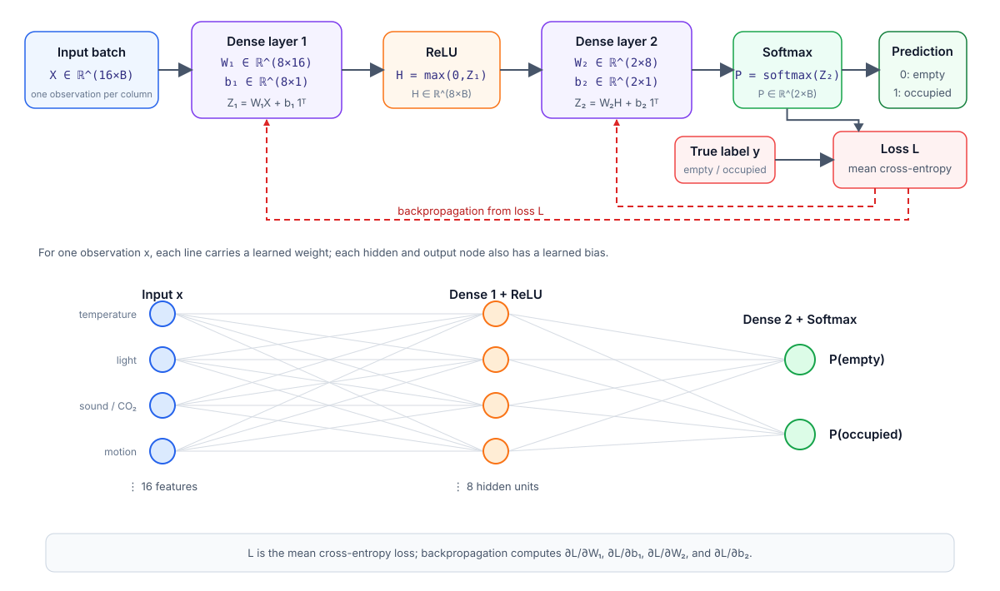

# Project 3 — Automatic room-occupancy detection with a neural network

## Purpose

Develop a small neural-network library in C++ and use it to detect automatically whether a room is empty or occupied from non-intrusive environmental sensors. A system of this kind can support demand-controlled ventilation, lighting, and energy management without cameras or wearable devices.

The program must classify each sensor observation as `empty` or `occupied`. The project starts with a tiny artificial problem, introduces the representation of a neural network in C++, and only then moves to the real dataset, Python bindings, and one focused comparison with PyTorch.

No previous knowledge of neural networks, backpropagation, matrix libraries, third-party C++ libraries, or Python bindings is assumed. The mandatory data preparation, network, mathematical operations, data structures, and training procedure are specified below.

---

## 1. Dataset and detection problem

### 1.1 Data source and application

Use the [Room Occupancy Estimation dataset](https://archive.ics.uci.edu/dataset/864/room+occupancy+estimation) from the UCI Machine Learning Repository, DOI [10.24432/C5P605](https://doi.org/10.24432/C5P605).

The dataset contains 10,129 observations collected approximately every 30 seconds during four days in a controlled room. Temperature, light, sound, carbon-dioxide, and passive-infrared sensors were used. The ground truth is the number of occupants, from zero to three. The dataset is distributed under CC BY 4.0 and is approximately 1 MB uncompressed.

Download `Occupancy_Estimation.csv` from the official page. In the README cite Singh and Chaudhari, the DOI, the UCI page, and the CC BY 4.0 license. Use the original CSV without a separately prepared copy.

### 1.2 Exact input schema

The CSV must contain exactly these 19 columns in this order:

```text
Date,Time,
S1_Temp,S2_Temp,S3_Temp,S4_Temp,
S1_Light,S2_Light,S3_Light,S4_Light,
S1_Sound,S2_Sound,S3_Sound,S4_Sound,
S5_CO2,S5_CO2_Slope,S6_PIR,S7_PIR,
Room_Occupancy_Count
```

The 16 model features are:

| Group       | Columns                  | Meaning                                 |
|-------------|--------------------------|-----------------------------------------|
| Temperature | `S1_Temp`–`S4_Temp`      | temperature at four sensor nodes, in °C |
| Light       | `S1_Light`–`S4_Light`    | light level at four nodes, in lux       |
| Sound       | `S1_Sound`–`S4_Sound`    | sound-sensor amplifier output, in volts |
| Air quality | `S5_CO2`, `S5_CO2_Slope` | CO₂ concentration and its recent slope  |
| Motion      | `S6_PIR`, `S7_PIR`       | passive-infrared motion indicators      |

Number observations with $i=0,\ldots,N-1$, where $N$ is the number of loaded CSV rows. Number the 16 features with $j=0,\ldots,15$ in the exact order shown in the CSV schema: four temperatures, four light values, four sound values, two CO₂ values, and two PIR values. The symbol $x_{j,i}$ denotes feature $j$ of observation $i$. Thus every observation supplies a 16-element feature vector.

`Date` and `Time` are metadata and must not be passed to the mandatory model. `Room_Occupancy_Count` is the original target and must be converted to the following binary label:

| Binary label | Definition                            | Meaning       |
|-------------:|---------------------------------------|---------------|
|            0 | `Room_Occupancy_Count == 0`           | empty room    |
|            1 | `Room_Occupancy_Count` in `{1, 2, 3}` | occupied room |

Preserve the original occupancy count as metadata for validation, but do not train the mandatory network to distinguish one, two, and three occupants.

### 1.3 Deterministic validation and cleaning

In Checkpoint 3, students read the original CSV in C++ using the standard library and perform the following checks:

1. verify the exact header and field count;
2. require non-empty `Date` and `Time` values;
3. parse all 16 sensor values as finite numbers;
4. require both PIR values to be 0 or 1;
5. parse the original target as an integer in $\lbrace 0,1,2,3\rbrace$ and create the binary label;
6. stop at the first invalid row and report its row number, column, and reason;
7. print the total and the two binary-label counts; the total must be 10,129.

The official dataset declares no missing values. Therefore, silently discarding or imputing an invalid row is not allowed in the mandatory pipeline. Keeping `Date` and `Time` as metadata makes it possible to inspect suspicious rows without turning them into model features.

### 1.4 Deterministic split

In Checkpoint 3, students implement a reproducible split stratified by the binary label so that empty and occupied observations appear in every subset:

1. collect the original row indices separately for each class;
2. create one `std::mt19937 rng(42)`, shuffle the class-0 index vector first, and then shuffle the class-1 index vector using the same engine;
3. for a class containing $n_c$ rows, assign the first $\lfloor0.70n_c\rfloor$ to training and the next $\lfloor0.15n_c\rfloor$ to validation;
4. assign all remaining rows of that class to test;
5. concatenate the two class-specific parts for each split.

Do not move observations between splits after inspecting model results. Record the two binary-label counts in every split.

The floor notation $\lfloor v\rfloor$ means round $v$ down to the nearest integer. For each class, the test count is therefore $n_c-\lfloor0.70n_c\rfloor-\lfloor0.15n_c\rfloor$.

### 1.5 Standardization

Standardization changes a numerical feature's scale. Let $n_{\mathrm{train}}$ be the number of observations assigned to the training split. For every non-binary feature $j=0,\ldots,13$, compute only from training observations

$$
\mu_j=\frac{1}{n_{\mathrm{train}}}
\sum_{i\in\mathrm{training}}x_{j,i},
$$

$$
s_j=\sqrt{
\frac{1}{n_{\mathrm{train}}}
\sum_{i\in\mathrm{training}}(x_{j,i}-\mu_j)^2
}.
$$

Use denominator $n_{\mathrm{train}}$, not $n_{\mathrm{train}}-1$. Then transform that feature in every split using the same training statistics:

$$
x'_{j,i}=\frac{x_{j,i}-\mu_j}{s_j}.
$$

The transformed value is $x'_{j,i}$. Leave the two binary PIR features $j=14,15$ unchanged. If $s_j=0$, transform the entire feature to zero and report it. Computing $\mu_j$ or $s_j$ from validation or test rows is **data leakage**.

The random stratified split is convenient for this course project, but adjacent observations are temporally related. State in the README that this can make the measured accuracy optimistic and that four controlled days do not represent every building or occupancy pattern.

---

## 2. Neural-network methods

### 2.1 What a neural network is

A **neural network** is a parameterized function built by composing simple layers. It receives a feature vector and produces scores. During training, the program compares the scores with known labels, computes how the error changes with every parameter, and adjusts the parameters to reduce future error.

A single artificial neuron with $d$ input values $x_0,\ldots,x_{d-1}$ computes

$$
z=\sum_{j=0}^{d-1}w_jx_j+b,
$$

where $d$ is the number of inputs, the $w_j$ values are adjustable **weights**, and $b$ is an adjustable **bias**. In this project, a neuron in the first dense layer has $d=16$ inputs and a neuron in the second dense layer has $d=8$.

A dense layer contains several neurons. Collecting their weights in a matrix $W$, their biases in a vector $\mathbf b$, and one input vector in $\mathbf x$, the layer is

$$
\mathbf z=W\mathbf x+\mathbf b.
$$

Composing only linear layers would still produce a linear function. A nonlinear **activation function** between layers lets the network represent nonlinear decision boundaries. This project uses

$$
\mathrm{ReLU}(a)=\max(0,a).
$$

### 2.2 Mandatory architecture and representation

Use the network

$$
16\longrightarrow8\longrightarrow2.
$$

It consists of:

1. a dense layer from 16 sensor features to 8 hidden values;
2. ReLU applied element by element;
3. a dense layer from 8 hidden values to 2 output scores.

The two output scores are called **logits**. They are not probabilities and may have any real value.

A **batch** is the collection of observations processed in one forward and backward pass. Let $B\ge1$ be its number of observations and number them with $i=0,\ldots,B-1$. Store observations as columns:

| Quantity    | Shape          | Meaning                                    |
|-------------|----------------|--------------------------------------------|
| $X$       | $16\times B$ | standardized input features                |
| $W_1$     | $8\times16$  | first-layer weights                        |
| $b_1$     | $8\times1$   | first-layer biases                         |
| $Z_1,H$   | $8\times B$  | hidden pre-activations and activations     |
| $W_2$     | $2\times8$   | output-layer weights                       |
| $b_2$     | $2\times1$   | output-layer biases                        |
| $Z_2,P,Y$ | $2\times B$  | logits, probabilities, and one-hot targets |

For example,

$$
(Z_1)_{r,i}=\sum_{j=0}^{15}(W_1)_{r,j}X_{j,i}+(b_1)_r.
$$

Here $r=0,\ldots,7$ selects one hidden unit. The same bias is added to every observation. A **one-hot target** for class $c\in\lbrace 0,1\rbrace$ is a two-element column whose entry $c$ is 1 and whose other entry is 0.

The following figure displays the network and the notation used in this project. The upper part shows the matrix operations for a batch of $B$ observations; the lower part shows the equivalent layers for one observation.



### 2.3 Forward propagation

Forward propagation evaluates the network from input to prediction. Let $\mathbf1$ be a $B$-element column vector filled with ones. The products $b_1\mathbf1^T$ and $b_2\mathbf1^T$ copy each bias column across all $B$ observations:

$$
Z_1=W_1X+b_1\mathbf1^T,
\qquad
H=\mathrm{ReLU}(Z_1),
$$

$$
Z_2=W_2H+b_2\mathbf1^T.
$$

For observation $i$, turn logits into probabilities with stable softmax:

$$
m_i=\max_{c\in\lbrace 0,1\rbrace }(Z_2)_{c,i},
$$

$$
P_{c,i}=
\frac{\exp((Z_2)_{c,i}-m_i)}
{\sum_{k=0}^{1}\exp((Z_2)_{k,i}-m_i)}.
$$

Subtracting the largest logit prevents overflow without changing the probabilities. Predict the class having the largest logit; if the two logits are exactly equal, predict class 0.

For correct class $y_i$, compute cross-entropy directly from logits:

$$
\ell_i=-(Z_2)_{y_i,i}+m_i+
\log\left(\sum_{c=0}^{1}\exp((Z_2)_{c,i}-m_i)\right).
$$

The batch loss $L$ is the arithmetic mean of the $B$ individual losses:

$$
L=\frac{1}{B}\sum_{i=0}^{B-1}\ell_i.
$$

### 2.4 Backpropagation

**Backpropagation** applies the chain rule from the loss toward the input. A derivative describes how a small increase in one parameter would change the loss.

The network has four trainable arrays: $W_1$, $b_1$, $W_2$, and $b_2$. Backpropagation must therefore compute four parameter-gradient arrays with the same respective shapes:

| Parameter | Gradient                    | Shape         |
|-----------|-----------------------------|---------------|
| $W_1$   | $\partial L/\partial W_1$ | $8\times16$ |
| $b_1$   | $\partial L/\partial b_1$ | $8\times1$  |
| $W_2$   | $\partial L/\partial W_2$ | $2\times8$  |
| $b_2$   | $\partial L/\partial b_2$ | $2\times1$  |

For softmax combined with cross-entropy,

$$
G_2=\frac{\partial L}{\partial Z_2}=\frac{P-Y}{B}.
$$

Division by $B$ applies to every element of $P-Y$. The matrix $G_2$ has shape $2\times B$: it is the gradient that arrives at the output logits, not one of the four trainable parameter gradients.

The output-layer gradients are

$$
\frac{\partial L}{\partial W_2}=G_2H^T,
\qquad
\frac{\partial L}{\partial b_2}=G_2\mathbf1.
$$

Propagate to the hidden values:

$$
G_H=W_2^TG_2.
$$

$G_H$ has shape $8\times B$ and describes how the loss changes with the hidden activations. The ReLU derivative is 1 for a positive input and 0 for a negative input; use 0 at exactly zero. Therefore

$$
G_1=G_H\odot I_{Z_1 \gt 0},
$$

where $\odot$ is element-wise multiplication and $I_{Z_1 \gt 0}$ is an $8\times B$ matrix whose entry is 1 where the corresponding entry of $Z_1$ is positive and 0 otherwise. The result $G_1$ also has shape $8\times B$. Finally,

$$
\frac{\partial L}{\partial W_1}=G_1X^T,
\qquad
\frac{\partial L}{\partial b_1}=G_1\mathbf1.
$$

Multiplication by $\mathbf1$ sums the columns, producing one bias gradient per neuron. Do not divide any parameter gradient by $B$ again because $G_2$ already contains that factor. Compute all four parameter gradients before modifying any parameter.

### 2.5 Initialization and training

For a dense layer, let $n_{\mathrm{in}}$ be its number of input values and $n_{\mathrm{out}}$ its number of output neurons. Initialize each weight independently from

$$
\mathcal U(-a,a),
\qquad
a=\sqrt{\frac6{n_{\mathrm{in}}+n_{\mathrm{out}}}}.
$$

Here $\mathcal U(-a,a)$ is the uniform distribution on the interval $[-a,a]$: every value in that interval is equally likely. Create a new `std::mt19937` engine with seed 42 for network initialization; do not reuse the engine whose state was changed by the data split. Draw $W_1$ in row-major order followed by $W_2$ in row-major order using `std::uniform_real_distribution`. Initialize all biases to zero.

Use full-batch gradient descent, so $B=n_{\mathrm{train}}$ and every training observation participates in every update. One **epoch** is one complete forward, backward, and update pass over this training batch:

1. run forward propagation on all training observations;
2. compute mean cross-entropy;
3. run backpropagation;
4. for every scalar element $\theta$ of $W_1,b_1,W_2,b_2$, apply

$$
\theta\leftarrow\theta-\eta\frac{\partial L}{\partial\theta};
$$

   use the parameter values from the start of the update until every new value has been computed;

5. compute validation loss and accuracy with the new parameters, without running backpropagation or updating them.

Use learning rate $\eta=0.05$ and exactly 500 epochs. Both values must be command-line options, but no hyperparameter search or early stopping is required. The validation set is used only to monitor and report this fixed training procedure; do not change the test set or repeatedly tune settings after seeing test results.

### 2.6 Required C++ data structures

Implement the network structures below, adapting the C++ vector or matrix examples supplied during the course. Reuse a suitable existing matrix implementation; implement only missing operations and their tests. No third-party numerical or neural-network library is needed for the mandatory network.

The mandatory numerical experiments use `double`. A template can also vary a non-numerical type. No conversion of every network class to `<Scalar>` is required: choose one useful generic component in Checkpoint 2 and exercise it with two real types, as specified there.

A matrix with `rows_` rows and `cols_` columns uses a row-major `std::vector<double> data_` of length `rows_ * cols_` for numerical operations. With zero-based row `r` and column `c`, element $(r,c)$ is stored at `data_[r * cols_ + c]`. Check the available course matrix first; implement any missing operations in this order:

1. construct a matrix filled with zero or a supplied value and reject zero dimensions;
2. provide `rows()`, `cols()`, and const and non-const `operator()(r,c)` using `r * cols_ + c`; reject `r >= rows_` or `c >= cols_`;
3. implement matrix multiplication `matmul(A,B)` after checking `A.cols() == B.rows()`;
4. implement `transpose(A)`;
5. implement addition of one bias value to every column, element-wise multiplication, and row sums;
6. reject incompatible dimensions before entering a numerical loop.

These are the only mandatory matrix operations. When a tested course implementation already provides one, reuse and acknowledge it rather than rewriting it. Do not implement determinants, inverses, iterators, expression templates, or a generic linear-algebra framework.

For clarity, if $A$ has shape $m\times k$ and $B$ has shape $k\times n$, their product $C=AB$ has shape $m\times n$ and

$$
C_{r,c}=\sum_{s=0}^{k-1}A_{r,s}B_{s,c}.
$$

Here $r=0,\ldots,m-1$ and $c=0,\ldots,n-1$. The transpose satisfies $(A^T)_{c,r}=A_{r,c}$. Element-wise multiplication requires equal shapes and produces $C_{r,c}=A_{r,c}B_{r,c}$. Row sums of an $m\times n$ matrix produce an $m\times1$ column with $s_r=\sum_{c=0}^{n-1}A_{r,c}$. Bias addition requires an $m\times1$ bias and adds its entry $b_r$ to every element in row $r$.

`Dataset`:

- `Matrix` of `double` features with shape `number_of_features × number_of_observations`;
- `std::vector<std::size_t> labels`, each in $\lbrace 0,1\rbrace$;
- original row numbers, dates, and times stored as metadata;
- separate objects for training, validation, and test splits.

`Standardizer`:

- vectors `mean` and `scale` for the first 14 features;
- `fit` callable only on training data;
- `transform` that does not modify the fitted statistics.

`Dense`:

- `weights`, `bias`, `weight_gradient`, and `bias_gradient`;
- `cached_input` retained from the most recent training forward pass because backward propagation needs it;
- `forward`, `backward`, and `update` operations.

`ReLU`:

- no trainable parameters;
- cached pre-activation values or a Boolean positivity mask;
- `forward` and `backward` operations.

`Layer` and `Sequential`:

- `Layer` is an abstract base class with a virtual destructor and virtual `forward`, `backward`, and `update` operations;
- `Sequential` owns layers in `std::vector<std::unique_ptr<Layer>>`;
- forward propagation visits layers from first to last;
- backward propagation visits layers in reverse order.

One sufficient interface is `forward(const Matrix& input, bool cache_for_backward)` returning a matrix, `backward(const Matrix& output_gradient)` returning the input gradient, and `update(double learning_rate)`. A training forward pass sets `cache_for_backward = true`; validation and prediction set it to false and must not overwrite the cache needed by an unfinished backward pass. Equivalent documented signatures are acceptable.

`Dense::update(eta)` updates its weights and biases. `ReLU::update(eta)` is a no-op because ReLU has no trainable parameters. This lets `Sequential` train every layer through the common interface without type checks or downcasts.

The training loop only needs the current training loss and the final validation metrics; storing the complete epoch history is optional.

Checkpoint 1 should use plain functions or small concrete structs. Introduce the generic and polymorphic design only in Checkpoint 2, after the mathematics works.

### 2.7 Numerical gradient checking

Gradient checking tests backpropagation without replacing it during training. Select one scalar weight $\theta$, save its original value, and keep the input batch and every other parameter fixed. Compare the analytical gradient computed by backpropagation with the centered finite-difference approximation

$$
g^{\mathrm{FD}}=
\frac{L(\theta+\varepsilon)-L(\theta-\varepsilon)}{2\varepsilon},
\qquad \varepsilon=10^{-6}.
$$

Here $L(\theta+\varepsilon)$ is a complete forward loss after changing only that weight to $\theta+\varepsilon$; define $L(\theta-\varepsilon)$ similarly. Restore the original weight after the check.

Check exactly two scalar weights: $(W_1)_{0,0}$ and $(W_2)_{0,0}$. For this test only, use the 12 toy observations of Checkpoint 1 with every entry of $W_1$ equal to 0.1, every entry of $b_1$ equal to 0.25, the first row of $W_2$ equal to $(0.5,0,0,0)$, its second row equal to $(-0.5,0,0,0)$, and $b_2=(0,0)^T$. Both checked analytical gradients are nonzero; use seeded initialization for the training experiment, not for this test. Collect their two analytical values in $g^{\mathrm{analytic}}$ and their two finite-difference values in $g^{\mathrm{FD}}$. For a two-element vector $v=(v_0,v_1)$, define $\lVert v\rVert _2=\sqrt{v_0^2+v_1^2}$. Require

$$
\frac{\lVert g^{\mathrm{analytic}}-g^{\mathrm{FD}}\rVert _2}
{\max(1,\lVert g^{\mathrm{analytic}}\rVert _2,\lVert g^{\mathrm{FD}}\rVert _2)}
<10^{-4}.
$$

Use test inputs whose ReLU pre-activations are not exactly zero. Finite differences are slow and belong in tests; backpropagation is used for training.

### 2.8 Evaluation

The baseline always predicts the most frequent training class; if the two training class counts are equal, define the baseline to predict class 1.

For a validation or test split containing $q$ observations, count:

- **TP**: true label 1 and predicted label 1;
- **TN**: true label 0 and predicted label 0;
- **FP**: true label 0 and predicted label 1;
- **FN**: true label 1 and predicted label 0.

The confusion matrix has true classes as rows and predicted classes as columns:

$$
\begin{bmatrix}
TN & FP\\
FN & TP
\end{bmatrix}.
$$

Define

$$
\text{accuracy}=\frac{TP+TN}{q},
$$

$$
\text{recall}_0=\frac{TN}{TN+FP},
\qquad
\text{recall}_1=\frac{TP}{TP+FN},
$$

$$
\text{balanced accuracy}=
\frac{\text{recall}_0+\text{recall}_1}{2}.
$$

Both classes are present in every split by construction, so the two recall denominators are nonzero. Report on validation and test data:

- mean cross-entropy;
- accuracy and balanced accuracy as defined above;
- the $2\times2$ confusion matrix;
- rows and split counts per class;
- the initial and final training and validation losses in a compact table.

For a binary dataset containing both classes, the majority baseline has balanced accuracy 0.5. If the network does not beat it, diagnose and report the result rather than changing the test set. This real-data comparison is a diagnostic, not an automatic pass/fail threshold for an otherwise correct implementation.

---

## 3. Checkpoint 1 — Implement and verify one small network

Checkpoint 1 must use only C++ and the standard library. Do not include, download, import, or link any third-party dependency. Build it with one documented compiler command such as

```text
c++ -O2 -Wall -Wextra -pedantic src/*.cpp -Iinclude -o toy_nn
```

Use a `2–4–2` network and the same dense, ReLU, softmax, loss, backpropagation, initialization, and full-batch update formulas given above, with dimensions changed accordingly.

Generate two small deterministic clusters. For $i=0,\ldots,5$, define

$$
\mathbf x^{(0,i)}=
\begin{pmatrix}
0.10+0.02i\\
0.90-0.01i
\end{pmatrix},
\qquad
\mathbf x^{(1,i)}=
\begin{pmatrix}
0.90-0.01i\\
0.10+0.02i
\end{pmatrix}.
$$

Store the observations in this exact order: $\mathbf x^{(0,0)},\ldots,\mathbf x^{(0,5)}$, followed by $\mathbf x^{(1,0)},\ldots,\mathbf x^{(1,5)}$. Use all 12 observations for this implementation check. Class 0 represents `empty` and class 1 represents `occupied`. Validation and test splits are introduced only for the real dataset in Checkpoint 3.

For this toy network, a full-batch input $X$ has shape $2\times12$; $W_1,b_1,W_2,b_2$ have shapes $4\times2$, $4\times1$, $2\times4$, and $2\times1$, respectively.

Use the following separate one-column case as the required hand-computed dense test:

$$
W=
\begin{bmatrix}
1&2\\
-1&0.5\\
0&-2\\
3&1
\end{bmatrix},
\qquad
b=
\begin{bmatrix}
0.5\\
1\\
-1\\
0\end{bmatrix},
\qquad
x=
\begin{bmatrix}
2\\
-1
\end{bmatrix}.
$$

The implementation must produce

$$
Wx+b=
\begin{bmatrix}
0.5\\
-1.5\\
1\\
5
\end{bmatrix}.
$$

Proceed in this order using `double` and only the standard library:

1. adapt a standard-library C++ matrix example from the course, or implement only missing operations from Section 2.6; test indexing, matrix multiplication, and dimension errors. This is still a Checkpoint 1 standard-library implementation, with no third-party dependency;
2. implement the two dense forward operations and check the hand-computed result above;
3. add ReLU, stable softmax, and cross-entropy. For logits $(1000,1001)^T$, require probabilities approximately $(0.2689414214,0.7310585786)^T$ and require their sum to agree with one within $10^{-12}$;
4. implement complete backward propagation using the formulas in Section 2.4;
5. check $(W_1)_{0,0}$ and $(W_2)_{0,0}$ with the centered finite-difference procedure in Section 2.7;
6. train the `2–4–2` network with full-batch gradient descent and print the predicted class for all 12 observations.

These steps form at most four focused handwritten test cases. A test case may check several related operations.

Print initial and final loss and the 12 predicted classes. Training must reduce the loss and classify at least 11 of the 12 toy observations correctly.

### Software-quality requirements from Checkpoint 1 onward

- validate command-line arguments, file opening, headers, field counts, numeric conversion, dimensions, labels, hyperparameters, and finiteness before using values;
- report input errors clearly and return a nonzero exit code;
- apply const-correctness: operations that do not change observable state must be `const`, and large read-only arguments should normally be passed by `const&`;
- use RAII and standard containers for every resource; do not use owning raw pointers or manual `new`/`delete`;
- prefer the Rule of Zero; if copy or move operations are defined, document why and test them;
- use `std::unique_ptr` for exclusive polymorphic ownership and give `Layer` a virtual destructor;
- avoid memory leaks, dangling references, out-of-bounds access, invalid iterator use, and use-after-move errors.

Apply a requirement when its component is introduced: CSV parsing and polymorphic layer ownership begin after Checkpoint 1. AI tools may be used under the common project rules; record their use and verification in `AI_USAGE.md`.

Handwritten test executables are sufficient at every checkpoint. A framework such as Catch2 or GoogleTest is optional. Maintain at most four focused test cases; one test case may verify several related properties.

---

## 4. Checkpoint 2 — Generic and polymorphic C++ library

Refactor the working code in this order:

1. implement or adapt one generic component that performs useful work with two actual types; test both uses and explain the avoided duplication in the README. For example, a `Matrix<T>` container can hold `double` activations and `std::uint8_t` ReLU masks (numeric matrix multiplication is required only for `double`). Alternatively, a useful numerical component may be tested with `float` and `double` on a small toy case. These are examples, not extra mandatory training runs; the assessed network uses `double`;
2. define the abstract base `Layer` with a virtual destructor and virtual `forward` and `backward` operations;
3. implement `Dense` and `ReLU` as concrete derived classes;
4. implement `Sequential` with `std::vector<std::unique_ptr<Layer>>`, visiting layers forward during prediction and in reverse during backpropagation;
5. throw exceptions for incompatible dimensions, invalid labels, non-finite values, prediction before fitting, and invalid training settings;
6. add simple CMake targets for the library, toy application, and handwritten tests.

The assessed experiments use `double`; an additional `float` training experiment is not required. The template is justified by its two real uses; it need not parameterize the layer hierarchy. Dynamic polymorphism is mandatory because a `Sequential` object stores and calls both `Dense` and `ReLU` through `Layer` pointers.

Rerun the Checkpoint 1 toy experiment through the new interface and require the same predictions when using the same parameters. Then construct a `16–8–2` network and one artificial batch with

$$
X_{j,0}=0.1(j+1),\qquad
X_{j,1}=-0.05(j+1),\qquad j=0,\ldots,15,
$$

and labels $y_0=0,y_1=1$. Verify the dimensions of one forward and backward pass: logits and probabilities are $2\times2$, the four parameter gradients have the shapes listed in Section 2.4, and every value is finite. Do not train on this artificial batch.

No numerical or neural-network dependency is permitted in Checkpoint 2.

---

## 5. Checkpoint 3 — Real data, Python, and one comparison

After third-party libraries and linking have been introduced in the course, proceed in this order:

1. download the original UCI CSV; use the instructor-provided loader and split starter specified in Section 1, check its reported row and class counts, and implement the training-only standardization;
2. train the fixed `16–8–2` network for 500 epochs with the C++ executable, using validation data only for monitoring, then evaluate the test split once;
3. register the four handwritten tests with CTest; a testing framework remains optional;
4. adapt the pybind11 example from the course to expose the standardizer and fixed network;
5. perform one exact forward comparison with PyTorch.

Provide one application equivalent to:

```text
occupancy_train --data Occupancy_Estimation.csv \
                --learning-rate 0.05 --epochs 500 --seed 42
```

The executable reports both class counts in each of the three splits, initial and final loss, validation and test accuracy, balanced accuracy, and confusion matrices. It does not need to write an epoch-history file.

The pybind11 module exposes `Standardizer` and the fixed network. At the Python boundary, use the conventional row-per-observation layout:

- `Standardizer.fit(X_train)` receives raw features with shape `(N, 16)`;
- `Standardizer.transform(X)` returns shape `(N, 16)`, standardizing columns 0–13 and copying columns 14–15 unchanged;
- network `fit(X, y)` receives already standardized `X` with shape `(N, 16)` and integer labels `y` with shape `(N,)`;
- `predict_logits(X)` and `predict_proba(X)` return shape `(N, 2)`;
- `predict(X)` returns integer labels with shape `(N,)`;
- `predict_proba(X)` stores the class-0 probability in column 0 and the class-1 probability in column 1;
- read-only parameter copies retain the mathematical shapes $8\times16$, $8$, $2\times8$, and $2$.

Validate dimensions, labels, and finite input values at the boundary. The C++ implementation may transpose or copy `X` internally to obtain its $16\times N$ column-observation layout. The architecture remains fixed; a general Python network builder is not required.

For the PyTorch comparison:

1. fit the bound C++ standardizer on raw training features, transform all splits with it, and train the C++ network by calling `fit` through the binding;
2. construct `torch.nn.Linear(16, 8)`, `torch.nn.ReLU()`, and `torch.nn.Linear(8, 2)` using `float64`;
3. copy $W_1,b_1,W_2,b_2$ directly into the corresponding PyTorch weight and bias arrays; PyTorch dense weights use the same `outputs × inputs` orientation;
4. place the first eight test observations in an `(8, 16)` NumPy array and evaluate exactly those rows with both implementations;
5. compute PyTorch probabilities with `torch.softmax(logits, dim=1)` and compare the two `(8, 2)` logit arrays and the two `(8, 2)` probability arrays. For arrays $A$ and $B$, use $d_{\max}=\max_{r,c}|A_{r,c}-B_{r,c}|$; require $d_{\max}<10^{-8}$ separately for logits and probabilities.

PyTorch training is not mandatory. The comparison must call the C++ implementation through pybind11. Record dependency versions, licenses, the UCI citation, and the dataset limitation in the README; no separate technical report is required.

---

## Optional bonus extensions

Attempt at most one extension after all mandatory requirements work correctly:

- **Four-class occupancy estimation.** Restore the original target $0,1,2,3$, change the output layer to four logits, use a `16–8–4` architecture, and report a $4\times4$ confusion matrix, accuracy, and balanced accuracy. For this extension, balanced accuracy is the arithmetic mean of the four class recalls. Compare the result with binary detection and discuss which occupancy counts are confused. Scikit-learn's [multiclass classification guide](https://scikit-learn.org/stable/modules/multiclass.html) introduces the terminology and evaluation setting.
- **Testing and profiling.** Move the four tests to [Catch2](https://catch2-temp.readthedocs.io/en/latest/) or [GoogleTest](https://google.github.io/googletest/primer.html), then profile or benchmark matrix multiplication with [Google Benchmark](https://github.com/google/benchmark/blob/main/docs/user_guide.md). Make one justified optimization and rerun the gradient checks.
- **Alternative library or newer C++ facility.** Either add an [Eigen](https://libeigen.gitlab.io/eigen/docs-5.0/GettingStarted.html) backend while preserving the chosen layer interface, or use [`std::span`](https://en.cppreference.com/w/cpp/container/span) for non-owning views of contiguous parameter or matrix buffers. Explain the concrete benefit. For Eigen, load identical parameters into both backends; for `std::span`, save reference logits before the refactor. In either case, require the compared logits to agree within $10^{-10}$. A different library or newer-standard facility may be substituted with prior instructor approval; link its official documentation and repeat an equivalent correctness comparison.

---

## Final submission checklist

1. Download the original UCI CSV; read and validate it in C++, perform the stratified split and training-only standardization exactly as specified in Section 1, then check and report row and class counts;
2. No duplicate or modified copy of the downloaded dataset in the final archive.
3. Source code, CMake files, four handwritten tests, binding, and comparison script.
4. `README.md` with clean build, test, data-preparation, training, and Python instructions.
5. Toy and real-data results.
6. Two numerical gradient checks and the exact PyTorch forward comparison.
7. Dependency versions, licenses, and attribution.
8. Contribution statement and `AI_USAGE.md` required by the common rules.
9. No executables, build directories, or virtual environments.
10. Name the archive using all group members' surnames, as required by `project_rules.md`.
