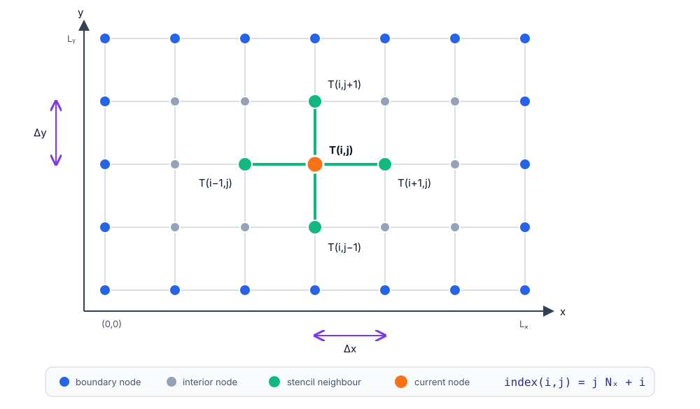

<!--
title: Projects overview
paginate: true

_class: titlepage
-->

# Course projects
 

## From a working C++ prototype to a reusable scientific library.
 

#### Advanced Programming for Computational Science SISSA, UniTS, 2026-2027

###### Pasquale Claudio Africa

###### 28 Oct 2026

---

# Development path

| Checkpoint                 | Main objective                                                                                                                       |
|----------------------------|--------------------------------------------------------------------------------------------------------------------------------------|
| **1. Make it work**        | Standard-library-only C++ baseline, one compiler script, small deterministic cases and handwritten tests.                            |
| **2. Make it reusable**    | One useful template exercised with two actual types; runtime polymorphism; clear exceptions; library/application/test CMake targets. |
| **3. Connect and compare** | Register tests with CTest; expose C++ through pybind11; compare with SciPy, scikit-learn or PyTorch.                                 |

Use `double` for the assessed numerical results. No previous knowledge of the scientific models is assumed: formulas and procedures are supplied in the full briefs.

**These slides are an overview. The full briefs and `project_rules.md` remain authoritative.**

---

# Project 1: Solar-panel thermal model (1/3)

**Goal:** compute the steady-state temperature of a photovoltaic panel under uniform heating or a local hot spot.

Model a **1.6 × 1.0 m** plate with cooled edges fixed at **298.15 K**. Report the maximum temperature and its position, mean temperature and maximum rise above ambient.

---

# Project 1: Build the solver (2/3)

The supplied thin-plate model is

$$
-K\Delta T+h(T-T_{\mathrm{amb}})=q(x,y),
\qquad T=T_{\mathrm{amb}}\text{ on the edges}.
$$

1. **Checkpoint 1:** store the grid in a flat vector and implement the five-point stencil and matrix-free **Jacobi iteration**, using separate old/new grids.
2. Check indexing, boundary values and the hand-computed **3 × 3** case; run the **9 × 7** baseline and export `x,y,temperature` as CSV.
3. **Checkpoint 2:** make the solver reusable; introduce a useful two-type template component and an abstract `HeatSource` with uniform, hot-spot and manufactured implementations.

Select the source at runtime through `std::unique_ptr<HeatSource>`. Return convergence information explicitly; reaching the iteration limit is not a converged solution.

---

# Project 1: Validate and compare (3/3)

- **Known answer:** validate against the supplied manufactured temperature field. On **17 × 11**, require $E_2<0.04\,\mathrm K$ and $E_\infty<0.06\,\mathrm K$ over interior nodes.
- **Checkpoint 3:** assemble the interior sparse system with Eigen triplets and solve with **`Eigen::SparseLU`**; report the relative residual.
- Bind the solver with **pybind11**; return a NumPy temperature array of shape **`(ny, nx)`**.
- Compare C++ and **SciPy `spsolve`** on the same **33 × 21** manufactured problem: relative/maximum absolute solution differences and both relative residuals. Investigate a relative difference above $10^{-8}$.
- Run the hot-spot case on that grid and explain the resulting temperature maximum.

**Optional:** choose at most one extension, such as a temperature map, profiling or a justified newer C++ facility.

---

# Project 2: Bike-sharing demand (1/3)

**Goal:** predict an hourly ride count and classify an hour as low or high demand from eight calendar features.

Start from the **provided hourly Citi Bike CSV**: **1,416 hours**, January-February 2026. The raw-trip boxes explain its origin; students do **not** reconstruct the aggregation.

---

# Project 2: Implement both models (2/3)

- **Regression:** fit a linear model to $z=\log(1+c)$; convert its output back to a non-negative predicted ride count.
- **Classification:** fit logistic regression to low/high demand, with the class threshold defined by the **training-count median**.
- **Checkpoint 1:** generate the specified **14 synthetic days** in C++; implement both baselines, stable losses and full-batch gradient descent. Verify the prescribed gradients and one-step updates.
- **Checkpoint 2:** refactor datasets and standardization; exercise a useful template with two types. Implement `LinearRegressor` and `LogisticClassifier`.
- Add validated CSV input, runtime model selection, and finite-difference gradient checks.

Standardize the **five non-binary features using training statistics only**; leave the three binary features unchanged. Do not fit either the scaler or the class threshold on validation/test data.

---

# Project 2: Evaluate and compare (3/3)

| Real-data split | Period in 2026        |  Rows |
|-----------------|-----------------------|------:|
| Training        | 1 January-14 February | 1,080 |
| Validation      | 15-21 February        |   168 |
| Test            | 22-28 February        |   168 |

1. **Checkpoint 3:** run **both** C++ models and compare their results with the prescribed baselines: count RMSE/MAE; classification accuracy, balanced accuracy, precision, recall, F1 and confusion matrix.
2. Expose the standardizer and **one chosen concrete model** through pybind11; compare that model with **scikit-learn** using exactly the same standardized arrays.
3. Report the prescribed output discrepancy; investigate regression differences above $10^{-3}$ or classification probability differences above $2\times10^{-2}$, as applicable.

**Optional:** at most one extension: L2 regularization, profiling, or a justified alternative backend/facility.

---

# Project 3: Automatic room-occupancy detection (1/3)

**Goal:** detect **empty / occupied** rooms from 16 temperature, light, sound, CO₂ and motion features.

Use the original **UCI Room Occupancy Estimation** CSV: **10,129 observations**. The mandatory network is **16 → 8 → 2**; occupancy counts 1, 2 and 3 all map to `occupied`.

---

# Project 3: Build and verify the network (2/3)

- **Checkpoint 1:** reuse/adapt the course matrix implementation and build the supplied **2 → 4 → 2 toy network**, using only C++ and the standard library.
- Implement dense layers, **ReLU**, stable softmax, cross-entropy and complete backpropagation; check the supplied hand calculation and **two scalar-weight gradients** by finite differences.
- Train on the 12 toy observations: loss must decrease and at least **11 of 12** predictions must be correct.
- **Checkpoint 2:** test one useful template with two actual types. Introduce abstract `Layer`, concrete `Dense`/`ReLU`, and `Sequential` owning layers through `std::unique_ptr`.
- Rerun the toy case; verify forward/backward dimensions and finite values for the final **16 → 8 → 2** network on the specified artificial batch.

No third-party numerical or neural-network library is permitted in Checkpoints 1-2. Finite differences check gradients; **backpropagation trains the network**.

---

# Project 3: Real data and an exact comparison (3/3)

1. **Checkpoint 3:** validate the UCI CSV in C++; use the specified class-stratified **70% / 15% / remainder** split with seed **42** and report class counts.
2. Standardize the first **14** features using training data only; leave the two PIR indicators unchanged. Train in full batches for **500 epochs**, learning rate **0.05**.
3. Report accuracy, balanced accuracy and confusion matrices against the majority baseline; monitor validation, then evaluate test once.
4. Bind C++ with pybind11. In **PyTorch `float64`**, load the **same trained weights** and compare logits and probabilities on the **first eight test rows**: each maximum absolute difference must be below $10^{-8}$.

**No PyTorch training is required.** Discuss the optimistic evaluation risk from temporally related observations. Four-class detection is optional.

---

# Common deliverables and good practice

- **Build and test:** source code, CMake configuration, at most **four focused handwritten test cases**, and CTest registration. A testing framework is optional.
- **Design:** const-correctness, validated inputs and RAII; no owning raw pointers or manual `new`/`delete`. Use `std::unique_ptr` for exclusive polymorphic ownership.
- **Python:** a pybind11 module and **one comparison script** calling the C++ implementation.
- **Document:** reproducible instructions and results in `README.md`, dependencies/licenses/data attribution, contribution statement and `AI_USAGE.md`. No separate technical report is required.
- **Package:** no executables, build directories or virtual environments; do not include copies of the datasets. Follow `project_rules.md` for archive naming.

**Attempt at most one bonus extension, after the mandatory work is correct.** Consult the full briefs for exact formulas, tests, tolerances and interfaces.
